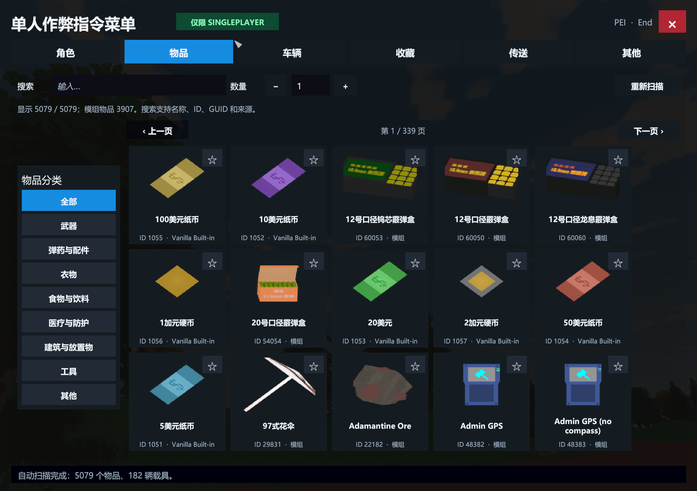
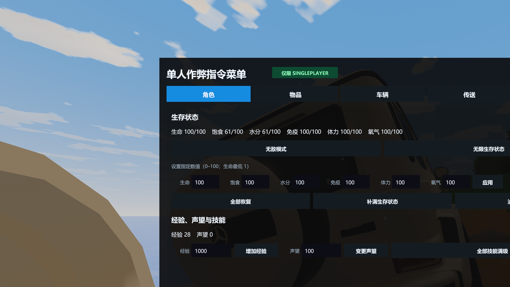
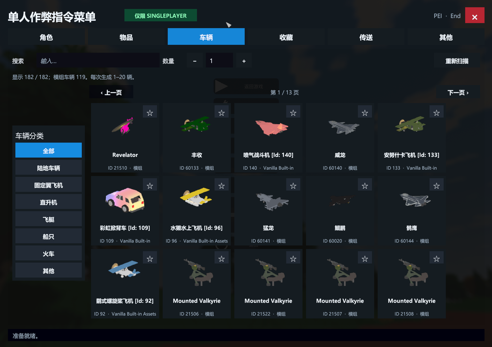
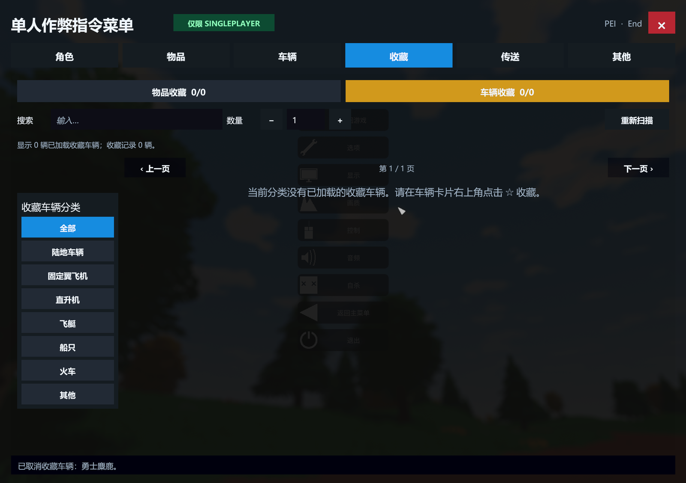
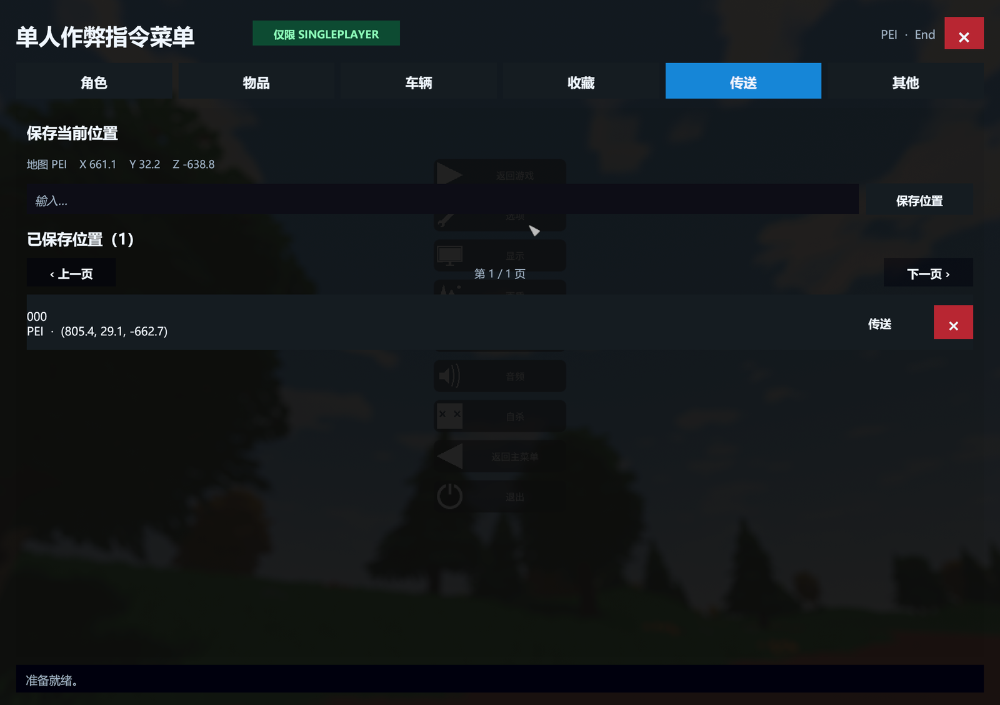
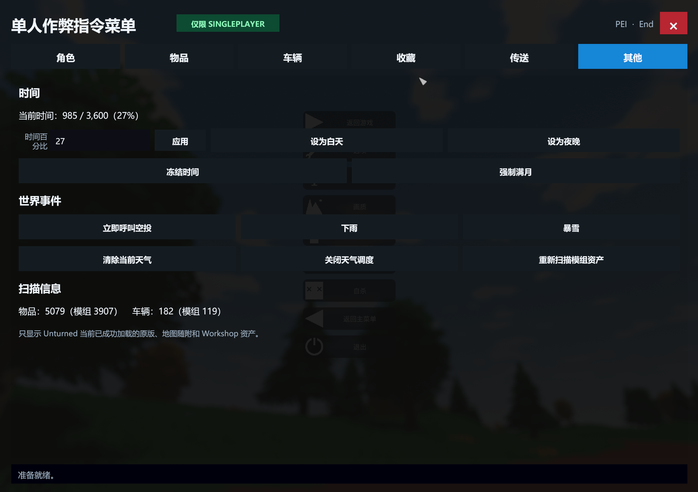

# Unturned Singleplayer Cheat Menu

[中文说明](README.md) · [Changelog](CHANGELOG.md) · [Security](SECURITY.md) · [Sponsor](https://afdian.com/a/Blowthesnow)

A bilingual Chinese/English BepInEx 5 in-game menu built specifically for **Unturned singleplayer worlds**. It scans the asset registry already loaded by the running game, so vanilla, map-provided, and Workshop items and vehicles can appear automatically. The current source version is `1.9.0`, adding automatic pickup, infinite storage, creature health bars, an editable minimap, hover details, view-direction flight, and global shortcuts. It also restructures runtime/uGUI lifecycle ownership, adds two-key parallel Workshop translation, and standardizes generated-camera vehicle thumbnails.

> **Singleplayer without BattlEye only.** This project does not disable, modify, or bypass BattlEye and does not support multiplayer servers.

**Default shortcut: press `End` after entering a singleplayer world to open or close the menu.**

> **Screenshot note: the project screenshots currently show the 1.1 interface; screenshots will be updated together for 2.0.**



<details>
<summary><strong>View more interface screenshots</strong></summary>

### Player stats and skills



### Vehicle browser and spawning



### Favorites



### Teleport points



### Time, weather, and world events



</details>

## Features

- Player controls: god mode, infinite survival stats, healing, configurable health/food/water/immunity/stamina/oxygen, experience, reputation, and max skills.
- Items: automatic loaded-asset scan, primary and exact-type filters, origin, rarity, equipment slot, gun-action and multi-select fire-mode filters, name/ID/GUID/source search, pagination, game-generated icons, and quantities from `1–255`.
- Vehicles: automatic loaded-asset scan, engine categories, search, pagination, uniformly generated-camera model thumbnails (asset-authored `Icon2/Icon` framing is ignored), configurable `128 × 96`, `192 × 144`, or `256 × 192` output with framing control and per-configuration disk caching, and batches from `1–20` placed in front of the player.
- Favorites: persistent item and vehicle favorites keyed by asset GUID, with direct actions from the favorites tab.
- Teleports: map and list views, zoom/pan, player and saved-point markers, safe map-click landing on terrain or available building tops, customizable marker shapes/colors, and persistent map-scoped positions.
- World controls: time slider, day/night, time freeze, full moon, airdrop, rain, snow, weather clearing, and asset rescan.
- Tools: crosshair interaction with Smart, Inspect, Repair, Teleport, Utility, and Delete modes; middle-mouse activation; configurable target HUD fields; and Shift-guarded deletion.
- Movement: native-simulation flight and noclip with separate horizontal/vertical speed multipliers and safe-exit recovery.
- Minimap: circular or square HUD, editable anchor/offset/size/radius, player/group/teleport/world/item markers, six rarity filters, floor indicators, and native-map/realtime/fallback background modes.
- Automatic-pickup integration: optional minimap-range and minimap-rarity linkage, both disabled by default so existing pickup behavior does not change implicitly.

The menu only opens after confirming a loaded local player in a true `Singleplayer_` world where the current process is both client and server. It closes automatically if that condition stops being true.

The last main tab and teleport subview are persisted and restored the next time the menu opens.

The map setup checkbox named **singleplayer cheats** is not required. It controls Unturned's built-in command system; this plugin does not depend on `Provider.hasCheats`.

## Tested environment

| Component | Version |
| --- | --- |
| Unturned | `3.26.3.8` |
| Unity | `2022.3.62f3` |
| Runtime | Windows x64 / Unity Mono |
| BepInEx | `5.4.23.5` x64 |
| Plugin | `1.9.0` |

## Installation

The `Unturned-Singleplayer-Cheat-Menu-v1.7.0-Plugin-Only.zip` release asset contains the plugin only.

1. Exit Unturned.
2. Install BepInEx `5.4.23.5` x64 into the Unturned game root.
3. Extract the release asset into the directory containing `Unturned.exe`.
4. Verify that the DLL is located at:

   ```text
   BepInEx\plugins\UnturnedSingleplayerCheatMenu\UnturnedSingleplayerCheatMenu.dll
   ```

   Deployment rule: keep exactly one active `UnturnedSingleplayerCheatMenu.dll` under `BepInEx\plugins`, at this canonical subdirectory path. Do not leave another same-named DLL in the plugins root or another subdirectory. Backups must use a non-`.dll` suffix so BepInEx cannot load duplicates and prevent future upgrades from replacing the active plugin.

5. Use Steam's launch-option dialog and explicitly choose the **no BattlEye** entry.
6. Enter a singleplayer world and press `End` after the player has loaded.

Do not use this plugin with BattlEye or on multiplayer servers.

## Configuration and saved data

Files are created under `BepInEx/config` after first use:

- `com.codex.unturned.singleplayer-cheat-menu.cfg`
- `UnturnedSingleplayerCheatMenu.favorites.json`
- `UnturnedSingleplayerCheatMenu.teleports.json`
- `AutoPickup.rules.json`
- `UnturnedSingleplayerCheatMenu/InfiniteStorage/<world>/<player>.json`

The default shortcut is `End` and can be changed through `ToggleShortcut`.

The top-right `EN` / `中文` button switches the language immediately and writes the choice back to `Interface.Language`; no restart is required.

`Interface.Language` initially defaults to `Auto`: Chinese Unturned languages use Chinese, while all other game languages use English. It can also be set explicitly to `English` or `Chinese`. Unknown values fall back to `Auto`.

The Workshop localization page accepts up to two API keys. The first row keeps the `+` control, additional rows can be removed with `×`, and one worker is created per key to consume translation batches in parallel. Batch size is configurable from `1–100`; the page remains vertically scrollable as rows are added.

Only assets successfully loaded by the current game process are discoverable. Missing subscriptions, failed downloads, unresolved dependencies, or map-specific assets that were not loaded cannot be synthesized by the plugin.

## Building

Game, Unity, and BepInEx assemblies are intentionally not committed.

```powershell
.\scripts\Prepare-References.ps1 -GameRoot 'C:\Program Files (x86)\Steam\steamapps\common\Unturned'
dotnet build .\UnturnedSingleplayerCheatMenu.slnx -c Release
Get-ChildItem .\tests -Recurse -Filter '*Smoke.csproj' | Sort-Object FullName | ForEach-Object {
    dotnet run --project $_.FullName -c Release
    if ($LASTEXITCODE -ne 0) { throw "Smoke failed: $($_.FullName)" }
}
```

The helper copies required references into the git-ignored `lib/` directory. The plugin is emitted to `artifacts/UnturnedSingleplayerCheatMenu.dll`.

## Verification

The `1.9.0` source changes, build, and Smoke evidence are recorded in the [v1.9 source changelog](docs/V1.8_RECOVERY_CHANGELOG.md). This update pushes code only: no tag, release package, or GitHub Release was created. The `1.7.0` Plugin-Only package remains the latest formal release asset.

Published plugin DLL:

```text
SHA-256: FA500D0EC9E4E927797462CB72D713C1B6E409FE698F2F945C498F64BC31B3CF
```

## Disclaimer and license

This is an unofficial community project and is not affiliated with or endorsed by Smartly Dressed Games, Unturned, BattlEye, or BepInEx.

Plugin source code is available under the [MIT License](LICENSE). Unturned, Unity, BepInEx, and any third-party files retain their respective licenses and ownership.
## Current architecture verification

The source now uses one `PluginUiRoot`; `RuntimeUpdatePatch` hooks `Provider/MenuUI/PlayerUI.Update` and dispatches one de-duplicated Update/LateUpdate per frame to `PluginRuntimeContext`. Like the working legacy branch, this static bridge does not depend on transient BepInEx or driver components that Unturned destroys during its startup scene transition. `PluginUiRoot` recreates itself if the bootstrap scene removes it. It also includes input-capture release, draggable/clamped window position persistence, and teleport-point views isolated to the current map. The production source no longer contains the legacy IMGUI menu or `UnityEngine.IMGUIModule` reference.

After a Release build, run every existing `tests/*Smoke` project serially. Smoke checks cover source and automation contracts only; input, IME, EventSystem scene rebinding, native-menu coexistence, HUD, font rendering, and visual behavior still require real singleplayer acceptance.
