# Unturned Singleplayer Cheat Menu

[English](README.en.md) · [Releases](https://github.com/Blowthesnow/Unturned-Singleplayer-Cheat-Menu/releases) · [更新日志](CHANGELOG.md) · [安全说明](SECURITY.md) · [赞助](https://afdian.com/a/Blowthesnow)

   

**面向 Unturned 单人世界的 BepInEx 5 中英双语工具箱。** 它不依赖写死的物品或载具表，而是读取当前游戏进程已经加载的资产；原版内容、当前地图附带内容和 Workshop 模组会按实际加载结果进入物品与载具目录。

除资产目录外，2.0 还整合了运行时翻译、角色状态、收藏、背包整理、自动拾取、Snapshot 无限储存、准星交互、生物血条、飞行与穿墙、地图传送、小地图以及时间与天气控制。

**默认快捷键：本地玩家生成后按 `End` 打开或关闭菜单。**

> 玩法功能以单人世界为正式支持目标；资产翻译是独立的本地内容功能。完整会话矩阵见下方“运行边界”。

## 独家核心功能：原版与 Workshop 资产运行时翻译

**公开可检索的 Unturned 插件生态里，目前没有发现第二个插件专门完成这条完整链路：运行时扫描已加载的原版与 Workshop 资产 → 批量翻译 → 按资产与字段缓存 → 应用到插件目录和 Unturned 本地显示路径。** 这不是预先制作的静态语言包，也不是退出游戏后改写地图文件的离线转换器，而是跟随当前进程实际加载内容工作的翻译系统。

| 常见方案 | 能处理什么 | 与本项目的关键区别 |
| --- | --- | --- |
| [Unturned 原生 Localization](https://docs.smartlydressedgames.com/en/latest/assets/asset-definitions.html#localization) / Workshop 语言包 | 为已知资产预先制作同目录语言 `.dat` | 需要维护静态文件；不会为本次运行中任意已加载资产自动补齐缺失译文 |
| [Unturned Map Translator](https://steamcommunity.com/sharedfiles/filedetails/?id=3365019362) | 在游戏外选择地图并生成/覆盖语言文件 | 是离线文件转换器，不是游戏内运行时插件 |
| [XUnity.AutoTranslator](https://github.com/bbepis/XUnity.AutoTranslator) | 面向多种 Unity 游戏的通用文本与资源翻译 | 不专门枚举 Unturned `Assets`、识别原版/Workshop 来源或维护资产字段级目录 |
| [服务端聊天翻译插件](https://imperialplugins.com/Unturned/Products/Translation) | 翻译玩家聊天消息与频道 | 不翻译 Item、Vehicle、Quest、NPC、Object 或 Vendor 资产 |

- 扫描物品名称与描述、载具名称、动作文字与提示、NPC 名称/对话/响应、任务名称与描述、已加载 `ObjectAsset` 的对象名称与交互对话显示名、Vendor 文本。
- 只处理当前进程已成功加载、进入 `Assets` 映射且属于受支持类型/字段的内容；不承诺覆盖未加载内容、所有地图文件或所有地图文本。
- 按资产类型、GUID、字段和缓存 schema 隔离译文；同一资产的不同字段独立处理。
- 优先保留已有中文本地化，保护富文本标签、格式占位符和对话控制符。
- 支持扫描、待翻译队列、批处理、失败重试、缓存命中、强制重译、进度统计和本地文本应用。
- 最多配置两个 API Key 并行工作，批量大小可设为 `1–100`。
- 内置 18 种协议/供应商配置：腾讯云 TMT、百度翻译、Google Cloud、Microsoft Translator、DeepL、有道、OpenAI、OpenAI Compatible、Azure OpenAI、Anthropic、Gemini、Ollama、OpenRouter、DeepSeek、SiliconFlow、LM Studio、腾讯混元和百度千帆。
- 不修改原始 `.dat` 或 AssetBundle；进入多人、关闭菜单或切换连接不会自动取消已经开始的翻译批次。

<details>
<summary><strong>查看截图：资产扫描与翻译设置（2 张）</strong></summary>

**翻译状态与缓存**

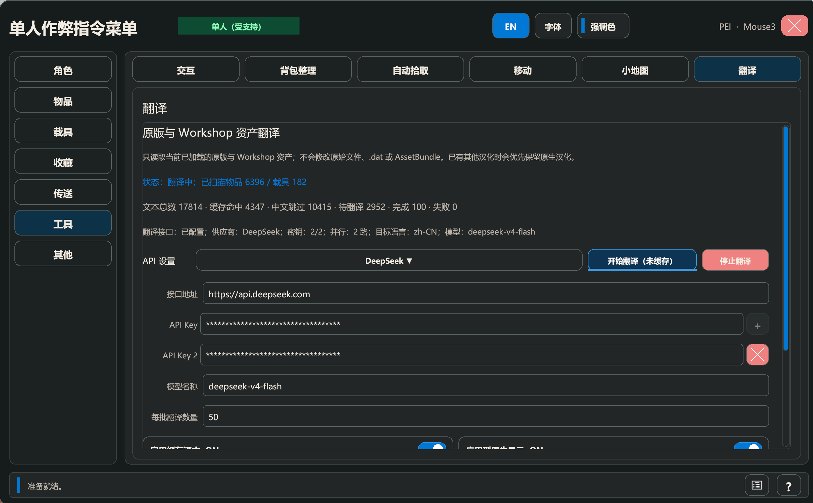

**接口与密钥**

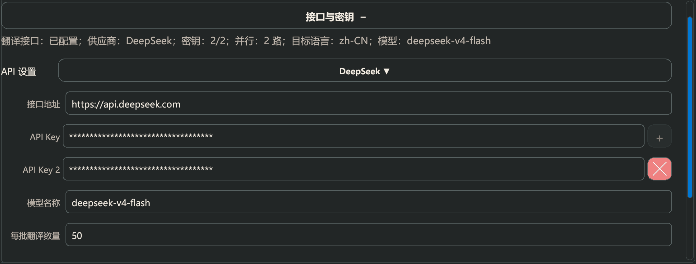

</details>

> 检索边界：上述“未发现第二个插件”基于截至 2026-09-05 对 GitHub、Thunderstore、Nexus、Steam Workshop 和公开 Unturned 插件市场的检索，不包含私有或未索引实现。

## v2.0.0 完整功能

### 角色状态

- 无敌模式与无限生存状态。
- 一键恢复生命、处理伤势并补满生存数值。
- 分别设置生命、饱食、水分、免疫、体力和氧气。
- 自定义增加经验、修改声望并一键将全部技能升至满级。

<details>
<summary><strong>查看截图：角色状态与技能</strong></summary>

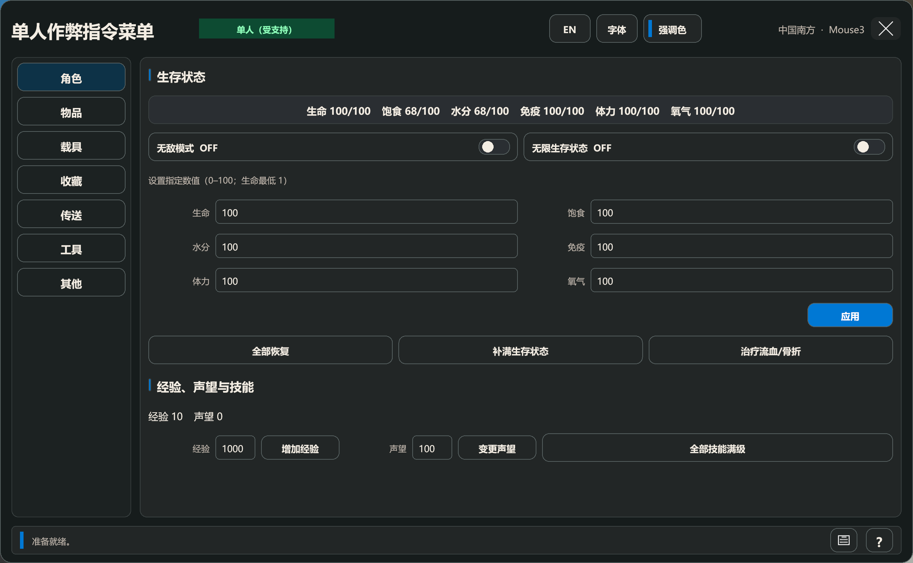

</details>

### 物品目录

- 动态读取当前已经加载的 `ItemAsset`，覆盖原版、当前地图附带和 Workshop 内容。
- 支持主分类、精确物品类型、来源、稀有度、装备槽位、枪械机制和多选射击模式筛选。
- 支持名称、ID、GUID、来源搜索和分页；物品页与收藏页分别保存筛选状态。
- 使用游戏生成的缩略图和本地化名称，按纹理真实宽高显示，不拉伸图像。
- 每次给予数量可设置为 `1–255`。

<details>
<summary><strong>查看截图：已加载物品目录</strong></summary>

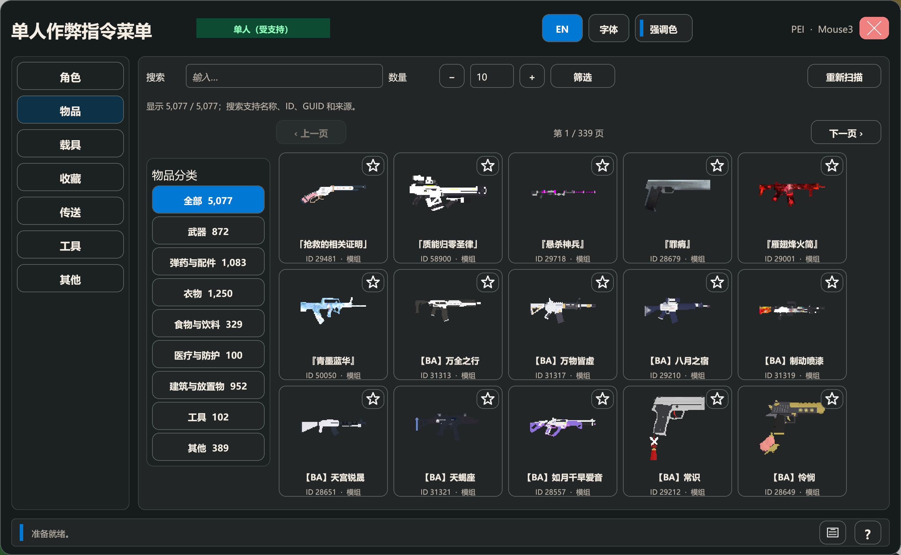

</details>

### 载具目录

- 动态读取当前已经加载的 `VehicleAsset`，按陆地车辆、固定翼飞机、直升机、飞艇和船只分类。
- 支持名称、ID、GUID、来源搜索、分页和每次 `1–20` 辆批量生成。
- 所有载具根据实际模型使用统一自动取景相机和最高可用 LOD 生成缩略图，不依赖资产自带 `Icon2/Icon` 取景。
- 支持 `128 × 96`、`192 × 144`、`256 × 192` 三档输出、取景倍率和按 GUID/渲染配置隔离的磁盘缓存。
- 多辆载具在玩家前方按地面阵列摆放，避免重叠。

<details>
<summary><strong>查看截图：已加载载具目录</strong></summary>

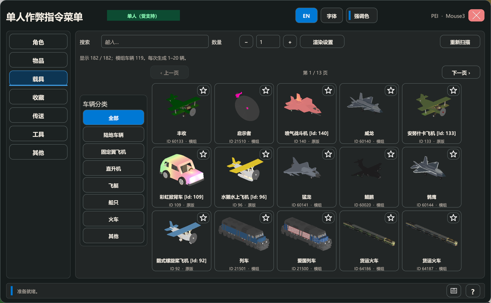

</details>

### 收藏

- 物品和载具卡片右上角可直接收藏或取消收藏。
- 收藏以资产 GUID 持久保存；暂未加载的 Workshop 资产不会被自动删除。
- 物品与载具收藏各自保留分类、搜索、数量和分页，并可直接给予物品或生成载具。

<details>
<summary><strong>查看截图：物品与载具收藏</strong></summary>

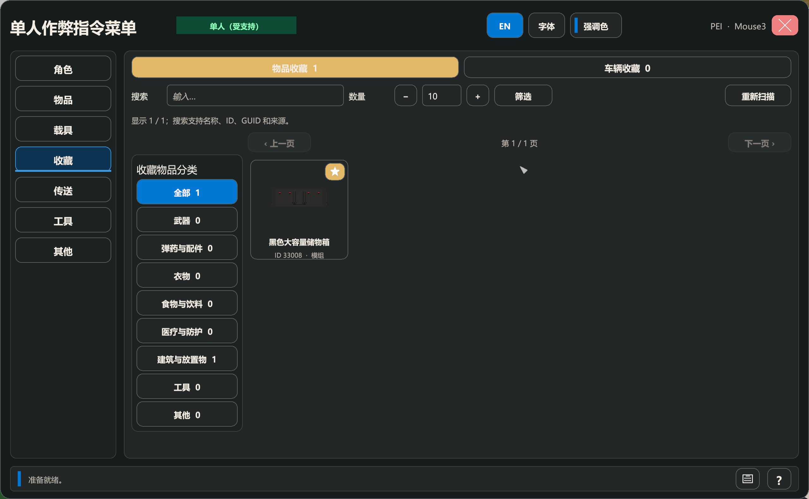

</details>

### Snapshot 无限储存

- 精确保留原生 `{id, amount, quality, state[]}`，不把品质、状态和数量单位混在一起。
- 按世界、Steam ID 和角色槽隔离；使用版本化路径、严格身份校验和碰撞检查。
- 支持 Store All、精确桶取出、搜索、分页、默认模板和永久销毁确认。
- Crafting、Ammo Refill 与 Decomposition 是同一 DLL 内可独立启用的适配模块。
- 自动拾取可选择 Snapshot 优先路径；后台写入与原生掉落交接采用保守事务和对账状态。
- 主文件、备份、候选历史和 reconciliation marker 都有原子写入、TOCTOU 与失败闭锁保护。

### 背包整理

- 支持预览、当前容器或全部随身页整理，以及紧凑等排序预设。
- 支持自动旋转、跨页、保护装备、保护快捷栏绑定、只压缩、只归并和撤销上次整理。
- 打开储物箱时可按住 Ctrl/Shift 点击物品做同资产跨箱集中。
- 预检不能完整安置时取消操作；应用、原生拖放或异常失败时保留回滚边界。

<details>
<summary><strong>查看截图：背包整理</strong></summary>

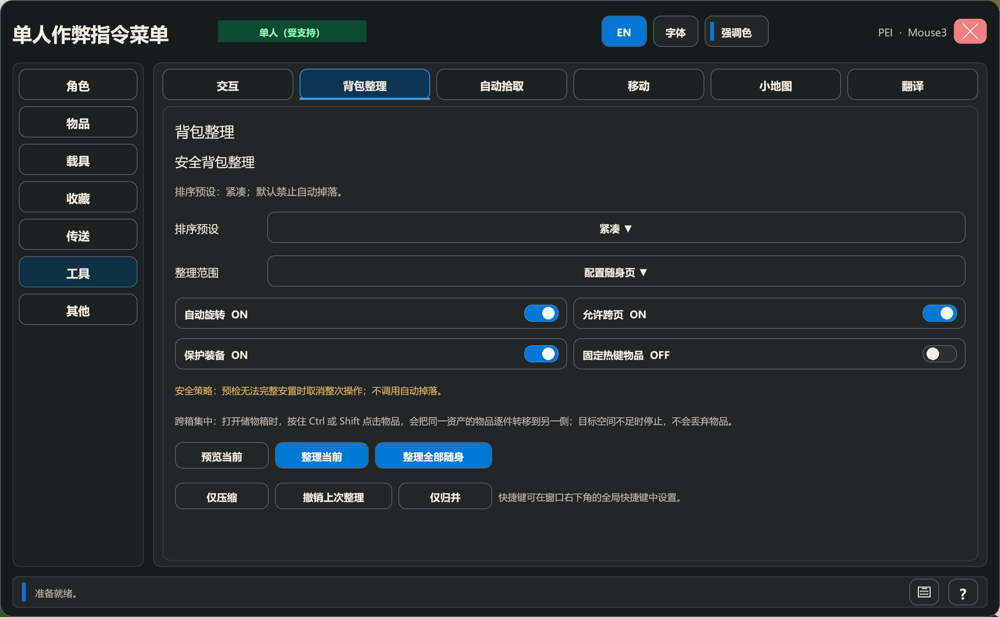

</details>

### 自动拾取

- 可配置拾取距离、扫描频率、每轮请求上限、菜单打开暂停和死亡暂停。
- 支持丢弃后禁拾时长、品质阈值、六档稀有度、白名单、黑名单和诊断计数。
- 可显式跟随小地图范围与稀有度；两项默认关闭，不会隐式改变现有规则。
- 可选择背包优先或 Snapshot 无限储存优先，并处理合法 `amount=0`、请求超时、原生后态不确定和失败补偿。

<details>
<summary><strong>查看截图：自动拾取规则</strong></summary>

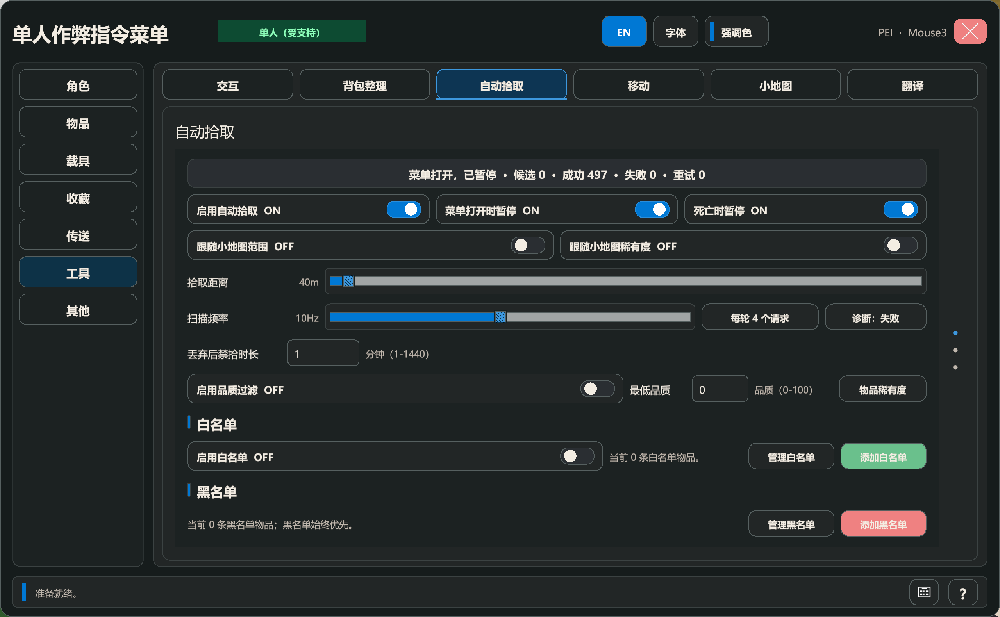

</details>

### 准星交互

- 智能、检查、维修、传送、实用和删除六种模式，中键执行。
- 智能模式根据准星目标选择单一动作；无目标时仍可检查世界表面或使用安全坐标回退。
- 删除操作必须同时按住 `Shift`；可选显示名称、ID/GUID 和生命/耐久信息。

<details>
<summary><strong>查看截图：准星交互工具</strong></summary>

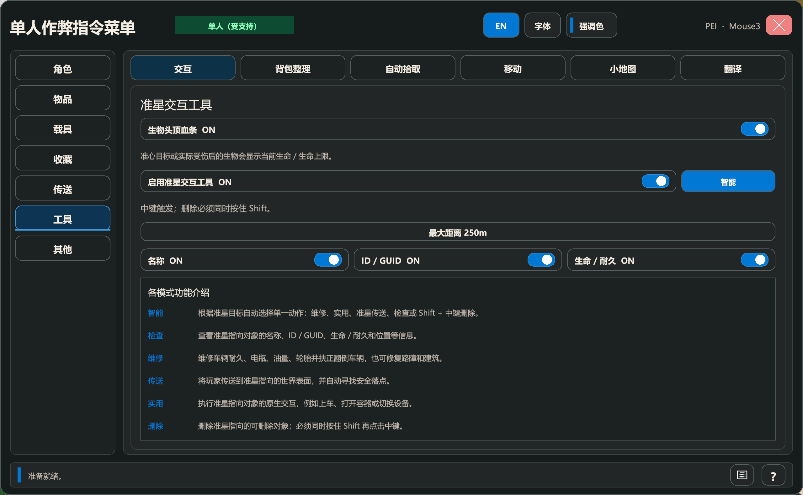

</details>

### 生物血条

- 准星目标或实际受伤的僵尸/动物可显示当前生命与生命上限。
- HUD 与插件字体、强调色、画布生命周期和场景清理保持一致。

<details>
<summary><strong>查看截图：实机生物血条</strong></summary>

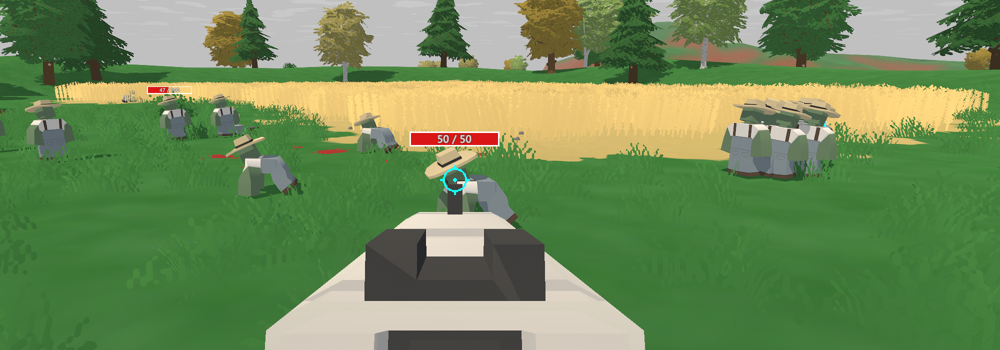

</details>

### 移动工具

- 飞行与穿墙沿用 Unturned 原生移动模拟路径，支持独立水平/垂直速度倍率。
- 视角方向飞行读取用户配置的方向键；W/S 跟随镜头 pitch/yaw，Space/Ctrl 固定世界纵轴优先。
- 斜向移动归一化，零向量或非有限镜头方向自动回退。
- 关闭穿墙后搜索安全位置；退出授权、死亡或进入载具时恢复原生移动状态。

<details>
<summary><strong>查看截图：飞行与穿墙</strong></summary>

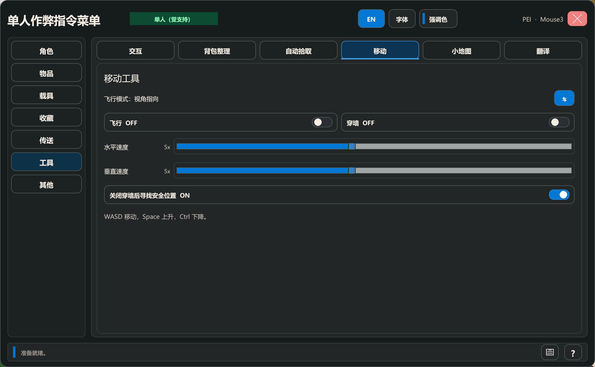

</details>

### 地图与传送点

- 保存多个具名位置，并按地图隔离坐标、朝向和创建时间。
- 在传送点列表与 GPS 地图之间切换；地图支持缩放、拖动、玩家位置和保存点标记。
- 点击地图时解析地表、屋顶和附近安全回退位置。
- 传送点支持星形、正方形、圆形、菱形以及预设或自定义颜色。

<details>
<summary><strong>查看截图：地图与传送点（2 张）</strong></summary>

**具名传送点列表**

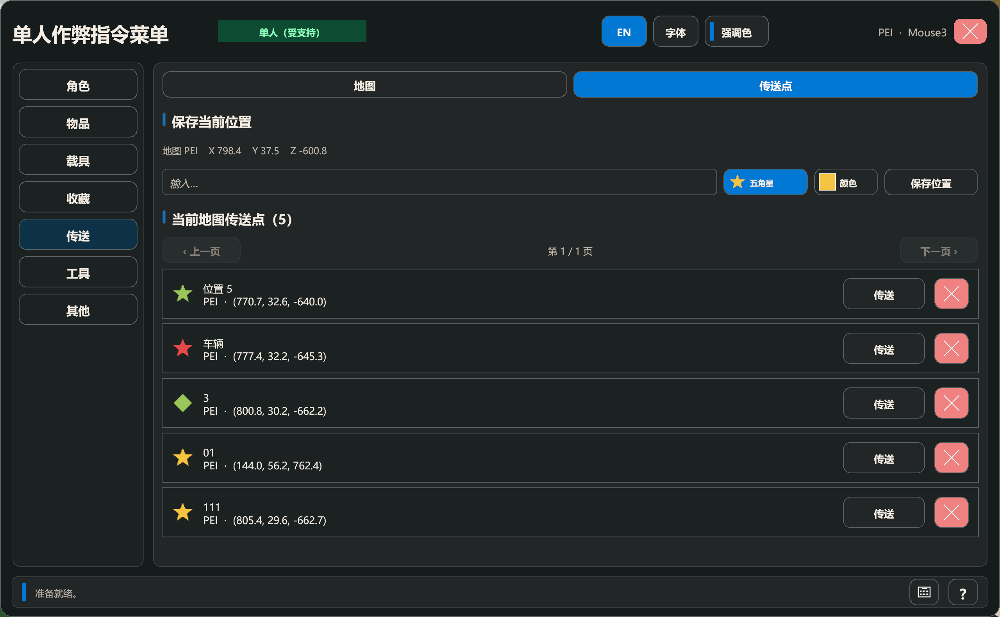

**地图 GPS**

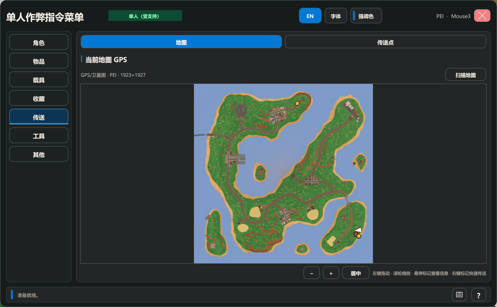

</details>

### 小地图

- 支持圆形/方形 HUD、锚点、偏移、尺寸、可视半径和直接拖动/缩放的布局编辑。
- 支持北向固定或随视角旋转，显示指南针和世界坐标。
- 可显示玩家、组员原生标记、传送点、僵尸、动物、其他玩家和地面物品；物品支持六档稀有度和跨楼层处理。
- 背景可使用原生地图裁剪、实时地表、实时高度切片或回退网格；建筑/洞穴探测按配置选择背景。
- 有界僵尸区域保留避免扫描边界反复丢失标记，同时限制内存增长。

<details>
<summary><strong>查看截图：小地图设置与实机效果（3 张）</strong></summary>

**设置页**

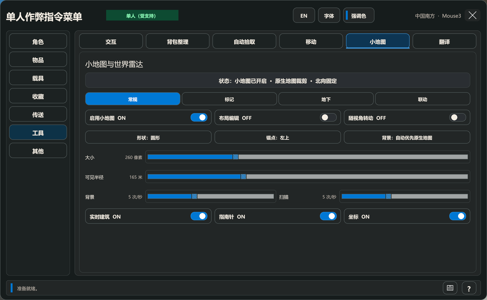

**圆形实时地表 HUD**

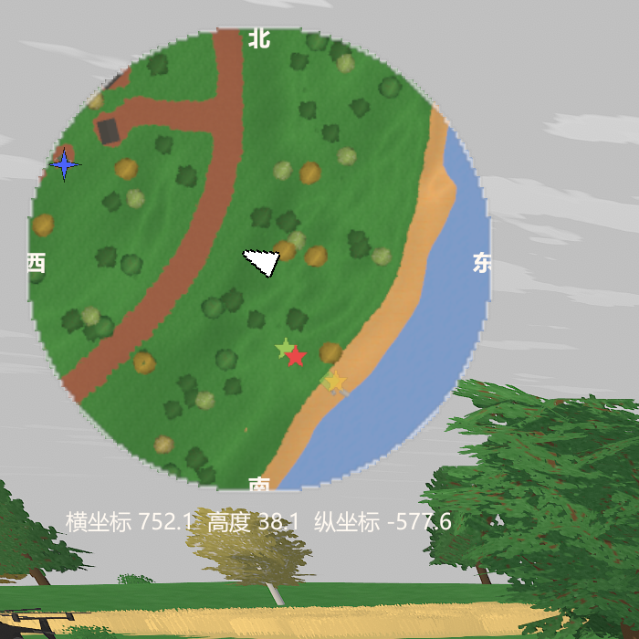

**方形原生地图裁剪 HUD**

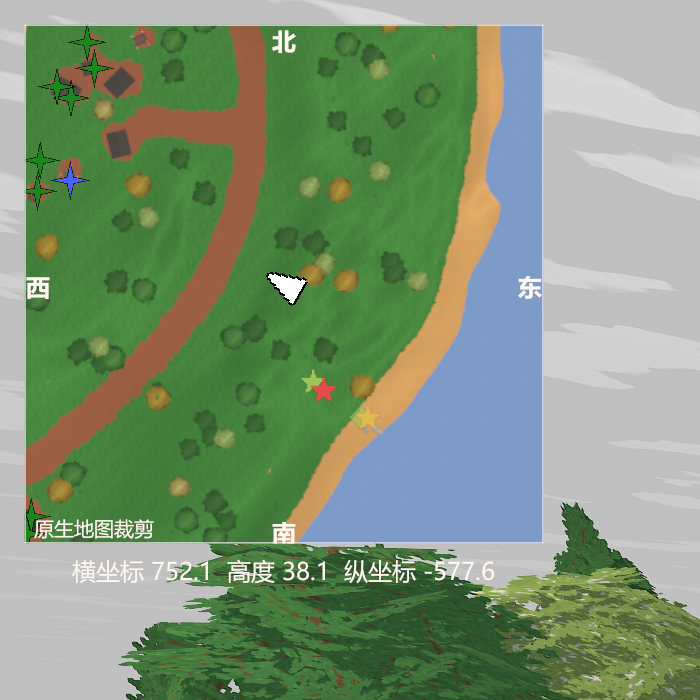

</details>

### 时间、天气与世界事件

- 中英双语 12 小时时间环，支持拖动、滚轮、键盘调整以及白天/夜晚快捷设置。
- 冻结时间、强制满月、请求空投。
- 下雨、暴雪、清除当前天气和关闭天气调度。
- 手动重新扫描当前已经加载的资产。

<details>
<summary><strong>查看截图：时间、天气与世界事件</strong></summary>

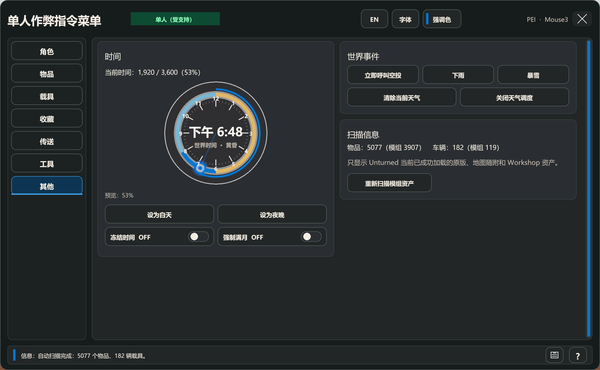

</details>

### 界面、快捷键与持久化

- 中英双语即时切换、Windows 系统字体选择和持久强调色。
- Fluent 风格 Legacy uGUI 控件、响应式宽/窄布局、统一 HUD/Modal/Tooltip/Toast 和帧驱动动效。
- 单一持久 `PluginUiRoot` 管理菜单、HUD、输入、弹窗、场景切换和确定性清理。
- 保存主页面、工具子页、传送视图、窗口位置及功能配置；全局快捷键支持冲突检测和原生输入隔离。

## 从 v1.7.0 到 v2.0.0

`1.8.0`、`1.9.0`、`1.95.0`、`1.98.0` 和 `1.995.0` 都是未正式发布的源码检查点。`2.0.0` 是正式版用户从 `1.7.0` 直接升级时，第一次集中获得这些变化的版本。

### 首次正式交付的新增功能

- 原版与 Workshop 资产运行时扫描、翻译队列、批处理、重试、缓存、进度和本地 UI 应用。
- 物品、载具、动作、NPC 对话、任务、已加载 `ObjectAsset` 名称/交互对话显示名和 Vendor 文本的字段级翻译与富文本/占位符保护。
- 背包整理预览、回滚、当前页/全部随身页、旋转、跨页、装备/快捷栏保护、压缩、归并、撤销和跨箱集中。
- 自动拾取的范围、调度、请求限额、暂停门、品质、稀有度、白名单/黑名单、诊断、小地图联动和 Snapshot 优先路径。
- 全局快捷键框架、快捷键冲突检测、原生输入隔离，以及背包整理/菜单动作的持久绑定。
- 事务化 BepInEx 配置初始化；首次、空白或既有配置在绑定/保存失败时精确回滚。
- 小地图与自动拾取共享一份按最大半径/最高频率生成的 nearby-item snapshot，避免重复扫描并保持显示与拾取规则解耦。
- Snapshot 无限储存，以及 Crafting、Ammo Refill、Decomposition 三个同 DLL 适配模块。
- 生物血条、物品/载具悬停详情和弹药兼容信息。
- 圆形/方形可编辑小地图、原生/实时背景、世界标记、稀有度、楼层、旋转与有界僵尸区域保留。
- Fluent 风格 Legacy uGUI 控件库、强调色、系统字体、响应式布局和帧驱动 UI 动效。

### 重要改变

- 无限储存的早期未发布实现被 Snapshot Kernel 替换，改为精确原生 item state、严格会话身份、原子主备文件和 persistent reconciliation。
- 翻译服务扩展为 18 种协议/供应商、最多两个 API Key 并行和 `1–100` 批量；翻译生命周期与玩法授权分离。
- 物品/载具缩略图按真实宽高显示；载具统一由自动取景相机和最高可用 LOD 生成并按配置缓存。
- 世界时间滑条改为中英双语 12 小时时间环。
- UI 改为持久根节点、宽窄响应式布局、共享字体/主题和确定性页面清理。
- 菜单就绪与玩法授权分开；新增实时会话状态及按连接失效的多人风险确认，单人仍是正式玩法支持目标。
- 自动拾取的 Snapshot 落盘改为单后台任务；同一次原生 Craft 请求合并为一个 Snapshot 外层事务。

### 重点修复与数据安全

- 修复 Snapshot 品质/状态/数量混淆、损坏文档、外部改写、替换竞态、回滚和不确定提交路径。
- 修复自动拾取在合法 `amount=0`、请求超时、原生后态不确定、储存回退和 reconciliation 场景中的重复或丢失风险。
- 修复无变化整理仍重建背包、快捷栏绑定丢失，以及撤销记录跨连接继续生效。
- 修复当前 Unturned 运行时下的视角飞行、纵向键优先、斜向速度和本地飞行视模倾斜。
- 修复 Crafting 的全局 `SearchContents`/`forceAddItem` Hook 干扰附件槽、稀有度、奖励和其他原生授予路径。
- 修复未知资产来源误报 Workshop、裸 `<color>` 标签、本地化遗漏、场景/Canvas/输入/弹窗/Tooltip/Toast 生命周期残留。
- 过期 Snapshot 后台回调绑定原连接与原 `ItemDrop`；会话已变化时不会作用于当前世界。
- Workshop 翻译 Pump 提升为独立的首个运行步骤，其他 UI/会话模块异常不会饿死翻译完成与延迟重扫。

- 修复兼容 Workshop 弹药盒无法供弹的问题；背包整理和 Snapshot 补弹仍保持弹量守恒，不通过不兼容的中间弹药转换。
- 修复小地图朝向、原生地图边缘裁剪、地形材质、悬崖、树冠和低画质水面显示，并补充原生传送后的背景恢复。
- 调整角色和整理表单、翻译页固定进度与操作区、接口/缓存折叠设置，以及时间与天气的双栏布局。
- 修复 Tooltip 交接、按钮状态过渡和 Toast 退场/重排的中断问题；小地图诊断截图默认关闭。

## 运行边界

菜单就绪和玩法授权是两个独立边界：只要客户端已经连接且本地玩家已生成，单人和多人客户端都可以打开主菜单。单人玩法立即可用；多人或非单人 listen host 会常驻显示“不受支持”警示，第一次尝试玩法动作或启用玩法自动化时才要求确认本次连接的风险。断线、换服、换图连接或本地玩家实例重建会使确认失效。

| 会话 | 主菜单 | Workshop 翻译 | 玩法功能 | Snapshot 无限储存 |
| --- | --- | --- | --- | --- |
| 主菜单/加载中 | 关闭 | 已开始的任务继续 Pump | 暂停 | 关闭 |
| 单人世界 | 打开 | 可用 | 受支持 | 可用 |
| 多人客户端，未确认 | 打开并警示 | 可用且不中断 | 阻断 | 关闭 |
| 多人客户端，已确认 | 打开并持续警示 | 可用且不中断 | 不受支持的 best-effort | 关闭 |
| U3DS Dedicated Server | 不创建 UI | 不初始化客户端翻译 | inert/no-op | 关闭 |

Workshop 翻译扫描、缓存、请求、批次完成和本地文本应用不经过玩法授权。进入多人、菜单关闭、连接切换或风险确认变化不会取消当前批次；运行期间的资产刷新只合并为批次完成后的一次延迟重扫。

地图创建界面的 **“单人作弊指令”复选框可以不勾选**。那个选项控制 Unturned 原生命令系统；本插件不依赖 `Provider.hasCheats`。

## 兼容环境

当前 `2.0.0` 源码已针对以下环境构建；版本归属、构建记录与验证边界见 [更新日志](CHANGELOG.md)：

| 项目 | 版本 |
| --- | --- |
| Unturned | `3.26.3.8` |
| Unity | `2022.3.62f3` |
| 架构/运行时 | Windows x64 / Unity Mono |
| BepInEx | `5.4.23.5` x64 |
| 插件 | `2.0.0` |

游戏更新可能改变内部 API。若新版 Unturned 启动后插件不加载，请先查看 `BepInEx/LogOutput.log`，再提交 Issue。

## 安装

GitHub Release 中的 `Unturned-Singleplayer-Cheat-Menu-v2.0.0-Plugin-Only.zip` **只包含插件，不包含 BepInEx**。

1. 完全退出 Unturned。
2. 安装 BepInEx `5.4.23.5` x64 到 Unturned 游戏根目录。
3. 下载 Release 中的插件压缩包。
4. 将压缩包内容解压到能看到 `Unturned.exe` 的游戏根目录。
5. 确认最终文件位于：

   ```text
   Unturned\BepInEx\plugins\UnturnedSingleplayerCheatMenu\UnturnedSingleplayerCheatMenu.dll
   ```

   部署约束：`BepInEx\plugins` 下只能保留这一份活动的 `UnturnedSingleplayerCheatMenu.dll`，不能在 `plugins` 根目录或其他子目录再放置同名 DLL。旧版本或备份文件必须改为非 `.dll` 后缀，避免 BepInEx 重复加载，造成新版覆盖安装失效。

6. 继续使用原有的 Steam/Unturned 启动流程；本次运行边界调整不新增或改造启动器。
7. 本地玩家加载完成后按 `End`。单人是唯一受支持的玩法环境；多人菜单只提供不受支持、自担风险的会话级确认，Snapshot 始终不可用。

启动流程保持不变。即使现有启动方式能够启动游戏，也不等于 BattlEye 会允许 BepInEx、本插件或服务器连接继续运行。

## 配置与数据

首次成功运行后会在 `BepInEx/config` 下生成：

| 文件 | 用途 |
| --- | --- |
| `com.codex.unturned.singleplayer-cheat-menu.cfg` | 界面语言、快捷键、UI 缩放、每页卡片数、车辆缩略图、准星工具和移动设置 |
| `UnturnedSingleplayerCheatMenu.favorites.json` | 物品与车辆收藏 |
| `UnturnedSingleplayerCheatMenu.teleports.json` | 具名传送点 |
| `AutoPickup.rules.json` | 自动拾取白名单/黑名单规则 |
| `UnturnedSingleplayerCheatMenu/InfiniteStorageSnapshots/v1/<世界哈希前24位>/<玩家哈希前24位>/snapshot.json` | Snapshot schema 1；96 位目录前缀控制 Unity Mono 路径长度，文档内完整身份仍按世界、Steam ID 与角色槽精确校验 |
| `BepInEx/LogOutput.log` | BepInEx 与插件运行日志 |

默认快捷键是 `End`，可以在配置文件中的 `ToggleShortcut` 修改。修改前请退出游戏。

插件窗口右上角提供 `EN` / `中文` 语言切换按钮，点击后立即刷新界面并写回 `Interface.Language`，不需要重启游戏。

从未发布的旧 `UnturnedSingleplayerCheatMenu/InfiniteStorage/` 格式已废弃；当前运行时不会读取、Claim、迁移、移动或删除该目录中的文件。新路径不存在时，无限储存从空仓库开始。

若同目录出现 `snapshot.json.reconciliation-required`，无限储存与自动拾取会保持锁定，避免把无法证明一致的原生/仓库状态继续扩散。先按活文档核对 primary、`.bak`、临时残件与世界掉落，手工清理标记后重启；不要直接覆盖存档。

`Interface.Language` 初始默认为 `Auto`：简体/繁体中文 Unturned 使用中文，其余游戏语言使用英文。也可以在配置文件中显式填写 `English` 或 `Chinese`；未知值按 `Auto` 处理。

Workshop 本地化页支持最多两个 API Key。首行保留 `+`，后续行可用 `×` 删除；每个 Key 使用独立 worker 并行消费批次，批量大小范围为 `1–100`。该页面使用垂直滚动布局，增加输入行不会压缩下方设置。

自动扫描只会显示**当前游戏进程已经成功加载并进入 `Assets` 映射的内容**。未订阅、下载失败、依赖缺失或当前地图没有加载的模组不会被插件凭空发现。进入世界后可以在“其他”页点击“重新扫描”刷新。

## 卸载

退出游戏后删除：

```text
BepInEx\plugins\UnturnedSingleplayerCheatMenu
```

即可停用插件。配置、收藏、传送点、自动拾取规则和 Snapshot 数据不会随 DLL 自动删除；如需彻底清理，可手动删除上文列出的配置与数据文件/目录。

## 从源码构建

仓库不会提交 Unturned、Unity 或 BepInEx 的二进制程序集。构建者必须拥有合法安装的游戏和 BepInEx。

```powershell
.\scripts\Prepare-References.ps1 -GameRoot 'C:\Program Files (x86)\Steam\steamapps\common\Unturned'
dotnet build .\UnturnedSingleplayerCheatMenu.slnx -c Release
Get-ChildItem .\tests -Recurse -Filter '*Smoke.csproj' | Sort-Object FullName | ForEach-Object {
    dotnet run --project $_.FullName -c Release
    if ($LASTEXITCODE -ne 0) { throw "Smoke failed: $($_.FullName)" }
}
```

`Prepare-References.ps1` 只会把编译所需程序集复制到被 Git 忽略的本地 `lib/` 目录。Release DLL 输出到 `artifacts/UnturnedSingleplayerCheatMenu.dll`。

主要模块：

- `RuntimeSessionPolicy` / `GameplayFeatureAccessPolicy`：会话分类、菜单就绪、每连接多人风险确认和玩法执行授权。
- `CheatMenuPlugin` / `ShortcutToggleGate`：生命周期、快捷键去重、菜单状态和资产刷新。
- `CheatMenuOverlayUi`：运行时 Overlay UI 与输入隔离。
- `AssetCatalog` / `ItemFilterService`：资产扫描、物品分类与高级筛选。
- `IconCache` / `VehicleIconDiskCache` / `VehicleIconRenderer`：内存与磁盘图标缓存、车辆模型缩略图和渲染设置。
- `CheatActions`：角色、物品、车辆、时间、天气和事件操作。
- `FavoriteStore` / `TeleportStore`：原子化 JSON 持久化与失败回滚。
- `GodModePatch`：当前版本 `PlayerLife.doDamage` 的 Harmony 本地玩家授权补丁。

## 验证

`v2.0.0` 是自 `v1.7.0` 以来首个正式版本；中间源码检查点与本版累计变更、构建和 Smoke 记录见 [主更新日志](CHANGELOG.md)，v1.8 的逆向恢复边界单独记录在 [v1.8 恢复日志](docs/V1.8_RECOVERY_CHANGELOG.md)。2.0 Release 构建为 0 警告、0 错误，递归发现的 30 个 Smoke 项目全部逐项重建并运行通过；源码/API、发布包与真实游戏验收边界仍分别记录。

v2.0.0 发布产物：

```text
DLL SHA-256: 79AC75876C0B3B829188BB02EEB2DF5C32F04BF1AC7C025D695B44389B33F192
Plugin-Only ZIP SHA-256: 92CFA47EB93A68A98EC122EEDB67EDC6D59F7E0A290E0207F72500009D7049D9
```

最终 2.0 DLL/发布包在本次发布准备中未部署、未重启游戏验收；自动化通过不能替代真实单人玩法确认。

## 免责声明

本项目是社区制作的非官方单人玩法模组，与 Smartly Dressed Games、Unturned、BattlEye 或 BepInEx 项目没有隶属或背书关系。多人/服务器玩法和 BattlEye 加载均不受支持、不保证可用；使用前请备份存档并理解踢出、回档、断线或账号处罚风险。

插件源码采用 [MIT License](LICENSE)。Unturned、Unity、BepInEx 及发行包中相应第三方文件仍遵循各自的许可证和权利声明。
## 当前架构验证入口

当前源码使用单一 `PluginUiRoot`，由 `RuntimeUpdatePatch` 挂接 `Provider/MenuUI/PlayerUI.Update` 并按帧去重后分发 `PluginRuntimeContext` 的 Update/LateUpdate；这条静态桥与旧版相同，不依赖会在 Unturned 启动场景切换时被销毁的临时 BepInEx/Driver 组件。`PluginUiRoot` 若随启动场景丢失会自行重建。它还包含输入释放、窗口拖动/位置持久化和按当前地图隔离的传送点视图。生产源码不再包含旧 IMGUI 菜单或 `UnityEngine.IMGUIModule` 生产引用。

Release 构建后应递归发现并串行运行 `tests/**/*Smoke.csproj`，不要依赖手写项目数量或旧 `bin/obj` 目录。源码/API、构建、Smoke、部署哈希、BattlEye 启动、BepInEx/plugin 发现、多人连接、翻译连续性和真实游戏交互必须分别记录；其中任何一层都不能替代真实单人玩法验收。

## 赞助支持

如果这个插件帮你更方便地游玩和翻译 Unturned，欢迎通过 [爱发电](https://afdian.com/a/Blowthesnow) 支持后续开发。赞助完全自愿。

<p><a href="https://afdian.com/a/Blowthesnow"></a></p>
