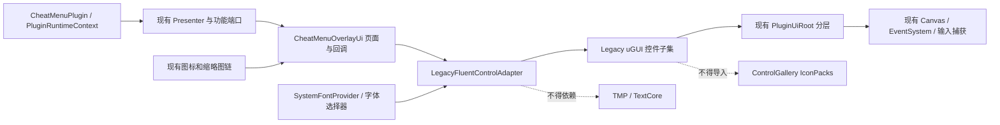

# Unturned 插件 uGUI 控件库重构落地方案

> 状态：设计与实施基线已确认；本文档只定义落地范围、步骤和验收门禁，尚未修改任何生产代码。
>
> 基线日期：2026-08-30
>
> 目标仓库：`D:\Unturned BepInEx`
>
> 控件库来源：`E:\控键库`

## 关键约束

1. 只允许修改 UI 界面和控件相关代码；功能、服务、补丁、配置模型和游戏行为全部冻结。
2. 当前插件不使用 TextMeshPro。本项目不得新增 `TMPro`、`TMP_*`、`Unity.TextMeshPro` 或 TextCore 依赖。
3. 图标完全排除：不导入控件库图标包，不替换或修改插件现有图标、Sprite、纹理、缩略图与标记生成链。
4. 保留当前唯一 `PluginUiRoot`、Canvas、EventSystem、输入捕获、页面生命周期和状态持久化，不创建第二套 UI 基础设施。
5. 最终继续交付单个 `UnturnedSingleplayerCheatMenu.dll`，不增加外置控件库 DLL。
6. 源码、构建、Smoke、部署、日志和实际游戏内验收必须分层记录，不得相互替代。

> Workshop API Key 验收口径（用户裁决 B）：保持冻结 HEAD 的服务与序列化契约，最多 2 个 Key；首行使用 `+` 添加，后续行使用 `×` 删除。不得只在 UI 中展示超过服务上限的 Key。

## 目标

使用 `E:\控键库` 的主题、控件状态、布局、圆角图形、组合控件和 Handle 生命周期设计，重新组织当前插件的窗口、页面和交互控件，同时满足以下结果：

- 保持所有现有功能和回调行为不变；
- 统一按钮、开关、输入框、滑块、滚动、分页、卡片、弹窗、提示和 HUD 非图标表面；
- 保持中文动态系统字体和当前字体选择器；
- 提升宽屏、窄屏和不同 UI Scale 下的可读性；
- 不触碰任何图标和游戏逻辑；
- 不改变现有部署形状。

## 已验证基线

### 插件仓库

| 项目 | 当前值 |
|---|---|
| Git 分支 | `main` |
| Git HEAD | `8a50906b9e562d9b692530257943a0f39079a4c5` |
| 工作树 | clean，与 `origin/main` 一致 |
| 插件版本 | `1.95.0` |
| 目标框架 | `netstandard2.1` |
| BepInEx | `5.4.23.5` |
| 运行时 | Unity Mono |
| 当前文字系统 | `UnityEngine.UI.Text`、`UiText`、动态 `UnityEngine.Font` |
| TMP 使用情况 | 插件生产源码 0 个 TMP 引用 |
| 主窗口首选尺寸 | `1120 × 790` |
| 主窗口最小尺寸 | `900 × 620` |
| 主 Canvas 排序 | `29900` |

当前 UI 根由 `D:\Unturned BepInEx\src\UnturnedSingleplayerCheatMenu\UI\PluginUiRoot.cs` 创建并拥有以下层级：

```text
PluginUiRoot
├─ HudLayer
├─ WindowLayer
├─ ModalLayer
├─ PopupLayer
├─ TooltipLayer
└─ ToastLayer
```

当前公共 UI 原语集中在 `D:\Unturned BepInEx\src\UnturnedSingleplayerCheatMenu\UI\CheatMenuOverlayUi.cs`：

| 原语 | 图谱调用方数量 |
|---|---:|
| `CreateButton` | 55 |
| `CreateRow` | 45 |
| `CreateLabel` | 41 |
| `CreateToggleAction` | 13 |
| `CreateInput` | 11 |
| `CreateSection` | 7 |
| `CreateSearchInput` | 6 |
| `CreateTimeSlider` | 5 |
| `CreateSummaryPanel` | 3 |
| `CreateLabeledInput` | 2 |

这意味着应优先改造公共控件原语和少量宿主适配，而不是逐页复制重写功能逻辑。

### 控件库

| 项目 | 当前值 |
|---|---|
| 程序集名称 | `ControlGallery.Ugui` |
| 版本 | `1.1.0` |
| 目标框架 | `netstandard2.1` |
| 生产目录 | `E:\控键库\ControlGallery\Ugui\Core`、`Controls`、`Runtime` |
| 生产源码文件 | 22 个 |
| 源码清单 SHA-256 | `E445784E7118BEDD8FCDCFC33DDA226C7435AF175F34D4874C6E7FD6E32F1E58` |
| 当前 DLL SHA-256 | `F65D4A4A277BCDCEF1181DEC1B4952B8E481C0BDA57B5BBFD29CA174A59AD18D` |
| TMP 耦合 | 10 个生产文件、123 处 TMP 标识引用 |
| Git 状态 | 尚无提交，所有内容均为未跟踪文件 |

控件库原始实现明确要求调用方提供 Canvas、EventSystem、输入策略和字体。它不负责游戏输入、配置持久化或 Unturned 数据绑定，适合作为 UI 控件设计来源，但其 TMP 文字后端不能原样进入当前插件。

## 核心决策

### 采用 Legacy uGUI 适配子集

不直接引用 `ControlGallery.Ugui.dll`，也不把完整图鉴搬入插件。实施时从控件库提取当前插件实际需要的控件，并在插件 UI 目录内建立 Legacy uGUI 适配版：

- 保留 `FluentTheme`、`RgbaColor`、间距、字号、圆角和语义状态；
- 保留 `FluentRoundedGraphic`、焦点状态、Handle、Dispose 和组合布局思想；
- 把 `TextMeshProUGUI` 替换为现有 `UiText : UnityEngine.UI.Text`；
- 把 `TMP_InputField` 替换为 `UnityEngine.UI.InputField`；
- 把 `TMP_FontAsset` 注入改为 `UnityEngine.Font` 注入；
- 把 TMP 对齐、字体样式和溢出映射为 `TextAnchor`、`FontStyle`、`HorizontalWrapMode` 与 `VerticalWrapMode`；
- 保留现有 `SystemFontProvider`、字体 `FamilyName` 和字体选择器行为；
- 只迁移实际使用的控件，不迁移图鉴和无关实验控件。

### 保持单程序集

Legacy 适配控件直接编译进 `UnturnedSingleplayerCheatMenu.dll`。因此：

- 不需要 `ControlGallery.Ugui.dll` 边车；
- 不修改 `D:\Unturned BepInEx\scripts\Install.ps1`；
- 不修改 `D:\Unturned BepInEx\scripts\Build-PortablePackage.ps1`；
- 不改变当前单 DLL 安装和回滚模型。

### 不使用 ControlAtlasBuilder

`ControlAtlasBuilder.Build` 是控件图鉴入口，会创建演示导航和演示页面，不适合当前插件。正式接入只使用经过 Legacy 适配的工厂、控件 Handle 和视觉组件，并挂载到现有 `PluginUiRoot` 层级。

## 修改边界

### 允许的生产文件范围

```text
D:\Unturned BepInEx\src\UnturnedSingleplayerCheatMenu\UI\**
D:\Unturned BepInEx\src\UnturnedSingleplayerCheatMenu\UnturnedSingleplayerCheatMenu.csproj
```

`.csproj` 只允许调整 Legacy 控件源码编译项；不得新增 TMP、TextCore 或外置控件库引用。

建议新增的 UI 内部结构：

```text
UI/
├─ ControlLibrary/
│  ├─ Core/                 # 主题、颜色、选项
│  ├─ Controls/             # Handle 与组合控件
│  ├─ Runtime/              # 工厂、圆角图形、焦点视觉
│  └─ UPSTREAM-MANIFEST.md  # 来源文件、版本和哈希
├─ LegacyFluentUiContext.cs
├─ LegacyFluentHandleRegistry.cs
├─ LegacyFluentTooltipBridge.cs
└─ LegacyFluentControlAdapter.cs
```

实际文件名可以按现有命名风格调整，但所有新增生产代码必须保留在 `UI` 目录内。

### 允许的验证范围

```text
D:\Unturned BepInEx\tests\UiArchitectureSmoke\**
D:\Unturned BepInEx\tests\UiControlLibrarySmoke\**
```

测试只能验证 UI、控件、依赖、生命周期和静态边界，不得修改功能实现或测试数据语义。

### 冻结的生产范围

以下目录和职责不得修改：

- `Services`：网络、翻译、图标渲染、缓存、扫描和数据服务；
- `Features`：游戏功能、状态应用和功能行为；
- `Patches`：Harmony 与运行时钩子；
- `Models`：配置模型、序列化模型和数据契约；
- `Minimap`：扫描、渲染、地图数据和标记数据；
- 插件入口、运行时驱动、部署和打包脚本；
- 配置键、默认值、SchemaVersion、持久化格式；
- 所有游戏 API 调用和 Presenter 到功能层的回调目标。

## 图标排除清单

以下代码和资产不进入本次重构：

- `D:\Unturned BepInEx\src\UnturnedSingleplayerCheatMenu\UI\OverlayIconBinder.cs`
- `D:\Unturned BepInEx\src\UnturnedSingleplayerCheatMenu\UI\TeleportMarkerIconFactory.cs`
- `CheatMenuOverlayUi.cs` 中的 `Get*Sprite`、`Create*Texture` 和图标纹理缓存段；
- `MinimapHud.cs` 中的玩家、传送点、星标、高度和原生标记绑定；
- 物品、载具和无限储存卡片中的图片、Sprite 与缩略图绑定；
- 载具相机缩略图渲染、磁盘缓存和缓存版本；
- `E:\控键库\ControlGallery\IconPacks\**`；
- SVG、PNG、图标 manifest 和图标生成脚本。

允许调整图标外围控件的背景、边框、圆角、焦点和布局容器，但必须保持以下属性不变：

- Sprite/Texture 来源；
- 图标尺寸与宽高比；
- 图标颜色；
- 图标资源 ID；
- 缓存键与缓存版本；
- 图片加载、释放和回退路径。

## 目标架构



### 责任边界

| 层 | 继续负责 | 不得新增职责 |
|---|---|---|
| `PluginUiRoot` | Canvas、层级、EventSystem 共存、ToastLayer | 不创建第二个根或改变输入策略 |
| Presenter | 读取状态、调用功能、保存现有状态 | 不感知具体控件实现 |
| 页面 View | 页面组合、显示文本、绑定控件事件 | 不包含游戏行为 |
| Legacy 控件适配器 | 主题、视觉树、Handle、事件桥接 | 不访问 Unturned API |
| 控件 Handle | 控件值、交互事件、Dispose | 不持久化配置 |
| 图标链 | 现有 Sprite、Texture、缩略图 | 不接受控件库图标 |

## Legacy uGUI 适配契约

### 文字

- 所有新文字节点使用 `UiText`，不直接创建普通 `Text`；
- 字体由现有 `SystemFontProvider` 或当前 Shell Presenter 注入；
- 中文、英文、数字、标点和用户输入必须使用同一字体回退策略；
- `FamilyName` 继续作为稳定配置值，显示名继续由现有本地化逻辑生成；
- 字体切换后重建 UI 子树，不修改功能状态和配置键。

### 输入框

- 使用 `UnityEngine.UI.InputField`；
- 保留现有 `onValueChanged` 与 `onEndEdit` 区分；
- 搜索框继续使用当前防抖控制器；
- 密码输入继续隐藏 API Key；
- 保留字符上限、只读、多行和提交规则；
- 中文 IME 合成期间不得提前提交或触发搜索。

### 按钮与选择状态

- 每个按钮必须保持原 action 回调；
- 每个按钮必须继续经过 `ButtonTooltipText.Require` 或等价强制门禁；
- 默认、Hover、Pressed、Selected、Disabled、Focus 状态均由语义主题控制；
- 图标按钮只允许替换外围 Button 表面，图标子节点保持原样；
- 主导航和工具导航继续保存原枚举值，不用显示文本作为内部 ID。

### 生命周期

- 工厂创建的每个交互控件必须返回 Handle；
- 页面级 Handle 按页面根节点注册；
- 页面切换时先退订调用方事件，再 Dispose Handle；
- 旧页面立即 `SetActive(false)`，随后进入现有延迟销毁队列；
- 不允许 Handle 和页面宿主同时重复销毁同一个根对象；
- 字体切换、语言切换、场景切换和插件卸载必须清空 Handle 注册表。

## 视觉设计规范

### 主题

默认采用控件库的 `DarkInk` 语义体系，不新增主题配置键：

- 主背景：深墨黑灰；
- 导航与页面表面：分级灰黑；
- 主强调：暖橙红；
- 焦点：青绿色；
- 成功、警告、错误、信息使用独立语义色；
- 间距统一使用 4、8、12、16、24、32；
- 控件高度统一为 34、40、44；
- 圆角统一为 6、10、16；
- 不使用玻璃拟态、霓虹紫蓝或卡片套卡片。

### 主窗口

保留现有窗口尺寸、拖动、边界钳制和归一化位置持久化。

宽布局：

```text
┌────────────────────────────────────────────────────────────┐
│ 标题 / 单人标记 / 地图与快捷键 / 语言 / 字体 / 关闭       │
├──────────────┬─────────────────────────────────────────────┤
│ 角色         │                                             │
│ 物品         │              当前页面内容                   │
│ 载具         │                                             │
│ 收藏         │                                             │
│ 传送         │                                             │
│ 工具         │                                             │
│ 其他         │                                             │
├──────────────┴─────────────────────────────────────────────┤
│ 状态 / 警告 / 操作反馈                                    │
└────────────────────────────────────────────────────────────┘
```

- 面板宽度足够时使用约 168px 的纯文字左导航；
- 窄布局切回可横向滚动的纯文字导航；
- 不使用图标折叠导航；
- Header 目标高度 56px，状态栏目标高度 36–40px；
- 内容区必须保留现有滚动和页面懒构建。

### 页面布局

| 页面 | 目标结构 | 保留事项 |
|---|---|---|
| 角色 | 状态摘要、开关、数值操作两列布局 | 所有目标值、按钮和回调 |
| 物品 | 搜索/筛选工具栏、分类、图片网格、分页 | 物品图片与发放逻辑 |
| 载具 | 搜索/分类、图片网格、数量与生成操作 | 载具缩略图和生成逻辑 |
| 收藏 | 物品/载具文字分段、筛选、网格、分页 | 收藏存储和星标图形 |
| 无限储存 | 搜索、分类、状态、网格、操作栏 | 卡片图片和库存语义 |
| 传送 | 地图/列表文字分段、操作区、分页 | 地图纹理和所有标记图形 |
| 工具 | 二级文字导航、右侧设置内容 | 原 ToolsTab 枚举和状态 |
| 自动拾取 | 摘要、开关、范围/频率、规则和分页 | 规则、Hands 枚举和拾取逻辑 |
| 库存整理 | 预设、范围、选项、预览/执行/撤销 | 排序计划和回滚行为 |
| Workshop 翻译 | 状态、协议、滚动设置、API Key 行 | `+`、`×`、最多两个 Key、密码模式 |
| 其他 | 时间、世界和杂项操作卡片 | 世界操作回调与防抖 |

## 控件映射

| 当前实现 | Legacy 控件落点 | 行为门禁 |
|---|---|---|
| `CreateButton` | Fluent Button | 原回调、Tooltip、禁用状态 |
| `CreateToggleAction` | Fluent Switch | 初始值、显示状态、回调时机 |
| `CreateInput` | Legacy Fluent TextBox | Password、提交模式、宽度 |
| `CreateSearchInput` | Legacy Fluent TextBox + 现有防抖 | IME、草稿/提交状态 |
| 数值文本框 | Legacy NumberBox 或 TextBox 适配 | 原范围、步长、Clamp |
| 自制 Slider | Legacy Fluent Slider | 值域、格式、Debouncer |
| 主/工具导航 | Navigation Button + Selected 状态 | 原枚举、最后页状态 |
| Section/Summary | Surface、Card、Badge、InfoBar | 原文本和数据来源 |
| ScrollRect | Fluent ScrollView | 位置、裁剪、滚动条和动态高度 |
| 分页 | Fluent Pagination | 页码、页大小、边界 |
| Drawer | DropDown/Popup Surface | PopupLayer、关闭顺序 |
| Modal | Dialog Surface | ModalLayer、焦点恢复、Escape |
| Tooltip | Tooltip Surface + 现有显示时机 | 动作专属提示和延迟 |
| Toast | Toast Surface + 现有过期队列 | 最多三个、时长、无 Raycast |
| HUD 非图标表面 | HudPanel/HudBar 风格 | 数据、Canvas 和缩放不变 |

## 实施顺序

### 阶段 0：冻结基线

执行前记录：

- Git HEAD、分支、工作树和索引状态；
- 当前插件 DLL、游戏部署 DLL 和本地程序集 SHA-256；
- 当前主窗口、无限储存、主要页面、弹窗和 HUD 截图；
- 当前 Canvas、EventSystem、排序层和输入恢复行为；
- 控件库来源文件清单与上述源码哈希。

门禁：任何已有脏改动必须原样保留，不允许 reset、stash、clean 或覆盖。

### 阶段 1：建立 Legacy 控件子集

1. 创建 `UI\ControlLibrary` 目录和上游来源清单。
2. 提取主题、颜色、圆角、焦点、Handle 与所需工厂方法。
3. 完成 `UiText`、`InputField`、`Font` 后端适配。
4. 建立 Handle 注册和 Tooltip 桥。
5. 不接入任何现有页面，不产生可见变化。

阶段门禁：

- Release 编译通过；
- 插件源码和引用中没有 TMP/TextCore；
- 最终程序集没有 `Unity.TextMeshPro` 依赖；
- 控件子集不引用 BepInEx、Assembly-CSharp 或 SDG.Unturned；
- 不存在 IconPacks、SVG 或新 PNG 引用。

### 阶段 2：完成最小垂直切片

只接入以下范围：

- 主窗口外壳；
- Header；
- 主导航；
- 状态栏；
- 角色页。

阶段门禁：

- 打开/关闭热键、光标和移动恢复不变；
- 角色页所有按钮、开关和输入均调用原 Presenter；
- 中文字体、语言切换和字体切换正常；
- Tooltip、焦点、Tab 导航和 Disabled 状态正常；
- 页面关闭、重建和场景切换无残留 Handle。

### 阶段 3：迁移普通页面

按以下顺序逐页迁移，每页独立构建和验收：

1. 其他；
2. 移动；
3. 迷你地图设置；
4. Point Tool；
5. 库存整理；
6. 自动拾取；
7. Workshop 翻译。

Workshop 页面必须单独验证新增 Key 后页面仍可滚动，`+` 与 `×` 尺寸和行为不变，最多两个 Key，且日志不泄露 Key。

### 阶段 4：迁移复杂集合页面

依次迁移：

1. 物品；
2. 载具；
3. 收藏；
4. 无限储存；
5. 传送。

复杂页面只替换控制条、容器、分页和文字控件。图片网格、缩略图、收藏星标、地图和标记全部沿用现有实现。

### 阶段 5：迁移反馈层与 HUD 非图标表面

- 字体选择、快捷键、筛选、确认框；
- Drawer、Popup、Tooltip、Toast；
- PointTool HUD 表面和文字；
- Minimap 外框、状态文字和非图标控制；
- CreatureHealthBar 的背景、填充和文字样式。

CreatureHealthBar 必须保留独立 `ScreenSpaceOverlay` Canvas、`ConstantPixelSize`、`scaleFactor=1`、排序 `29940`、18m 参考距离以及现有近远缩放。

### 阶段 6：清理与发布收口

- 删除确认无调用的旧视觉原语；
- 保留所有图标创建与绑定函数；
- 更新 UI Smoke 的文件扫描范围；
- 完成全量构建、Smoke、部署和实机验收；
- 只有在实机验收完成后才允许标记 UI 重构完成。

## 验证方案

### 静态边界

实施期间每一批都执行以下检查：

```powershell
git status --short
git diff --name-only
Get-ChildItem .\src\UnturnedSingleplayerCheatMenu -Recurse -Filter *.cs |
    Select-String -Pattern '\bTMPro\b|\bTMP_|Unity\.TextMeshPro|TextCore'
Get-ChildItem .\src\UnturnedSingleplayerCheatMenu -Recurse -File |
    Select-String -Pattern 'IconPacks|\.svg|ControlGallery\.Ugui\.dll'
```

通过条件：

- 生产代码改动只在 UI 允许区；
- `.csproj` 没有 TMP、TextCore 或 ControlGallery DLL 引用；
- 不出现图标包、SVG 或新图标资产；
- 非 UI 功能代码哈希不变。

### 源码和 Smoke

至少验证：

- UI 根与层级唯一性；
- 所有按钮 Tooltip 非空且与动作对应；
- 语言与字体切换重建不丢状态；
- 页面延迟销毁顺序；
- InputField 草稿、提交、密码和 IME 状态；
- 导航 Selected 状态；
- ScrollRect 裁剪、滚动条和位置恢复；
- Modal/Popup 焦点恢复；
- Workshop Key 数量和页面布局；
- 无 TMP、无外置控件库依赖、无图标包引用；
- 原有功能 Smoke 全部保持通过。

### 部署

1. 确认 `Unturned` 进程不存在。
2. 备份现有部署 DLL。
3. 只复制新的 `UnturnedSingleplayerCheatMenu.dll`。
4. 验证插件目录中只有一个活动插件 DLL。
5. 比较构建 DLL 与部署 DLL 的 SHA-256。
6. 保留安装清单和回滚路径。

### 实机矩阵

| 维度 | 检查值 |
|---|---|
| 分辨率 | 1920×1080、2560×1440、2560×1600、3440×1440 |
| UI Scale | 80%、100%、125% |
| 语言 | 中文、英文 |
| 输入 | 鼠标、滚轮、键盘焦点、快捷键、中文 IME |
| 窗口 | 主菜单、无限储存 |
| 页面 | 全部主 Tab 与工具子页 |
| 浮层 | Drawer、Popup、Modal、Tooltip、Toast |
| 生命周期 | 进地图、退主菜单、断线、重进、插件卸载 |
| 共存 | 原生菜单、原生光标、相机和玩家移动 |
| 图标 | 所有现有图标、标记和缩略图前后截图一致 |

## 验收标准

满足以下全部条件才算完成：

- [ ] 生产代码只修改 UI 允许区；
- [ ] 没有新增 TMP、TextCore 或外置控件库 DLL；
- [ ] 没有导入或修改图标资产与图标链；
- [ ] 所有功能回调、配置键、默认值和序列化格式不变；
- [ ] 现有 Canvas、EventSystem、输入捕获和页面生命周期不变；
- [ ] 所有现有 Smoke 与新增 UI Smoke 通过；
- [ ] 构建、部署和部署哈希验证通过；
- [ ] 所有页面和弹窗完成实机交互检查；
- [ ] 中文字体、IME、滚动、焦点和分辨率矩阵通过；
- [ ] 图标与缩略图前后视觉一致；
- [ ] 用户完成最终游戏内视觉验收。

## 风险与处理

| 风险 | 处理方式 |
|---|---|
| TMP 控件库与 Legacy uGUI 不兼容 | 只提取所需控件并替换文字/输入后端，不引用原 DLL |
| 公共原语一次替换影响面过大 | 先做角色页垂直切片，再逐页迁移 |
| 页面切换出现闪烁或重复销毁 | 保留现有延迟销毁队列并引入页面级 Handle 注册 |
| 字体切换后旧控件仍引用旧 Font | 字体切换时释放并重建 UI 子树 |
| IME 输入被搜索防抖提前提交 | 保留现有搜索编辑状态和提交时机 |
| Popup/Modal 抢占游戏输入 | 继续使用现有层级、Modal 注册和输入捕获控制器 |
| 图标因按钮重建而变化 | 图标子节点和 Sprite 绑定保持原样，只替换外围表面 |
| 控件库来源没有 Git 提交 | 用来源路径、文件清单和 SHA-256 固定上游快照 |
| 构建通过但游戏内布局失败 | 使用实机分辨率、UI Scale 和输入矩阵验收 |

## 回滚方案

实施应按阶段形成可独立回退的变更批次：

1. Legacy 控件子集与适配层；
2. Shell 与角色页；
3. 普通页面；
4. 复杂集合页面；
5. 弹窗与 HUD；
6. 清理与发布。

回滚时只撤销对应阶段的 UI 文件，不允许 reset、stash、clean 或覆盖其他工作。部署回滚使用实施前备份 DLL，并重新核对唯一活动 DLL 和 SHA-256。

## 交付物

实施完成后应交付：

1. UI 目录内的 Legacy uGUI 控件子集；
2. 上游来源和哈希清单；
3. 主窗口、全部页面、弹窗和 HUD 非图标表面的重构；
4. UI 静态边界与生命周期 Smoke；
5. Release 构建结果；
6. 部署备份、复制和 SHA-256 记录；
7. 实机分辨率、输入、字体、生命周期和图标一致性验收记录；
8. 明确列出的未完成或需要用户最终确认的视觉项。

## 用户追加验收口径（2026-08-31）

以下为实施过程中用户直接追加、并覆盖原冻结边界中冲突部分的验收要求：

1. 全局强调色默认使用 Fluent 蓝 `#0078D4`；允许复用传送点 RGB/HEX/预设色交互自定义，但强调色与传送点颜色状态严格独立。自定义强调色仅在当前游戏会话生效，不新增配置 Schema。
2. 强调色只覆盖 Accent/Focus、导航选中、Slider fill 和对应交互态；Success/Warning/Error 继续保留绿/黄/红语义。
3. Hover Tooltip 使用独立、略亮于普通强边框的 `2 px` 边框。
4. 物品/载具分类侧栏固定 `196 px` 最小/首选宽度，分类按钮高 `40 px`；卡片列数按主导航、页面 Padding、分类宽度和间距动态计算，`1120 px` 首选窗口允许回落为 4 列。
5. PointTool、Minimap 和 CreatureHealthBar HUD 使用黑色 `80%` 透明背景与四条独立 `1 px` 边；地图 Mask 只允许裁剪地图视口，不得遮罩或染色整个 HUD。
6. 中英文切换必须递归本地化动态组合值和单位；长生命周期 Minimap HUD 的背景状态、坐标、罗盘及布局提示必须原地刷新，不依赖销毁 HUD。
7. 为支持新增双语固定文案与动态 Pattern，允许额外修改 `Services/PluginLocalization.cs`；最终范围证据不得继续宣称所有非 UI 生产文件哈希均不变，而应明确仅此获授权文件发生变化。
8. 用户随后明确撤销第 5 项对 CreatureHealthBar 视觉样式的要求：CreatureHealthBar 恢复 GitHub `main` 基线的透明根、四条白色边、矩形深红填充和白色文字，不再接入 `HudFrameStyle`、Fluent 圆角或主题色。仅保留已经验收的独立 `ScreenSpaceOverlay` / `29940` / `ConstantPixelSize` / `scaleFactor=1`、投影缩放行为，以及跟随 `SystemFontProvider.Revision` 的字体生命周期修复。PointTool 与 Minimap 仍遵守第 5 项黑色 80% 背景和四边框要求。
9. 分类按钮维持 `196 x 40`，物品/载具/收藏卡片维持 `155 x 158`，不得通过缩小卡片补回列数。主窗口首选宽度从 `1120` 调整为 `1280`，默认宽布局恢复 5 列；无限储存独立窗口继续保持 `1120` 首选宽度，窄屏仍由现有响应式列数和缩放策略处理。
10. 用户实机观察后将分类侧栏/按钮宽度从 `196` 微调为 `176`，高度继续为 `40`；卡片尺寸仍严格保持 `155 x 158`，主窗口 `1280` 首选宽度及默认 5 列目标不变。
11. 无限储存保持独立窗口 `1120` 首选宽度，网格固定 `5` 列、`3` 行、每页 `15` 条，卡片同样保持 `155 x 158`；不得为了五列缩小卡片或扩大到影响当前独立窗口几何。

## 参考文件

- `D:\Unturned BepInEx\src\UnturnedSingleplayerCheatMenu\UI\CheatMenuOverlayUi.cs`
- `D:\Unturned BepInEx\src\UnturnedSingleplayerCheatMenu\UI\PluginUiRoot.cs`
- `D:\Unturned BepInEx\src\UnturnedSingleplayerCheatMenu\UI\UiText.cs`
- `D:\Unturned BepInEx\src\UnturnedSingleplayerCheatMenu\UI\UiSearchInputController.cs`
- `D:\Unturned BepInEx\src\UnturnedSingleplayerCheatMenu\UI\UiToastService.cs`
- `D:\Unturned BepInEx\src\UnturnedSingleplayerCheatMenu\UI\DeferredUiDestroyQueue.cs`
- `E:\控键库\README.md`
- `E:\控键库\docs\CONTROL_COVERAGE.md`
- `E:\控键库\docs\WPF_TO_UGUI_MAPPING.md`
- `E:\控键库\docs\UNTURNED_BEPINEX_INTEGRATION.md`
