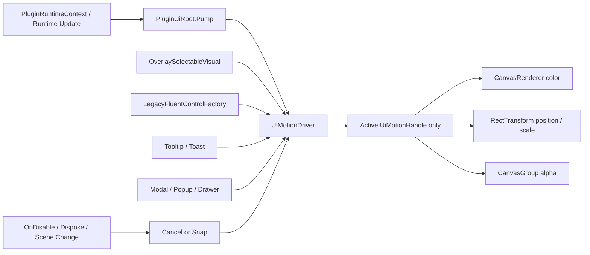

# Unturned BepInEx 插件 UI 动效优化落地方案

> 文档日期：2026-09-01
> 文档状态：待实施
> 工作区：`D:\Unturned BepInEx`
> 目标插件：`UnturnedSingleplayerCheatMenu`
> 评审路由：`unturned-bepinex-development-expert` → `bepinex-ugui-ui` → `emil-design-eng` → `bepinex-developer`

## 1. 目标

在不改变现有功能、窗口几何、输入语义、图标资产、配置结构和游戏逻辑的前提下，为当前 Legacy Unity uGUI 插件补齐一套轻量、可中断、可回收、暂停状态可运行的动效基础设施，并优先改善以下体验：

1. Button 的 Hover、Pressed 与 Focus 反馈；
2. Switch 的 Thumb 位移和 Track 颜色变化；
3. Tooltip 的首次延迟、连续浏览和出现/消失连续性；
4. Toast 的进入、退出和队列重排；
5. Modal、Popup、Drawer 的空间来源和打开/关闭连续性；
6. 仅在实机证据证明有必要时，改善小地图标记、背景切换和血条出现/消失。

本方案不以“动画越多越好”为目标。最终标准是：常用操作仍然快，偶发界面不再突兀，连续操作可以随时反向，且动效不会破坏现有 UI 生命周期和游戏输入。

## 2. 当前基线与证据边界

### 2.1 代码与运行时基线

| 项目 | 当前值 |
| --- | --- |
| Git 分支 | `main` |
| 基线 HEAD | `8a50906b9e562d9b692530257943a0f39079a4c5` |
| 工作树 | 存在大量既有未提交修改和未跟踪文件，实施时必须原样保留 |
| BepInEx | `5.4.23.5` |
| Unity | `2022.3.62f3` |
| Runtime | Unity Mono |
| Target Framework | `netstandard2.1` |
| UI 栈 | Legacy `UnityEngine.UI`，无 TMP |
| 当前 DLL SHA-256 | `7A5E2CD9D408FB29DD901C56AB99CB4D9DD3D743770AD2F484E6A54366AB9013` |

### 2.2 已验证证据

- 当前源码隔离 Release 构建：0 warning、0 error；
- `UiControlLibrarySmoke`：通过；
- `UiArchitectureSmoke`：通过；
- 本地产物与部署目录 DLL SHA-256 一致；
- `WorldTimeRingDragAccumulator` 已进入当前源码，慢速圆周拖拽的子步增量不再被逐次丢弃。

### 2.3 尚未验证

- 当前哈希 DLL 尚未完成重启游戏后的动效实机验收；
- 现有 PNG 只能证明静态布局，不能证明时序、缓动、反向和帧时间；
- Build、Smoke、部署哈希均不能替代实际鼠标、键盘、暂停菜单、分辨率和场景切换验证。

## 3. 当前动效评审结论

当前 UI 的状态设计已经完整：Normal、Hover、Pressed、Selected、Disabled、Focus 均有对应颜色和边框；Plugin UI 也已经具备单一根节点、分层、延迟销毁、Handle 清理、原生 EventSystem 共存和输入恢复能力。

问题不在于“没有状态”，而在于绝大多数状态通过一次赋值或 `SetActive` 瞬间跳转：

- `OverlaySelectableVisual` 在事件回调里直接改颜色；
- `LegacyFluentControlFactory` 将 `Selectable.Transition` 设为 `None`；
- Switch Thumb 在 `-9px/+9px` 间瞬移；
- Tooltip 直接 `SetActive(true/false)`；
- Toast 直接创建和销毁，VerticalLayoutGroup 立即重排；
- Modal、Popup、Drawer 直接创建并在关闭时进入延迟销毁；
- 页面和窗口使用同步显示/隐藏；
- 小地图标记目标约 20Hz 更新，Slot 直接写入目标位置。

因此当前体验的优点是响应快、维护成本低、几乎没有动效性能风险；缺点是控件反馈偏硬、浮层出现突兀、Toast 队列会跳动、Switch 缺乏连续性。

## 4. 动效决策表

| 优先级 | Before | After | Why |
| --- | --- | --- | --- |
| P0 | 时间环旧运行态可能存在慢拖丢步 | 保留当前 `WorldTimeRingDragAccumulator`，重启游戏后做慢拖、跨 0 点和反向拖拽验收 | 直接操控必须跟手，不能用平滑掩盖输入错误 |
| P1 | Button Hover/Pressed 直接跳色 | Hover 100ms 颜色过渡；Pressed 60ms，Release 100ms；可选视觉根缩放至 `0.985` | 保留即时响应，同时增加按压确认 |
| P1 | Switch Thumb 在 `-9px/+9px` 间瞬移，ON 状态还会把整行 Toggle Surface 涂成强调色；现有 OFF Track 又与整行背景过于接近 | 整行始终使用中性 Surface；OFF Track 使用独立中性填充和强边框，ON 时只有 Track 显示强调色，并以 130ms 位移、100ms 颜色过渡切换 | OFF 仍清晰可见，ON 又不会让强调色吞掉整块开关区域 |
| P1 | 卡片 Tooltip 固定等待 2 秒并瞬间出现 | 首次等待 400–500ms；110ms 淡入并从 `0.98` 缩放；连续浏览立即切换 | 2 秒过慢，密集卡片浏览效率低 |
| P1 | Toast 瞬时插入、删除和重排 | 180ms 进入、130ms 退出；退出时同步收缩占位高度 | 避免队列跳动，又不延迟消息可见性 |
| P1 | Modal 遮罩和窗口瞬间出现/销毁 | Scrim 120ms；Dialog 170ms `opacity + scale(0.98→1)`；关闭更快 | Modal 低频且居中，适合短动效 |
| P1 | Popup/Drawer 瞬时出现 | 140ms 淡入和 4px 定向位移，从触发控件方向展开 | 明确浮层的空间来源 |
| 保留 | Mouse3 主窗口同步开关 | 继续瞬时 | 高频快捷操作不能被动画拖慢 |
| 保留 | Tab 内容树同步替换 | 继续瞬时，仅允许导航选中颜色短过渡 | 页面切换频率高，整页滑动会拖慢操作 |
| 保留 | 拖窗、地图平移、Slider、时间环跟随指针 | 继续直接跟随 | 直接操控不添加惯性和视觉滞后 |
| 保留 | 原生暂停菜单接管时立即隐藏插件交互层 | 继续同步切换 | 焦点、Raycast、相机和输入所有权必须立即交接 |
| P2 | 小地图背景瞬切，标记目标约 20Hz 更新 | 仅在录像确认后增加背景 Crossfade 或按 StableId 的短插值 | 防止无证据地增加 HUD 拖影和 CPU 成本 |
| P2 | 血条出现/消失瞬切 | 位置和血量保持直接；只允许 80–100ms 显隐 | 战斗信息准确性优先 |

## 5. 动效原则

### 5.1 高频操作保持瞬时

以下动作不得增加开关动画或等待：

- Mouse3 打开/关闭主窗口；
- 主 Tab 和工具 Tab 内容替换；
- Escape、关闭按钮和原生 UI 接管；
- 文本输入、快捷键录入、Slider、窗口拖拽；
- 时间环和地图直接拖拽；
- 小地图玩家方向旋转；
- 生命值和游戏状态本身的更新。

### 5.2 动效必须有目的

允许的目的只有：

- 反馈：确认控件收到 Hover、Press、Toggle；
- 空间连续性：说明 Popup、Drawer、Tooltip 从哪里出现；
- 避免突变：Toast、Modal 和可选 HUD 显隐；
- 状态变化：Switch 和导航选中态。

不得加入纯装饰性循环动画、呼吸灯、常驻脉冲、彩虹循环或无业务意义的弹跳。当前 Smoke 明确要求不恢复已删除的神话物品循环变色路径。

### 5.3 时间基准

所有 UI 动效统一使用：

```csharp
Time.unscaledDeltaTime
```

不得使用 `Time.deltaTime`，否则暂停、菜单、时间冻结和 Time Scale 修改会让动效停住或改变速度。

### 5.4 可中断

任何 Hover、Pressed、Tooltip、Toast、Popup、Modal 动效都必须支持：

```text
当前值 → 新目标值
```

而不是：

```text
重置到预设起点 → 重播整段动画
```

例如鼠标在 Hover 动画尚未结束时按下按钮，应从当前颜色和缩放直接转向 Pressed；鼠标快速移出时，应从当前位置反向返回 Normal。

## 6. 动效 Token

### 6.1 时长

| Token | 时长 | 用途 |
| --- | ---: | --- |
| `Instant` | 0ms | 高频开关、Tab、原生 UI 接管、生命周期强制收口 |
| `PressIn` | 60ms | Button 按下 |
| `PressOut` | 100ms | Button 松开或取消 |
| `Hover` | 100ms | Button、Input、Toggle 色彩过渡 |
| `Tooltip` | 110ms | Tooltip 显隐 |
| `Switch` | 130ms | Switch Thumb 位移 |
| `Popup` | 140ms | Popup、Drawer |
| `ModalScrim` | 120ms | Modal 遮罩 |
| `Modal` | 170ms | Modal Dialog |
| `ToastIn` | 180ms | Toast 进入 |
| `ToastOut` | 130ms | Toast 退出和高度收缩 |
| `HudVisibility` | 80–100ms | 可选 HUD 显隐 |

常规 UI 动效不得超过 200ms。

### 6.2 缓动

首版不引入外部 Tween 库，统一使用可测试的纯函数：

```csharp
internal static float EaseOutCubic(float t)
{
    t = Mathf.Clamp01(t);
    float inverse = 1f - t;
    return 1f - inverse * inverse * inverse;
}

internal static float EaseInOutCubic(float t)
{
    t = Mathf.Clamp01(t);
    return t < 0.5f
        ? 4f * t * t * t
        : 1f - Mathf.Pow(-2f * t + 2f, 3f) * 0.5f;
}
```

用途：

- 元素进入、Hover、Pressed、Switch：`EaseOutCubic`；
- Toast 队列位移、同屏位置变化：`EaseInOutCubic`；
- 持续匀速效果：当前范围不新增。

## 7. 目标架构



### 7.1 新增文件

建议新增：

```text
src/UnturnedSingleplayerCheatMenu/UI/Motion/
├─ UiMotionTokens.cs
├─ UiMotionEasing.cs
├─ UiMotionChannel.cs
├─ UiMotionHandle.cs
├─ UiMotionDriver.cs
└─ UiTransientMotion.cs
```

### 7.2 `UiMotionDriver`

职责：

- 仅维护当前正在运动的 Handle；
- 由现有 `PluginUiRoot.Pump()` 驱动；
- 每帧接收一次 `Time.unscaledDeltaTime`；
- 使用倒序或 swap-remove 清理已结束 Handle；
- 在场景切换、Root 重建、插件卸载时统一 Cancel/Snap；
- 提供活动数量和耗时统计，但默认不写每帧日志。

禁止：

- 为每个控件永久运行 `Update()`；
- 为每次 Hover 创建 Coroutine；
- 每帧分配闭包、数组、Enumerator 或临时 List；
- 使用反射查找目标属性；
- 引入 DOTween、LeanTween 或新的外部 DLL。

### 7.3 `UiMotionHandle`

每个 Handle 至少保存：

- Owner/Root；
- Channel，例如 `FillColor`、`BorderColor`、`Scale`、`Position`、`Alpha`；
- Current、Start、Target；
- Duration、Elapsed；
- Easing；
- Apply 回调；
- Completion 回调；
- `Retarget`、`Cancel`、`SnapToEnd`、`Dispose`。

同一 Owner、同一 Channel 只允许一个活跃 Handle。新请求必须 Retarget 旧 Handle，不能叠加多个竞争动画。

### 7.4 颜色性能边界

当前 `LegacyFluentSurface.SetColors` 最终写入 `Graphic.color`。若每帧这样修改，`FluentRoundedGraphic` 可能反复标记 Mesh 为 Dirty。

动效期间应优先：

- 保持圆角几何、Radius 和顶点不变；
- 使用 `CanvasRenderer.SetColor` 或等价 CanvasRenderer 颜色乘数；
- 动效结束后一次性提交最终语义色；
- 不在每帧调用 `SetVerticesDirty()`。

## 8. 分组件实施规范

### 8.1 Button / Input / Toggle 状态

主要文件：

- `UI/OverlaySelectableVisual.cs`
- `UI/LegacyFluentControlAdapter.cs`
- `UI/ControlLibrary/Runtime/LegacyFluentControlFactory.cs`
- `UI/ControlLibrary/Runtime/LegacyFluentSurface.cs`

实施：

1. `Refresh()` 不再直接写最终色，而是计算 `VisualState` 和目标 Palette；
2. 状态未变化时不创建或 Retarget 动效；
3. Disabled 必须立即落到 Disabled 状态，不播放；
4. Focus 可做 100ms 边框颜色过渡，但焦点对象本身必须立即激活；
5. Pressed 视觉根可缩放到 `0.985`；Hit Target 必须保持原尺寸，避免缩放后 PointerExit 抖动；
6. 如果无法在不改变控件层级的情况下隔离视觉根，第一阶段只做颜色过渡，不强行加入 Scale。

验收：

- 快速 Enter/Exit 不闪回初始颜色；
- Press 中移出控件能恢复 Normal；
- Disabled 途中立即终止 Hover/Press；
- 键盘 Focus 与鼠标 Hover 不互相覆盖；
- 不改变 Button action、Tooltip、禁用状态和尺寸。

### 8.2 Switch

主要文件：

- `UI/ControlLibrary/Runtime/LegacyFluentControlFactory.cs`

实施：

- Toggle 整行 Root/Surface 无论 ON/OFF 都保持中性 `Surface`；
- Hover/Pressed 只使用中性的 `SurfaceHover` / `SurfacePressed`，不得因为 `isOn=true` 把整行改成 Accent；
- 只有右侧 `SwitchTrack` 表达布尔状态：ON 使用 `Theme.Accent`，OFF 使用与整行 Surface 拉开层级的 `Theme.SurfaceRaised`，并增加 `Theme.BorderStrong` 边框；
- `SwitchThumb` 保持高对比中性色，不随强调色变成同色；
- Track 颜色：100ms；
- Thumb：`-9px ↔ +9px`，130ms `EaseOutCubic`；
- 反复点击时从当前 Thumb 位置 Retarget；
- 初始化、页面重建、语言/字体切换时直接 Snap 到实际值；
- Disabled OFF 使用禁用中性色；Disabled ON 只允许在 Track 内使用降饱和/降透明的强调色，整行仍保持禁用中性色；
- Focus Indicator 可以继续使用 Focus 色，但它只表达键盘焦点，不得被当作 ON 状态背景；
- 当前 `CreateToggleAction` 中的 `current ? CheatMenuStyle.Accent : CheatMenuStyle.Surface` 应改为固定中性 Surface；
- 当前 `onValueChanged` 中调用 `toggleVisual.SetBaseColor(value ? Accent : Surface)` 的路径应删除，状态色只交给 `UpdateSwitch`/后续 Switch Motion 处理。

目标视觉状态：

| Toggle 状态 | 整行 Surface | Switch Track | Switch Thumb |
| --- | --- | --- | --- |
| OFF | `Surface` | `SurfaceRaised` + `BorderStrong` | `TextPrimary` |
| OFF + Hover | `SurfaceHover` | `SurfacePressed` + `BorderStrong` | `TextPrimary` |
| ON | `Surface` | `Accent` + `AccentHover` 边框 | `AccentText` 或高对比白色 |
| ON + Hover | `SurfaceHover` | `AccentHover` + Focus/Accent 边框 | `AccentText` 或高对比白色 |
| Pressed | `SurfacePressed` | 向目标状态过渡 | 保持高对比 |
| Disabled OFF | `DisabledSurface` | `SurfaceMuted` + `Border.WithAlpha(120)` | `DisabledText` |
| Disabled ON | `DisabledSurface` | `AccentSoft.WithAlpha(150)` + 禁用边框 | `DisabledText` |

这样“按钮区域显示强调色”被精确定义为右侧 `SwitchTrack`，而不是整条 Toggle 行。

OFF Track 不能继续只用当前 `SurfaceMuted (#202526)` 填充，因为它与整行 `Surface (#222728)` 的明度过于接近。默认 DarkInk 下采用：

```text
Toggle row     Surface       #222728
OFF track fill SurfaceRaised #292F30
OFF track edge BorderStrong  #566061
OFF thumb      TextPrimary   #F3EDE3
```

Track 需要从当前单个 `FluentRoundedGraphic` 升级为“圆角 Border + 内层 Fill”结构，可直接复用 `LegacyFluentSurface` 的双层实现，逻辑边框厚度为 1px。这样即使显示器黑位较差或游戏场景较暗，OFF 开关仍能靠轮廓和 Thumb 位置辨认，而不是依赖强调色。

### 8.3 Tooltip

主要文件：

- `UI/OverlaySelectableVisual.cs`
- `UI/LegacyFluentTooltipBridge.cs`
- `UI/CheatMenuOverlayUi.cs`

延迟策略：

```text
普通操作按钮：保持即时或 100–150ms
物品/载具/无限储存卡片：首次 400–500ms
任意 Tooltip 已打开后的相邻浏览：0ms
最后一个 Tooltip 关闭 700ms 后：恢复首次延迟
```

动效：

- Alpha：`0 → 1`；
- Scale：`0.98 → 1`；
- 时长：110ms；
- Origin：以目标控件最近边或弹出方向为基准；
- 内容切换：Tooltip 已显示时直接更新文本和位置，不先关闭再重新播放；
- PointerExit：立即开始 80–100ms 退出，不继续保留旧内容。

不得：

- 每次换卡片都重新等待 2 秒；
- 从 `scale(0)` 出现；
- 在 Tooltip 尺寸计算期间对用户显示 4096px 测量宽度；
- 动画过程中阻挡 Raycast。

### 8.4 Toast

主要文件：

- `UI/UiToastService.cs`

状态：

```text
Entering → Visible → Exiting → Destroyed
```

进入：

- 创建后立即加入布局；
- Alpha `0 → 1`；
- X 位移 `+12px → 0`；
- 180ms；
- 文本第一帧即可读取，不延迟消息出现。

退出：

- 立即标记为不再续期；
- Alpha `1 → 0`；
- X 位移 `0 → +8px`；
- `LayoutElement.preferredHeight` 从 46 缩到 0；
- 130ms 后才 Dispose Surface 和 Destroy Root。

队列：

- 仍维持最多三个；
- 超限时最旧 Toast 进入快速退出，而不是瞬时删除；
- 同一消息短时间重复出现时，可选合并或刷新过期时间；首版不强制合并。

### 8.5 Modal

主要文件：

- `UI/CheatMenuOverlayUi.ModalViews.cs`
- `UI/CheatMenuOverlayUi.cs` 中的确认框、颜色选择器和缩略图设置窗口
- `UI/PluginUiRoot.cs`

打开：

1. 创建 Root 和 Dialog；
2. 注册 Modal 和首选焦点；
3. Scrim Alpha 从 0 到目标值，120ms；
4. Dialog Alpha 从 0 到 1，Scale 从 `0.98` 到 1，170ms；
5. Modal Transform Origin 保持中心。

关闭：

1. 使用 `Closing` 防重入；
2. 禁止新点击和重复 dismiss；
3. 执行 100–120ms 退出；
4. 完成后再调用现有 Unregister、焦点恢复和 `QueueForDestroy`；
5. 场景切换、插件关闭、Root 重建时跳过退出动画并立即销毁。

不得在退出动画开始时立刻调用当前 `QueueForDestroy`，因为该队列会同步 `SetActive(false)`，导致动画根本不可见。

### 8.6 Popup / Drawer

主要文件：

- `CheatMenuOverlayUi.InteractionToolsView.cs`
- `CheatMenuOverlayUi.InventoryToolsView.cs`
- `CheatMenuOverlayUi.TranslationToolsView.cs`
- `CheatMenuOverlayUi.TeleportView.cs`
- `CheatMenuOverlayUi.InfiniteStorageView.cs`

实施：

- 保留现有每帧位置跟随和屏幕边界判断；
- Popup 从实际触发方向移动 4px 并淡入；
- Scale 可从 `0.98` 到 1；
- Origin 随上下展开、左右展开方向变化；
- 外部点击关闭时允许反向退出；
- Tab、窗口关闭和场景切换时立即收口，不等待动效。

### 8.7 主窗口和页面

以下保持现状：

- `OnOpened()` 直接显示 Root；
- `OnClosed()` 直接关闭交互和窗口；
- `ActivePageViewHost.Activate()` 同步替换页面；
- 旧页面立即 `SetActive(false)` 后延迟销毁；
- 主导航仅允许颜色过渡，不做整页滑动、缩放或交叉淡化。

原因：主窗口和页面是高频导航；当前页面树还涉及动态重建、Handle 释放和布局计算，整页动画的收益不足以覆盖复杂度和输入风险。

### 8.8 小地图（P2，可选）

只有实机 60fps/120fps 视频确认标记存在明显步进后才实施。

可选方案 A：视觉插值

- Slot 增加当前位置、目标位置和 StableId；
- 只有 StableId 未变化时插值；
- 新标记、换地图、缩放、旋转、设置变更时直接 Snap；
- 位移过大时直接 Snap，避免标记穿屏；
- 插值时间不超过一次目标刷新周期。

可选方案 B：提高纯投影频率

- 世界扫描和物理查询继续低频；
- 对缓存世界坐标进行更高频纯数学投影；
- 先测最大标记数量和 CPU，再决定 30Hz 或逐帧。

背景切换可使用两个固定 RawImage Layer 做 160ms Crossfade，但不得同时启动额外场景相机或恢复神话物品循环彩色动画。

### 8.9 CreatureHealthBar（P2，可选）

必须保留：

- 独立 `ScreenSpaceOverlay` Canvas；
- `sortingOrder=29940`；
- `ConstantPixelSize` 和 `scaleFactor=1`；
- 当前距离缩放；
- 透明根、白色四边、深红填充和白色文字；
- 位置、血量和准星目标逐帧准确。

只允许在 Root 出现和过期时做 80–100ms Alpha；不得给位置增加拖尾，不得缓慢追赶真实血量。

## 9. 文件修改边界

### 9.1 第一阶段允许修改

```text
src/UnturnedSingleplayerCheatMenu/UI/Motion/**
src/UnturnedSingleplayerCheatMenu/UI/PluginUiRoot.cs
src/UnturnedSingleplayerCheatMenu/UI/OverlaySelectableVisual.cs
src/UnturnedSingleplayerCheatMenu/UI/LegacyFluentControlAdapter.cs
src/UnturnedSingleplayerCheatMenu/UI/ControlLibrary/Runtime/LegacyFluentControlFactory.cs
src/UnturnedSingleplayerCheatMenu/UI/ControlLibrary/Runtime/LegacyFluentSurface.cs
src/UnturnedSingleplayerCheatMenu/UI/LegacyFluentTooltipBridge.cs
src/UnturnedSingleplayerCheatMenu/UI/UiToastService.cs
src/UnturnedSingleplayerCheatMenu/UI/CheatMenuOverlayUi.cs
src/UnturnedSingleplayerCheatMenu/UI/CheatMenuOverlayUi.ModalViews.cs
src/UnturnedSingleplayerCheatMenu/UI/CheatMenuOverlayUi.*View.cs（仅对应 Popup/Drawer 生命周期）
tests/UiMotionSmoke/**
tests/UiArchitectureSmoke/**
tests/UiControlLibrarySmoke/**
```

### 9.2 第一阶段冻结

- `AutoPickup/**`；
- `InfiniteStorage/**` 的功能与数据层；
- `Minimap/**`；
- `Services/**`；
- `Patches/**`；
- `Models/**`；
- 配置键、SchemaVersion、持久化格式；
- 游戏功能回调、Presenter 到功能层的调用；
- 字体、图标、Sprite、Texture、缩略图和地图纹理；
- 主窗口、无限储存窗口和所有卡片几何尺寸；
- Canvas、EventSystem、排序层和输入策略。

P2 获准后，才能单独开放 `MinimapHud.cs`、`MinimapMarkerPool.cs` 或 `CreatureHealthBarHud.cs`。

## 10. 实施阶段与门禁

### 阶段 0：冻结证据基线

记录：

- Git HEAD、分支、工作树和索引状态；
- 当前源 DLL、部署 DLL、BepInEx/Unity/Assembly-CSharp SHA-256；
- 当前 Mouse3、Tab、Tooltip、Toast、Modal、Switch、时间环视频；
- 当前 UI Scale、分辨率和 Diagnostics 配置；
- 当前全量 Smoke 数量和结果。

门禁：不得 reset、stash、clean、覆盖或格式化既有脏改动。

### 阶段 1：Motion Core，无可见变化

1. 新增 Token、Easing、Handle、Driver；
2. 接入 `PluginUiRoot.Pump()`；
3. 接入 Dispose、场景切换和 Root 重建；
4. 新增纯逻辑 Smoke；
5. 默认没有任何控件调用 Motion。

门禁：

- Release 0 warning / 0 error；
- Motion Smoke 全通过；
- 现有 UI Smoke 全通过；
- 不新增外部 DLL、TMP、Animator、AnimationClip；
- Menu/HUD 行为与截图无变化。

### 阶段 2：共享控件最小切片

1. 先接入一个普通 Button、一个 Primary Button 和一个 Switch；
2. 验证 Hover/Pressed/Disabled/Focus/反向；
3. 验收后再从共享 Factory 扩展到所有同类控件；
4. Navigation 只做颜色，不做缩放。

门禁：

- 所有 Button 回调仍只触发一次；
- Tooltip 内容与时机不回退；
- 文字、图标、布局和 Hit Target 不变；
- 快速来回移动鼠标无闪烁；
- Idle 状态无持续活动 Handle。

### 阶段 3：Tooltip 与 Toast

1. 引入 Tooltip warm state；
2. 卡片延迟从 2 秒降至 400–500ms；
3. 增加 Tooltip 显隐；
4. Toast 增加进入、退出和高度收缩；
5. 验证最多三个 Toast 和超限退出。

门禁：

- Tooltip 不遮挡目标和屏幕边缘；
- 相邻卡片浏览不重复等待；
- Toast 不阻挡 Raycast；
- 语言/字体切换后无旧 Tooltip/Toast Handle；
- 退出后无残留 GameObject。

### 阶段 4：Modal、Popup、Drawer

1. 抽出统一 transient surface 生命周期；
2. 先迁移 About Modal；
3. 再迁移 Font、Shortcut、Confirm、Picker；
4. 最后迁移各工具 Drawer/Popup；
5. 每迁移一类都做 Escape、外部点击和场景切换测试。

门禁：

- LayerStack 顺序不变；
- Escape 只关闭最顶层 Surface；
- 焦点恢复到正确对象；
- 动画退出期间不会点击穿透；
- 原生暂停菜单接管仍然同步生效。

### 阶段 5：P2 证据评估

先录视频和帧时间，不直接写代码。

只有满足以下之一才进入实现：

- 小地图标记在稳定 60fps 下仍肉眼可见步进；
- 背景模式切换存在明显闪帧；
- 血条出现/过期产生明显弹出感；
- 用户明确点名要求对应 HUD 动效。

### 阶段 6：构建、全量 Smoke、部署与实机验收

按仓库中全部 `tests/**/*Smoke.csproj` 递归发现并逐项运行，不得只运行旧的固定列表。

部署前必须：

1. 正常停止 `Unturned` 和 `Unturned_BE`；
2. 备份部署 DLL；
3. 确认插件目录只有一个活动 DLL；
4. 复制新 DLL；
5. 比较构建与部署 SHA-256；
6. 重启游戏并重新进入同一场景。

## 11. 测试设计

### 11.1 新增 `UiMotionSmoke`

建议目录：

```text
tests/UiMotionSmoke/
├─ UiMotionSmoke.csproj
└─ Program.cs
```

纯逻辑断言：

- Easing 在 `t=0` 为 0、`t=1` 为 1；
- Easing 单调，无 NaN/Infinity；
- 0ms 动效同步结束；
- Retarget 从当前值继续，无跳变；
- Cancel 不触发 Completion；
- SnapToEnd 恰好触发一次 Completion；
- 同 Owner/Channel 不产生多个活跃 Handle；
- Disable/Dispose 后不再 Apply；
- 大帧间隔会落到正确结果，不无限追帧；
- Driver 空闲时活动数量为 0。

### 11.2 更新 `UiArchitectureSmoke`

增加静态契约：

- `PluginUiRoot.Pump()` 使用 `Time.unscaledDeltaTime`；
- Motion 目录不出现 `Time.deltaTime`；
- 不出现 DOTween、LeanTween、AnimationClip、Animator；
- Native UI coexistence 不进入缓动路径；
- 页面销毁仍立即退订并隐藏；
- Modal 退出完成前不调用同步隐藏队列；
- Tooltip/Toast 的 CanvasGroup 不阻挡 Raycast；
- Toggle Root 的基础色不再由 `isOn` 决定；
- `CreateToggleAction` 不再通过 `SetBaseColor(value ? Accent : Surface)` 给整行着色；
- ON/OFF 强调色只由 `SwitchTrack` 状态路径设置；
- OFF Track 的 Fill 不得等于 Toggle Row Surface，且必须存在 `BorderStrong` 圆角边框；
- Minimap 神话循环动画路径仍然不存在。

### 11.3 回归测试

至少覆盖：

- `UiControlLibrarySmoke`；
- `UiArchitectureSmoke`；
- `LocalizationSmoke`；
- `ShortcutToggleSmoke`；
- `MinimapSmoke`；
- `CreatureHealthBarSmoke`；
- 所有其他 `tests/**/*Smoke.csproj`。

修改任何 Smoke 源码后必须先重新 Build，再运行；不得用 `--no-build` 执行陈旧测试二进制。

## 12. 性能验收

### 12.1 测试场景

分别记录：

1. 菜单打开后静置 15 秒；
2. 连续扫过 30 个 Button；
3. 连续切换 20 次 Switch；
4. 连续浏览两页物品卡片 Tooltip；
5. 连续打开/关闭 Modal 20 次；
6. 连续触发 10 条 Toast；
7. 时间环慢拖、快速拖、跨 0 点反向拖；
8. 小地图 50/100/200 标记条件下移动；
9. 打开原生暂停菜单并返回。

### 12.2 通过标准

- Idle Motion Driver：0 个活跃 Handle；
- Idle steady-state：0 B/frame 动效分配；
- 2560×1440、120fps 下 Motion Pump p95 目标小于 0.30ms；
- 单次交互不得引入超过 2ms 的额外主线程尖峰；
- 打开 Motion 后 Idle FPS 降幅小于 1%；
- Hover/Pressed 快速反向无颜色闪烁和缩放卡死；
- Toast/Modal 完成后 Handle、GameObject 和 Listener 数量恢复基线；
- 不产生每帧或每个动效步骤日志。

正式帧时间测试前，应暂时关闭当前配置中的 `CreatureHealthBar.Diagnostics=true`，并停止 Workshop 翻译等后台任务，避免日志和后台处理污染测量。测试后按原配置恢复。

## 13. 实机验收矩阵

| 维度 | 检查值 |
| --- | --- |
| 分辨率 | 1920×1080、2560×1440、2560×1600、3440×1440 |
| UI Scale | 80%、100%、125% |
| 语言 | 中文、英文 |
| 帧率 | 60fps、120fps（设备允许时） |
| 主窗口 | Mouse3 快速开关、拖动、关闭 |
| 控件 | Hover、Press、取消、Disabled、Focus、Switch 连点 |
| Toggle 强调色 | OFF/ON、Hover、Pressed、Focus、Disabled ON/OFF；确认强调色只覆盖右侧 Track，并确认 OFF Track 在暗场景下仍有清晰边框和 Thumb 位置 |
| Tooltip | 首次延迟、连续浏览、屏幕边缘、长文本、多语言 |
| Toast | 单条、三条、超限、场景切换、语言切换 |
| Modal | 打开、关闭、Escape、中途反向、焦点恢复 |
| Popup | 上下展开、屏幕边界、外部点击、Tab 切换 |
| 直接操控 | Slider、时间环、窗口拖拽、地图拖拽 |
| 共存 | 原生暂停菜单、原生光标、相机、玩家移动 |
| 生命周期 | 进地图、退菜单、断线、重进、插件卸载 |

必须录制视频或保留连续帧证据。单张截图只能用于布局和静态状态验收。

## 14. 风险与处理

| 风险 | 处理 |
| --- | --- |
| 动画每帧改 `Graphic.color` 导致圆角 Mesh 重建 | 使用 CanvasRenderer 色乘数，几何保持稳定 |
| 每个控件常驻 Update/Coroutine | 单一 Driver，只 Pump 活跃 Handle |
| Button 缩放导致 PointerExit 抖动 | Hit Target 不缩放，只缩放独立视觉根；无法隔离则首版取消 Scale |
| Modal 退出时点击穿透 | Closing 阶段保持遮罩阻挡，禁用内部交互，完成后再注销 Layer |
| `QueueForDestroy` 立即隐藏导致退出动画不可见 | 动画完成回调后才入队；生命周期强制销毁时直接 Snap |
| 页面、字体、语言重建留下活动 Handle | `DisposeSubtree` 同步 Cancel Owner 下所有 Channel |
| Tooltip 连续浏览仍反复延迟 | 增加 700ms warm window，并在内容切换时复用 Root |
| Toast 收缩触发大量 Layout Rebuild | 只动画最多三个 Toast 的 LayoutElement，测量 Canvas rebuild 成本 |
| 小地图插值产生目标拖影 | 先录像；StableId 不同、位移过大和设置变化时直接 Snap |
| 健康条平滑掩盖真实血量 | 只动显隐，不动位置和生命值 |
| 当前脏工作树被覆盖 | 不 reset/stash/clean；按文件白名单和阶段性 diff 工作 |

## 15. 回滚方案

按阶段独立回滚：

1. Motion Core；
2. Button/Switch；
3. Tooltip/Toast；
4. Modal/Popup/Drawer；
5. 可选 HUD。

回滚原则：

- 只撤销对应阶段新增或修改的白名单文件；
- 不使用 `git reset --hard`、`git stash` 或 `git clean`；
- 若某类动效出问题，可把该组件 Motion Duration 临时设为 0，保留状态逻辑；
- 部署回滚使用实施前备份 DLL；
- 回滚后再次检查唯一活动 DLL 和 SHA-256；
- 回滚 DLL 后必须重启游戏，不能把磁盘替换当作运行时已回滚。

## 16. 最终验收清单

- [x] 当前脏工作树和无关改动完整保留；
- [x] Motion Core 无外部依赖、无 TMP、无 Animator；
- [x] 所有动效使用 unscaled time；
- [x] Button、Switch 支持中途 Retarget；
- [x] Toggle 整行始终保持中性，ON 强调色只出现在右侧 Switch Track；
- [x] OFF Track 使用独立中性色和强边框，不与整行 Surface 融为一体；
- [x] Tooltip 首次延迟合理，连续浏览即时；
- [x] Toast 进入、退出和 LayoutElement 重排路径已实现并有静态门禁；
- [x] Modal/Popup 的 Raycast、焦点、closing flush 和强制收口路径已实现并有静态门禁；
- [x] 主窗口、Tab、拖拽和原生 UI 接管保持瞬时；
- [ ] Idle 无活动 Handle、无动效分配、无日志洪泛；
- [x] Release 0 warning / 0 error；
- [x] 新增 Motion Smoke 通过；
- [x] 全部 `tests/**/*Smoke.csproj` 通过（21/21）；
- [ ] 游戏停止后完成备份、唯一 DLL、复制和 SHA-256 验证；
- [ ] 重启游戏完成相同场景、分辨率、语言和输入矩阵测试；
- [ ] 用户完成最终实机动效观感验收。

## 17. 交付物

实施完成后应交付：

1. `UI/Motion/**` 轻量动效基础设施；
2. Button、Switch、Tooltip、Toast、Modal、Popup/Drawer 接入；
3. `UiMotionSmoke` 与更新后的 UI Smoke；
4. Release 构建日志和全量 Smoke 汇总；
5. 动效性能记录；
6. 构建、部署 DLL SHA-256 和备份路径；
7. 60fps/120fps 实机视频或连续帧；
8. 未实施的 P2 HUD 项和对应证据；
9. 明确的用户最终观感验收结果。

## 18. 实施记录（2026-09-01）

### 18.1 已完成源码项

- 新增 `UI/Motion/**`：Token、Easing、Progress、Completion、Handle、Driver、Transient Motion；
- `PluginUiRoot` 使用稳定的单一 `UiMotionDriver`，通过 `Time.unscaledDeltaTime` 统一 Pump；
- Button/Input/Toggle Fluent Surface 支持可中断颜色过渡，同状态同目标不会重复 Retarget；
- 首版不缩放 Button/Toggle Root，Hit Target 几何保持不变；
- Toggle 整行始终保持中性 Surface；
- OFF Track 使用 `SurfaceRaised + BorderStrong`，ON Track 才使用 Accent；
- Switch Track、Thumb 位移、Thumb 颜色使用独立 Channel；Disabled ON/OFF 同步落到最终状态；
- Tooltip 详细卡片冷启动延迟改为 450ms，增加 700ms warm window、Owner 门禁和 110ms 显隐；
- Toast 增加 Enter/Exit/Height 状态机，VerticalLayoutGroup 由 LayoutElement 驱动 46→0 收缩；
- 9 个 Modal 和 6 个 Popup/Drawer 接入统一显隐；Popup 保持 Trigger 实时定位并叠加 4px 定向 Offset；
- 主窗口、Tab、工具 Tab、页面替换、场景切换和原生 UI 接管继续同步；
- Modal 正常退出完成后才 Unregister/恢复焦点；Popup 保持旧行为，在退出开始时同步恢复 Trigger；
- scene/rebuild/menu close/plugin dispose 会同步 Flush 所有 pending closing Root；
- Root 外部销毁后的恢复继续复用同一 Driver，destroyed Owner 不执行旧 Apply/Completion。

### 18.2 自动化证据

```text
Release build: 0 warnings / 0 errors
git diff --check: PASS
Smoke discovery: tests/**/*Smoke.csproj
Smoke result: 21/21 PASS
```

逐项结果保存在：

```text
D:\Unturned BepInEx\.codex-build\motion-review\smoke-results.tsv
D:\Unturned BepInEx\.codex-build\motion-review\logs\
```

新增 `UiMotionSmoke` 覆盖：

- Easing 端点、单调性和非法输入；
- 0 duration、负/NaN/Infinity delta；
- Retarget/Cancel/Snap completion 语义；
- Pump completion 重入；
- scene settle 和 destroyed owner；
- Hit Target 不缩放；
- Toggle Track/Thumb/Disabled/Accent 边界；
- Tooltip warm/owner；
- Toast reflow/click-through；
- Modal/Popup 注册与动效覆盖；
- pending closing flush、Tab/scene/rebuild 强制收口和 Modal-to-Modal 焦点链。

### 18.3 尚未完成的证据层

- 尚未部署本轮 DLL；
- 尚未重启游戏；
- 尚未完成 60fps/120fps 连续视频和交互矩阵；
- P2 小地图/血条只在实机视频确认问题后决定是否实施；
- 当前不能以 Build、21/21 Smoke 或本地 DLL 代替游戏内视觉验收。

### 18.4 预部署回滚准备

旁路审查尚未允许替换游戏目录 DLL，因此只完成了可逆的备份和 Dry Run：

```text
game_process_count=0
active_dll_count=1
new_build_sha256=51D1E6D9624B63A8E28C51488486F56B3F096ABF8AFE05852568A3193EE4B7D2
current_deployed_sha256=7F31F23FF7A16E3E00E5CE649400581EB8C51C2795310D77D400A0C88C3CE576
deployment_performed=false
```

旧 DLL 回滚副本与清单：

```text
D:\Unturned BepInEx\backups\motion-predeploy-20260901-161201\UnturnedSingleplayerCheatMenu.dll
D:\Unturned BepInEx\backups\motion-predeploy-20260901-161201\manifest.txt
```

待放行命令记录：

```text
D:\Unturned BepInEx\.codex-build\motion-review\deploy-after-approval.txt
```
