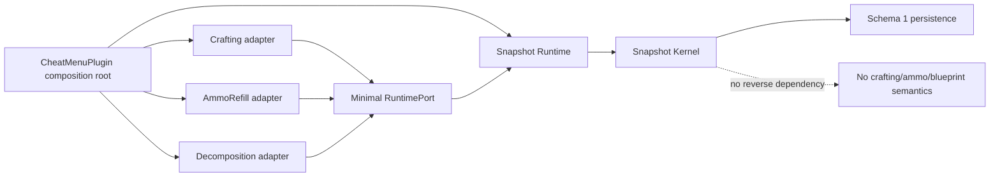

# Infinite Storage Snapshot Kernel living reference

> Breaking change and deployment gate — 2026-09-03
>
> The previous Infinite Storage implementation was never released. Its schema 1/2/3 documents, semantics revisions, migration/provenance records, `LegacyAmbiguousEntries`, and offline Claim tooling are retired. The new runtime does not inspect, claim, migrate, move, delete, or rewrite those files.
>
> The replacement uses a new Snapshot schema 1 and a different versioned path. A missing new file means an empty warehouse.
>
> This document describes source and automated Smoke evidence. It is not deployment evidence or real-game acceptance. During this implementation task the game has not been started, the deployed DLL has not been replaced, and no real legacy file has been claimed or modified.

## Current status

The active `1.995.0` source implementation is the Snapshot Kernel. Automated source gates have passed at the current source-checkpoint working point; independent review and real-game acceptance are still separate milestones.

| Layer | Current meaning |
| --- | --- |
| Source | Snapshot model, schema 1 persistence, identity/session state machine, Runtime integration, UI hierarchy, and three internal adapters exist in the working tree. |
| Targeted Smoke | Kernel, persistence, identity/session, Crafting, AmmoRefill, Decomposition, registry, AutoPickup, UI, and single-DLL integration slices pass. |
| Full repository | Solution Release is 0 warnings / 0 errors. All 26 recursively discovered Smoke projects were individually built and then run with `--no-build`: 26/26 PASS. |
| API inventory | Two consecutive generations produced 1,586 rows and identical SHA-256 `09DEFAB1A2640AC68A1E47050E14936B878C46FBFB23BDFAAD9A116F08A3D020`. |
| Product artifact | One `1.995.0.0` main DLL, 1,115,648 bytes, SHA-256 `0B5D302469CFA8779CF1F43D4D58723CD73EF7F6C77E5998D481834201393FA7`. |
| Deployment | Not performed for this source checkpoint; the installed DLL and loader state were not re-verified. |
| Real game | Not started and not accepted. |

The safe release statement is: the current source fixed point may be released only after the full gates in this document pass and the independent Standards/Spec review reports no actionable P0/P1/P2 findings. This is not a zero-bug guarantee.

## Architecture

The product still has one csproj, one product DLL, one BepInEx entry point, and one plugin GUID. Crafting, AmmoRefill, and Decomposition are internal modules in that DLL, not companion plugins.



The dependency rule is strict:

- `InfiniteStorage/SnapshotKernel/` contains no reference to any adapter namespace or Unturned blueprint/ammo interpretation.
- `InfiniteStorage/Runtime/` maps native `Item` and identity APIs to the pure Snapshot model.
- `InfiniteStorage/Adapters/Crafting/`, `AmmoRefill/`, and `Decomposition/` interpret their own domain semantics through `ISnapshotStorageRuntimePort`.
- `SnapshotModuleRegistry` contains module failures and exposes only enabled UI actions.
- Disabling or omitting any adapter does not disable Core Store, Withdraw, AutoPickup, Snapshot UI, or persistence.

## Storage model

### ItemGroup

`ItemGroup` is the user-visible item class:

- `AssetId` is the primary group identity.
- `AssetGuid` is the integrity guard.
- Display name, icon, maximum amount, and other presentation metadata are resolved at runtime with `Assets.find(EAssetType.ITEM, id)`.
- Runtime metadata is not authoritative persistence data.
- If the asset is missing, or the runtime ID resolves to a different GUID, the group and all buckets remain visible and persisted but withdrawal is disabled.
- Groups with different IDs never merge. A same-ID GUID conflict is rejected.

### ItemSnapshot

An `ItemSnapshot` is the exact native payload:

```text
{ ushort id, byte amount, byte quality, byte[] state }
```

Rules:

- `amount` is opaque Core data. It is never converted to a resource count by the Kernel.
- `quality` is always persisted and included in bucket equality, even when the native UI hides quality.
- `state` is always deep-copied and compared byte-for-byte, except for the one proven Farm timestamp canonicalizer below.
- Unknown and Workshop assets use the same exact fallback. There are no ID/name whitelists.

### SnapshotBucket

A bucket contains one normalized `ItemSnapshot` and `Count: long`.

- `Count` is the number of identical item instances.
- `amount 10 (x3)` means three native snapshots whose own amount field is 10.
- A UI may additionally show `total 30`, but this is presentation metadata only.
- `Count` arithmetic is checked. Overflow fails without mutation.
- Hash equality is only an index hint; the full amount/quality/state fields must match before merge.

### DefaultTemplate

The Runtime creates a full native item with `new Item(asset, EItemOrigin.ADMIN)` and registers its normalized snapshot as `DefaultTemplate`.

- It is runtime-only metadata for the group header, sorting, and the “default full state” marker.
- It is not serialized.
- It never contributes to `Count`.
- If no real matching bucket exists, it cannot be withdrawn.
- A real bucket equal to the template sorts first without changing stock.

## Snapshot key version 1

Inside an ItemGroup, the canonical key encoding is little-endian and length-prefixed:

```text
uint16 encodingVersion = 1
int32 amountLength = 1
byte amount
int32 qualityLength = 1
byte quality
int32 stateLength
byte[stateLength] state
```

SHA-256 of these bytes is the index key. The Kernel then performs full snapshot equality before merging, so a hash collision cannot merge different payloads.

All input arrays, returned arrays, checkpoint data, persistence documents, and withdrawal payloads are deep copies.

## Farm timestamp canonicalization

The only built-in Core canonicalizer handles the native Farm placement timestamp. It activates only when all facts are true:

1. runtime asset is an `ItemBarricadeAsset` whose `build == EBuild.FARM`;
2. `asset.MaxAmount == 1`;
3. `item.amount == 1`;
4. `item.state` is exactly four bytes.

Only those four timestamp bytes normalize to a structurally valid four-byte canonical state. `amount` and `quality` remain exact.

Malformed state lengths, amount other than 1, capacity other than 1, non-Farm assets, and Workshop-shaped nonstandard Farm configurations use exact state bytes. Persistence never accepts a null Farm shortcut because schema 1 has no Farm policy field: it stores only the resulting snapshot bytes.

## Persistence schema 1

New documents have exactly these authoritative fields:

```json
{
  "SchemaVersion": 1,
  "WorldKey": "snapshot-storage-identity-v1|...",
  "PlayerKey": "snapshot-storage-identity-v1|...",
  "UpdatedUtc": "2026-09-03T00:00:00.0000000Z",
  "Groups": [
    {
      "AssetId": 17,
      "AssetGuid": "00000000-0000-0000-0000-000000000000",
      "Buckets": [
        {
          "Amount": 30,
          "Quality": 87,
          "State": "AAECAwQ=",
          "Count": 3
        }
      ]
    }
  ]
}
```

`State` is Base64. The example GUID is illustrative; an actual stored GUID must be non-empty.

The raw `JObject` validator requires all root/group/bucket fields, exact field types, unique `AssetId` groups, non-empty GUIDs, non-null state, and positive counts. Duplicate JSON properties, JSON comments, missing required fields, unknown root fields, wrong schema versions, malformed Base64, and invalid counts fail closed. There is no migration branch.

The new path is:

```text
<BepInEx config>/UnturnedSingleplayerCheatMenu/InfiniteStorageSnapshots/v1/
  <SHA256(WorldKey) first 24 hex>/<SHA256(PlayerKey) first 24 hex>/snapshot.json
```

Each directory segment is a 96-bit SHA-256 prefix so all transactional sidecar names remain below Unity Mono's 260-character path ceiling at the supported install path. The full `WorldKey` and `PlayerKey` remain mandatory inside `snapshot.json`; a prefix collision or copied document fails the exact identity check rather than merging identities. The Runtime never probes the retired `.../InfiniteStorage/...` tree.

### Atomic save and backup behavior

- A first save writes a unique temporary file, flushes it to disk, reparses it, verifies SHA-256, and atomically moves it into place.
- Every save with an existing primary passes a unique `snapshot.json.pre-replace-<GUID>.bak` path to the same atomic `File.Replace` call. That file therefore captures the primary that existed at the replacement instant, including an external primary C written after the last optimistic check.
- On a clean ordinary save, that transaction backup is promoted to stable `.bak`; the prior stable backup is atomically retained as the bounded `.bak.previous` generation. Repeated saves replace `.bak.previous` rather than creating an unbounded success-history.
- If load fell back from a damaged primary to a valid `.bak`, the stable good `.bak` remains untouched. The atomic transaction backup retains the replaced damaged/instant primary at its unique recovery path.
- A successful load binds primary and backup existence/SHA as the session's expected file version. Changes observed before replacement fail with drift and are not overwritten. A change in the final check-to-Replace window can be replaced, but its exact bytes are captured by the transaction backup; a SHA mismatch then fails closed as `primary-changed-at-replace` and reports the recovery path.
- `Load` checks the persistent reconciliation marker at entry and before accepting its file-version baseline. `Save` checks before and after replacement and again before reporting success. A post-replace marker or output drift is a committed/uncertain failure, not success.
- `SnapshotSaveResult.MayHaveCommitted` distinguishes a failure that is proven to precede replacement from a failure after Move/Replace may have changed durable state. Replacement exceptions, post-replace verification failures, and replacement conflicts are conservative `true`; only an explicit rejection with unchanged primary/backup is proven uncommitted.
- Before replacement, Save persists the exact candidate bytes B at one unique `snapshot.json.candidate-recovery-<GUID>.json`, flushes them, and verifies SHA-256. If that preparation fails, replacement never starts and the verified `.write-*.tmp` is reported instead. A failed/uncertain replacement retains the unique candidate path.
- Fixed candidate history is considered for rotation only after a pre-promotion reconciliation-marker and primary-output verification succeeds. A clean commit atomically promotes B to `.candidate.latest` and retains `.candidate.previous`, bounded to two generations. Marker/output failure detected before promotion leaves the previous S1/S0 bytes unchanged.
- The candidate-history fault/concurrency window is followed by a second S1/S0 existence-and-SHA check before promotion. A change visible to that check is reported as `candidate-history-drift`, remains at its original fixed path byte-identically, and leaves B at its unique candidate path.
- A separate deterministic gate covers the remaining final-check-to-Replace window. B replaces `.candidate.latest` with a unique transaction backup that captures the replacement-instant latest bytes. The expected S1 then replaces `.candidate.previous` with another unique transaction backup that captures its replacement-instant bytes. If either captured SHA differs from the checked S1/S0, Save fails as `candidate-history-drift`; B is reported by `CandidateRecoveryPath` and exact external C is reported by `CandidateHistoryRecoveryPath` and reconciliation reason. In this atomic-displacement case C is preserved at the reported recovery copy, while the original fixed path may now hold B or S1; the contract is exact-byte recovery, not same-path retention. On a clean match, the product-owned duplicate of expected S0 is discarded and fixed successful history remains bounded to `.candidate.latest/.candidate.previous`.
- Clean removal of that expected-S0 duplicate is identity-bound on Windows: the first extended-length `CreateFileW` opens the target with read and delete access while sharing only reads; SHA is computed from that same handle and the deterministic concurrency hook runs while replacement is denied. A second read-only `CreateFileW` using the same extended drive/UNC normalization verifies the current path mapping while sharing delete with the locked first handle. Both `SafeFileHandle` instances are owned outside FileStream construction, so constructor or operation exceptions still close them. `SetFileInformationByHandle(FileDispositionInfo)` then marks the first exact identity for deletion using the native one-byte `BOOLEAN` layout. There is no path-based `File.Delete`. `GetLastWin32Error` is cached immediately after any failed native call and included in the error code. If an external Replace is attempted while locked it is rejected and its source C remains intact; if a platform lacks this primitive, either handle open/mark API fails or throws, or identity/path verification changes, Save fails closed and retains the history recovery path.
- Promotion and history verification are followed by another marker and primary SHA check before `Success`. A silent primary C or marker appearing during/after promotion returns `MayHaveCommitted=true`, prevents native compensation, and identifies B at the still-unique candidate or `.candidate.latest`; if promotion completed, the former S1 is in `.candidate.previous`. History drift or promotion exception likewise cannot be reported as success. The successful recovery path is resolved before this final hook/check block; once the marker and primary SHA pass, only in-memory expected-state assignment and result construction remain—there is no later filesystem call or fault callback before return.
- `RecoveryBackupPath` identifies replacement-instant primary A/C, `CandidateRecoveryPath` identifies candidate B, and `CandidateHistoryRecoveryPath` identifies replacement-instant candidate-history C. All applicable paths propagate through persistence, transaction, StoreAll/Withdraw reconciliation reason, and Crafting checkpoint diagnostics. Late-race content and the attempted committed candidate therefore remain separately recoverable; this is not a claim that every external write can avoid being atomically displaced from its original path.
- A failed save does not delete any temporary path that has become visible to the filesystem. The flushed unique `.write-*.tmp` candidate is retained as a forensic artifact; a successful Move/Replace consumes its own temporary file. The only clean-success history cleanup marks the already verified expected-S0 duplicate through its locked identity handle as described above.

## Identity and failure latching

The stable singleplayer identity includes:

- native `Provider.serverID == "Singleplayer_" + Characters.selected`;
- level name and native Sync/Worlds root;
- Steam ID;
- native character ID;
- selected character slot.

The current Assembly-CSharp ABI exposes five valid slots, 0 through 4. Non-singleplayer IDs, invalid slots, and disagreement between `SteamPlayerID.characterID` and `Characters.selected` fail closed.

The same account and map in slot 0 and slot 1 resolve to different storage paths. The same complete identity is stable across repeated resolution.

An ordinary activation/load/save failure latches that complete identity. Later frame pumps do not retry I/O or create repeated backups. That attempt latch clears after identity change, disable/re-enable, or an explicit lifecycle reset; reconciliation latches follow the stricter rule below.

Any cross-boundary failure whose storage/native state cannot be proven consistent creates `snapshot.json.reconciliation-required`: native StoreAll/Withdraw restore failure or throw, storage rollback failure, Crafting storage/native rollback failure, and the AutoPickup double-failure path. Marker creation happens only after the in-memory mutation gate closes. A marker-write failure is reported separately and the current process remains locked by storage path; a later process can only enforce the incident if the marker was successfully flushed.

A later runtime instance refuses to load an identity whose marker exists, and AutoPickup globally blocks both its storage and native pickup callbacks even after scheduler/feature recreation or when Snapshot storage is disabled. Once observed—or when marker persistence is attempted after an inconsistency—the exact path enters a static process-wide latch shared by all Runtime instances. Pump checks it before activation, so Runtime destruction/recreation, disable/re-enable, and identity round-trips cannot reopen it. There is no production clear API. Inspect the primary, `.bak`, `.bak.previous`, reported pre-replace recovery path, retained temporary candidates, and any quarantined world-drop incident before manually clearing the disk marker and restarting the process.

## Store and withdraw transactions

Core mutations are all-or-nothing with persistence:

- Store stages one exact snapshot instance, persists schema 1, and rolls memory back if persistence fails.
- Withdraw adds only the selected exact bucket payload to the native inventory, removes the number of successfully added instances, and persists once.
- Native inventory is restored only when persistence is explicitly proven not to have committed **and** the Kernel checkpoint rollback succeeds.
- Native StoreAll/Withdraw rollback runs only when the storage transaction reports `RollbackSucceeded=true`. `MayHaveCommitted=true`, a null result, a throwing persistence delegate, a missing/failed checkpoint restore, or any other uncertain durable outcome leaves the current native state untouched and locked for manual reconciliation rather than risking duplication or loss.
- A native checkpoint includes equipped selection, all seven clothing slots, quick-slot pages 0 and 1, and carried pages 2 through 6. Rollback dequips, clears every page, restores clothing through the current `ReceiveWear*` loopback handlers, clears again, restores exact items/coordinates, and restores the previous selection. It never calls `askWear*`, whose native implementation returns replaced clothing through `forceAddItem` and can drop it into the world.
- If any native rollback stage cannot complete or throws, mutation is closed, persistent reconciliation is attempted, and marker failure remains visible in the result/log rather than reopening mutation.
- AutoPickup uses the same `StoreCandidate` and `RollbackCandidate` path. A plain storage rejection may use its single native fallback only after rechecking the reconciliation gate. If the failed store itself creates a latch, that same call returns reconciliation-blocked and never invokes native pickup. Once storage succeeds, that attempt never falls through to native pickup.
- Native pickup confirmation captures composite before/after evidence over carried `ItemJar` instances: matching-asset jar count, total native `amount`, and exact candidate-snapshot jar count. An explicit `PickedUp` is accepted and an explicit `Requested` enters pending confirmation. For every other result, a still-current drop after a sent request suppresses Snapshot fallback and automatic retry **before** evidence growth is considered. For a stale drop, an increase in any evidence component proves native delivery, including a legal `amount=0` item whose jar count increases while total amount remains zero; only a stale drop with no increase in any component may fall back once to Snapshot storage.
- Pending confirmation delegates to that same post-state policy. A stale pending drop with evidence growth completes as native delivery; a stale pending drop with no growth attempts Snapshot recovery exactly once and clears pending state. A current drop at timeout, with or without evidence growth, performs zero storage writes, clears pending state, and remains suppressed by instance ID until the scheduler lifecycle resets. The AutoPickup settings UI reads only the structured localized state; raw `LastFailure` enum/detail composites have no UI consumer.
- The final-attempt boundary normalizes any non-final native result whose stale-drop evidence proves delivery to `PickedUp` before accounting. `RecordAttempt` therefore increments picked-up once, records no failure or pending entry, and clears prior backoff while preserving before/after evidence and `RequestSent`. A non-empty native `Detail` remains an exact UTF-8 prefix and receives a localized “composite evidence confirmed delivery” suffix; an empty detail becomes that structured localized explanation without a leading separator. That suffix rule runs before every older dynamic localization pattern, so even a diagnostic prefix which independently matches another rule is preserved verbatim and only the fixed suffix is translated. Literal `$1`, backslashes, internal full-width semicolons, and CRLF in the captured prefix are data rather than replacement syntax and remain byte-identical. Re-normalizing an already final `PickedUp` does not append again.
- Native and Snapshot callbacks are captured as explicit initialized outcomes. A false/throwing Snapshot recovery after an unconfirmed native attempt returns `UnknownFailure`, preserves the native `RequestSent` flag, and reports the bilingual structured detail “native delivery unconfirmed + Snapshot recovery failed”; it is never rewritten as capacity failure. A throwing/default native callback becomes an explicit suppressed `UnknownFailure` and cannot fall through to Storage. `RejectedByCapacity` is reserved for the no-attempt case where native capacity is genuinely unavailable. The recorder independently converts a raw default struct to failure so enum zero can never masquerade as `Requested`.
- If world-drop removal and Snapshot compensation both fail, storage remains authoritative, Core is latched closed, the unresolved world object is hidden for the session when possible, its scheduler ID is suppressed until reset, and the persistent reconciliation marker blocks reload. The attempt is reported as reconciliation-required, never as stored/picked up.
- “Store all carried” stores pages 2 through 6, while its failure checkpoint also covers pages 0/1, clothing, and equipment selection so native rollback is complete.

## Internal adapters

These are modules in the main DLL, not BepInEx plugins.

| Config key | Module | Semantic responsibility |
| --- | --- | --- |
| `InfiniteStorage.CraftingAdapterEnabled` | Crafting | Native `TotalItems` counts bucket instances. Native `TotalAmount` interprets amount only inside the adapter and can create an exact residual snapshot. |
| `InfiniteStorage.AmmoRefillAdapterEnabled` | AmmoRefill | Reads the native FillTargetItem compatibility graph and explicit Source/Target roles. Redistributes amount as rounds while preserving quality/state and total rounds. |
| `InfiniteStorage.DecompositionAdapterEnabled` | Decomposition | Reads supported native salvage blueprints, scope, output origin/count, TransferState, and gun attachment/firemode rules. |

All three default to enabled to preserve existing feature availability. They register independently through the composition root. There are no additional csproj files, product DLLs, plugin GUIDs, or dynamic loaders.

### Crafting

- Snapshot synthetic items are supply-only. The private U3 search is classified explicitly by comparing its `inputStatus` object with `status.targetStatus`; target searches never receive synthetic page-255 results, and reflection/ABI failure is treated as Target (fail-closed).
- Supply search removes the exact non-null `ItemToIgnore` `ItemJar` by reference identity before adding or counting Snapshot results. FillTargetItem and RepairTargetItem therefore require a real native target; a target existing only in Snapshot storage cannot make the blueprint craftable or consume same-asset materials.
- Synthetic search items mirror native `IncludeEmpty`, `ExcludeFullAmount`, `IncludeMaxQuality`, counting, and prioritization fields.
- Search expansion is bounded by the blueprint requirement rather than the warehouse’s potentially huge `Count`.
- `Delete` removes one exact snapshot instance.
- `DeleteAmount` is the only crafting path that may reinterpret amount and create a residual amount snapshot; quality/state are retained.
- Crafted output first uses native inventory. If full, the output is stored as one exact Snapshot.
- A native crafting exception restores the Snapshot checkpoint to persistence before restoring native inventory. If storage rollback fails, native restoration is skipped, memory returns to the last successfully persisted Snapshot state, mutation latches closed, and persistent reconciliation is recorded; this prevents duplicate materials or outputs.
- Native additions produced by rollback run inside a tested ThreadStatic rollback scope and bypass the crafting-output interceptor. The scope always resets, including exceptional exits.

### AmmoRefill

- Source-only, target-only, and both roles remain distinct.
- A target is not reclassified as source-only merely because it is also an `ItemSupplyAsset`.
- Capacity, compatibility, GUID, amount, quality, and state are checked by the adapter. Every participating Source, Target, or combined role must satisfy `amount <= capacity` before planning; an over-capacity candidate causes no Kernel mutation and no persistence call.
- The planner freezes donor budgets, preserves total rounds, and rewrites only affected exact buckets.
- Snapshot Core never knows that amount represents ammunition.

### Decomposition

- Scope is single instance, selected bucket, or all buckets in the ItemGroup.
- Only supported one-item native salvage recipes are used.
- Blueprint output instance count is checked for overflow.
- TransferState preserves source amount/quality/state per bucket, with native gun-specific attachment/firemode transformation inside this adapter.
- Persistence failure restores every input and removes every staged output.

## Snapshot UI

The storage page renders two levels:

1. ItemGroup header: runtime name/icon when resolved, ID, GUID, total snapshot instance count, and bucket count.
2. Expanded SnapshotBucket rows: opaque amount, optional native quality display, state fingerprint, `(xN)`, optional `amount × Count` metadata, and the default-template marker. Product-owned unresolved/conflicting fallback titles are localized before the shared card renderer; successfully resolved native/Workshop asset names remain byte-for-byte untouched.

Different amount, quality, or state values always occupy different rows. Withdrawal targets the complete group identity and exact snapshot, not a hash or display name. Missing/conflicting assets remain visible but their withdrawal controls are disabled.

Enabled global module actions appear in the top action row. Enabled bucket actions appear on applicable bucket rows. A missing, disabled, or throwing module does not remove Core controls.

## Retired implementation recovery

The 16 retired product source files were removed from the product tree. Because five had been untracked, a recovery bundle was created after the backup gate arrived:

```text
backups/20260903-010259-pre-snapshot-kernel-prune/
```

`RECOVERY_MANIFEST.tsv` lists every original path, the fixed PDB source SHA, and recovery level. All five formerly untracked files plus one tracked file were recovered byte-exact from session output. The remaining fixed semantics are preserved by the archived product DLL/PDB and ILSpy project; tracked HEAD text is retained as a formatting base. This backup directory is not referenced by the product or solution.

### Responsibility and LOC ledger

The count below uses physical C# lines with `bin/` and `obj/` excluded. Dedicated files are counted in full; shared composition/UI/test files are not fractionally attributed.

| Area | C# files | Physical lines | Responsibility |
| --- | ---: | ---: | --- |
| `InfiniteStorage/SnapshotKernel/` | 9 | 2,057 | Exact model/key/kernel, schema codec and persistence, transaction/session, identity and reconciliation policies, presentation metadata |
| `InfiniteStorage/Runtime/` | 4 | 838 | Unturned identity/asset adapter, inventory and clothing checkpoint bridge, native/storage recovery coordination |
| `InfiniteStorage/Composition/` | 1 | 119 | Same-DLL internal-module registry and action isolation |
| `InfiniteStorage/Adapters/Crafting/` | 4 | 713 | Blueprint counting, target/supply search separation, synthetic inventory bridge, storage-first abort and Harmony integration |
| `InfiniteStorage/Adapters/AmmoRefill/` | 2 | 294 | Ammo-role/compatibility interpretation and exact-bucket redistribution |
| `InfiniteStorage/Adapters/Decomposition/` | 2 | 347 | Native salvage recipe interpretation and three decomposition scopes |
| **Infinite Storage product area total** | **22** | **4,368** | Sum of the six rows above |
| Dedicated `CheatMenuOverlayUi.InfiniteStorageView.cs` | 1 | 327 | ItemGroup/SnapshotBucket UI; outside the product-area directory total |
| Six dedicated `Snapshot*Smoke` programs | 6 | 3,086 | Kernel, Runtime integration, registry, Crafting, AmmoRefill, Decomposition |
| Shared `AutoPickupSmoke/Program.cs` | 1 | 1,004 | Whole-file count shown separately because only part of this existing suite is Snapshot integration |

The former Infinite Storage product area was 3,916 lines; the new area is 4,368 (net +452). The complete product changed from 43,047 to 44,000 lines (net +953). This is **not** a LOC reduction. The simplification is conceptual and dependency-oriented: one exact Snapshot storage model, no migration/claim state machine, and one-way adapter boundaries. The safety coordinators, atomic persistence gates, A/B/C forensic conservation, reconciliation states, native rollback bridge, target-safe Crafting integration, three internal adapters, UI, and behavioral tests make the complete implementation larger than the former code.

Retirement/dependency proof at this fixed point is layered:

- source and solution search for `VirtualStorage`, `LegacyAmbiguous`, `MigrationRecord`, provenance, and Infinite Storage Claim runtime names returns zero product hits;
- product-DLL metadata/string search for the retired runtime names returns zero hits, and `SnapshotRuntimeIntegrationSmoke` also loads the built assembly and asserts the retired types are absent;
- the 23-path retirement manifest includes the old migration/Claim sources, project, Smoke, and PowerShell wrapper, and verifies none has reappeared in the product/solution;
- searching all nine `SnapshotKernel/` source files for adapter namespaces or `SDG.Unturned` returns zero hits. Native APIs exist only in Runtime/adapters, so Core does not depend upward on Crafting, AmmoRefill, Decomposition, or Unturned.

The old InfiniteStorage Smoke, Claim CLI project, and Claim PowerShell wrapper are also retired from the solution because the new runtime has no claim or migration workflow.

## Verification commands

Run source/build and Smoke gates without starting Unturned:

```powershell
dotnet build .\UnturnedSingleplayerCheatMenu.slnx -c Release

$projects = Get-ChildItem -LiteralPath .\tests -Recurse -Filter '*Smoke.csproj' |
  Sort-Object FullName
foreach ($project in $projects) {
  dotnet build $project.FullName -c Release
  if ($LASTEXITCODE -ne 0) { throw "Build failed: $($project.FullName)" }
  dotnet run --project $project.FullName -c Release --no-build
  if ($LASTEXITCODE -ne 0) { throw "Smoke failed: $($project.FullName)" }
}

git diff --check
```

The API inventory script must be run twice and produce the same inventory hash. Product Release output must be 0 warnings / 0 errors.

`SnapshotKernelSmoke` provides the executable failure-injection evidence for: pre/post-Replace drift, pre-replacement candidate-write failure, loaded-from-backup final-window primary C, separate recovery A/C and candidate B paths/hashes, bounded `.bak/.bak.previous` and `.candidate.latest/.candidate.previous` rotation, pre-promotion failure preserving S1/S0, silent primary/marker changes during or after promotion, candidate-history drift before/inside promotion and in the final check-to-Replace window for both latest and previous, replacement-instant C recovery plus result/reason propagation, identity-bound clean history deletion on an actual >260-character Windows drive path, drive/UNC prefix normalization, a competing external Replace rejected while the handle is held, one-byte disposition ABI, a real ownsHandle DELETE/share-read kernel handle whose injected FileStream-constructor failure is followed by successful Replace/write+delete-share reopen/Delete on the same path, real CreateFile failure/LastError ordering, second-handle open failure, injected native mark failure with Win32 error, injected exception, unsupported-platform fail-closed retention, promotion failure, a success-tail gate with no post-verification filesystem/callback work, null/throwing/mutating-false persistence results, transaction rollback certainty, marker-write failure, and process-wide path latching. Its StoreAll and Withdraw A/B/C scenarios inject legal C during candidate promotion, use one unique exact snapshot X, prove `candidate B + frozen native == 1`, persist recovery paths in reconciliation reason, and prove restart blocks Load and native compensation. `SnapshotAmmoRefillAdapterSmoke` covers over-capacity Source/Target/combined rejection with unchanged Core fingerprint and zero persistence. `AutoPickupSmoke` and `SnapshotCraftingAdapterSmoke` cover same-call fallback, target-versus-supply search, `ItemToIgnore`, storage-first rollback, and Crafting propagation of primary/candidate/history recovery evidence. These are automated tests, not observations from a running game.

`AutoPickupSmoke`, `LocalizationSmoke`, and `SnapshotRuntimeIntegrationSmoke` also lock the final diagnostic-detail boundary: append-once normalization, single-line collision with an older dynamic translation, multiline suffix hit/non-hit behavior, empty-detail output, and the compiled Runtime call path. A combined adversarial prefix contains literal `$1`, backslashes, an internal full-width semicolon, and CRLF; both the source-linked localization test and compiled-product reflection test require its UTF-8 bytes to remain exact, the English suffix to occur once, and the Chinese suffix to be absent.

Before and after all verification, separately check:

- Unturned process count is zero;
- deployed plugin DLL hash is unchanged;
- all four retired live JSON/.bak hashes are unchanged;
- no new Snapshot file was written under the real BepInEx config tree by tests;
- all test fixtures used temporary directories only.

## First deployment and real-game acceptance

Do not treat build or Smoke as permission to deploy. Before the first deployment:

1. Keep Unturned stopped.
2. Record SHA-256 for the deployed DLL and all retired InfiniteStorage JSON/.bak files.
3. Back up the deployed DLL and config directory to a new timestamped location.
4. Confirm the new product contains one BepInPlugin entry and no retired VirtualStorage/Claim types.
5. Confirm the new versioned Snapshot path does not yet exist, or back it up if this is a later test.
6. Copy the reviewed product DLL, then verify its SHA-256 and that exactly one active copy exists.
7. Start a disposable singleplayer world/character slot first.

Required in-game checks:

- empty first load does not read or alter old files;
- Store/Withdraw round-trip for ordinary, hidden-quality attachment, gun, magazine/ammo container, empty state, non-empty state, malformed Workshop-shaped Farm, and proven four-byte Farm;
- same snapshot merge and amount/quality/state difference split;
- default bucket marker and no template-generated stock;
- missing/GUID-conflicting asset remains visible and cannot withdraw;
- normal and full-inventory StoreAll/Withdraw behavior has no visible duplication or loss, and any intentionally induced reconciliation state disables further mutation across disable/re-enable and character-slot round-trips;
- AutoPickup priority success, native fallback, full-inventory behavior, and no repeated pickup of an item already accepted by Snapshot storage;
- Crafting adapter enabled/disabled, TotalItems, TotalAmount residual, full-inventory output, and a deliberately induced native crafting exception returning the player to a stable locked or restored state;
- Ammo source-only/target-only/both, over-capacity rejection for every role, and round conservation;
- Decomposition three scopes, TransferState, and persistence rollback;
- character slots 0 and 1 remain isolated;
- restart/reload preserves every bucket and count;
- disabling each adapter leaves Core Store/Withdraw/AutoPickup/UI/persistence operational.

Only those observations constitute real-game acceptance.
