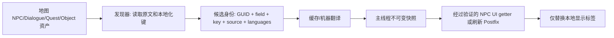

# 地图 NPC 对话与交互界面汉化实施方案

> 文档性质：技术调研与实施设计。本文不代表功能已经实现或经过游戏内验证。
>
> 更新日期：2026-08-26
>
> 目标：让地图 NPC 的对话页、对话选项按钮、NPC 显示名及其关联任务/交互提示能够显示中文，同时不改变任务、商店或多人游戏的原生行为。

## 1. 结论

可以汉化，且 Unturned 对地图 NPC 的核心文本已有原生资产本地化机制：

- 对话正文使用 `Message_#_Page_#`。
- 对话选项按钮使用 `Response_#`。
- NPC 交互时显示的角色名使用 `Character`。
- 任务名称和描述使用 `Name`、`Description`。
- 特定对象还能本地化交互提示 `Interact` 与对话显示名覆盖 `Dialogue_Name`。

因此应采用两层方案：

1. **地图作者或可维护地图内容时，优先补充中文语言 `.dat` 文件。** 这是引擎支持的路径，能随原生界面重新打开、翻页和重建而持续生效。
2. **无法改写 Workshop 地图文件时，扩展现有 BepInEx 的运行时翻译管线。** 该路径仅替换本地显示文本，不修改 NPC 选项请求、任务状态、商店库存或服务器权威逻辑；在实现前必须针对当前 `Assembly-CSharp.dll` 验证精确的资产类型和 UI 刷新入口。

当前插件**尚不支持 NPC 对话、NPC 名称、任务、商店或世界交互提示**。现有 Workshop 翻译只覆盖物品名、物品描述、载具名、物品 Action 按钮文字及其 Tooltip。

## 2. 范围与非目标

### 范围

| 表面 | 原生本地化键/来源 | 首期目标 |
| --- | --- | --- |
| NPC 对话正文 | `Dialogue` 资产的 `Message_#_Page_#` | 是 |
| 对话响应按钮 | `Dialogue` 资产的 `Response_#` | 是 |
| NPC 交互角色名 | NPC 资产 `Character` | 是 |
| 任务标题/描述 | Quest 资产 `Name`、`Description` | 第二阶段 |
| 对象显示名 | Object 资产 `Name` | 第二阶段 |
| 对象交互提示 | Object 资产 `Interact` | 第二阶段 |
| 对话角色名覆盖 | Object 资产 `Dialogue_Name` | 第二阶段 |
| 奖励名/提示 | Reward `Reward_#` 及各类提示 | 第三阶段 |
| NPC 商店界面 | Vendor 名称/描述、买卖描述及关联资产 | 第三阶段，先做实测发现 |

### 非目标

- 不翻译玩家输入、服务器公告或其他玩家发送的聊天文本。
- 不修改对话响应选择、任务条件、奖励结算、商店价格、库存或网络请求。
- 不承诺所有第三方地图都可在不做运行时逆向验证的情况下即时覆盖。
- 不把“编译成功”或“扫描到资产”作为游戏内汉化完成的证据。

## 3. 已核实的现状

### 3.1 当前插件能力边界

`WorkshopLocalizationScanner` 只扫描 `ItemAsset`、`VehicleAsset` 与物品 `SDG.Unturned.Action`。`WorkshopLocalizationSnapshot` 和 `WorkshopLocalizationPatch` 也只维护、替换下列五类字段：

| 当前字段 | 现有作用 |
| --- | --- |
| `ItemName` | 物品名 |
| `ItemDescription` | 物品描述 |
| `VehicleName` | 载具名 |
| `ActionText` | 物品 Action 按钮文字 |
| `ActionTooltip` | 物品 Action 提示 |

补丁已注册的 getter/UI 路径为 `ItemAsset`、`VehicleAsset`、`SDG.Unturned.Action` 和背包刷新路径；不存在 NPC、Quest、Dialogue、Vendor 或 NPC UI 的 Hook。插件自身的 `PluginLocalization` 是插件 UI 的中英文词典，不是游戏 NPC 文本翻译层。

现有服务仍可复用以下基础能力：候选收集、译文缓存、后台机器翻译、富文本保护、主线程快照发布、翻译来源追踪和原生译文保留判断。

### 3.2 官方资产本地化事实

Unturned Stable 文档说明：每个资产会在资产同目录中按当前语言查找 `.dat` 本地化文件。NPC 资产指向其 `Dialogue` 资产；对话资产的页文本和响应文本都有固定键名。

NPC 本地化还允许以下格式标记，翻译过程必须逐字保留：

```text
<color=...>
<name_npc>
<name_char>
<br>
<pause>
```

现有 `WorkshopRichTextProtector` 已保护所有尖括号标签、换行、URL、GUID、数字等文本片段；为 NPC 启用前仍应补充针对上述五类标记的单元测试，确认机器翻译响应缺标记、重复标记或改写标记时会被拒绝而非写入缓存。

### 3.3 当前程序集的有限证据

本仓库引用的本地游戏程序集内已确认存在以下类型名称：

```text
SDG.Unturned.DialogueElement
SDG.Unturned.DialogueMessage
SDG.Unturned.DialoguePage
SDG.Unturned.DialogueResponse
SDG.Unturned.IDialogueTarget
SDG.Unturned.PlayerNPCVendorUI
SDG.Unturned.SleekVendor
SDG.Unturned.PlayerQuest
SDG.Unturned.Localization
SDG.Unturned.NPCEventManager
```

字符串元数据还显示了 `PlayerNPCDialogueUI`、`FindDialogueAsset`、`ReceiveChooseDialogueResponseRequest_Read`、`SendOpenVendor`、`ReceiveOpenVendor` 等名称。这说明目标运行时区域存在，但**尚未验证成员签名、调用时机或文本最终写入的标签字段**。此前对该程序集进行广泛 PowerShell 反射枚举曾导致 `StackOverflowException`；后续应使用非执行式元数据读取器或受控反编译，不能重复该枚举方式。

## 4. 推荐架构

### A. 原生语言文件覆盖：地图内容可维护时的首选

为目标资产同目录创建或维护中文 `.dat` 文件，并写入原生键值。示意：

```ini
// Dialogue asset Chinese localization
Message_0_Page_0 你好，<name_char>。<br>需要什么帮助？
Response_0 我想看看任务。
Response_1 再见。

// NPC asset Chinese localization
Name 港口补给官
Character 补给官艾琳

// Quest asset Chinese localization
Name 收集医疗物资
Description 前往旧诊所，带回三份医疗物资。
```

优势：

- 使用官方支持的资产加载与语言选择流程。
- 原生对话翻页、响应按钮、任务预览重建后仍会取到对应语言文本。
- 能自然保留 NPC 特有替换标记和富文本解释。
- 不需要对私有 UI 字段做脆弱反射，也不需要全局替换 `ISleekLabel.Text`。

限制：

- 需要有权维护地图或在本地可接受地维护其内容覆盖；不能把修改后的内容误当作原 Workshop 原件发布。
- 已被游戏加载/缓存的资产可能需要重新进入地图或重启游戏后才会重新解析语言文件。
- 某些多人同步提示依赖服务端资产的本地化保留设置，见第 8 节。

### B. BepInEx 运行时显示替换：不修改 Workshop 文件的补充

在现有 `WorkshopLocalizationService` 旁新增明确的 NPC 本地化域，例如 `NpcLocalizationService`，或在保持缓存格式兼容的前提下新增一组不含歧义的 `WorkshopTextField` 值。不要把 NPC 文本伪装成 `ActionText`，也不要让旧缓存键与新领域冲突。

建议的数据流：



运行时方案必须满足：

- 扫描范围只限官方和 Workshop 资产，沿用 `AssetCatalog` 的来源过滤原则。
- 缓存身份至少包含源语言、目标语言、字段种类、资产 GUID、本地化键、规范化原文；推荐再加入 Workshop 内容版本或文件指纹，以免地图更新后复用旧译文。
- 每次显示时保留已有原生目标语言译文，避免把作者提供的中文再次机器翻译或覆盖。
- 后台线程只做候选去重、缓存与机器翻译；Unity/Unturned 对象读取、快照生效、UI 写入均在主线程完成。
- Harmony 只对已验证的 getter 或页面刷新方法挂窄范围 `Postfix`。禁止对全部 `ISleekLabel.Text`、全部 `Localization` 调用或全部 UI rebuild 做全局字符串替换。
- 任何翻译失败、标签保护校验失败、反射成员缺失都保留原文并仅记录诊断日志。

## 5. 资产发现与字段模型

首期发现器不应依赖“屏幕当前显示了什么”，而应围绕原生资产和本地化键建立可追踪记录。

| 资产域 | 发现内容 | 翻译字段标识建议 | 本地化键 |
| --- | --- | --- | --- |
| Dialogue | 每个消息页 | `DialogueMessagePage` | `Message_{message}_Page_{page}` |
| Dialogue | 每个响应 | `DialogueResponse` | `Response_{response}` |
| NPC | NPC 名称 | `NpcName` | `Name` |
| NPC | 交互显示角色名 | `NpcCharacter` | `Character` |
| Quest | 标题 | `QuestName` | `Name` |
| Quest | 描述 | `QuestDescription` | `Description` |
| Object | 对象显示名 | `ObjectName` | `Name` |
| Object | 自定义交互文案 | `ObjectInteract` | `Interact` |
| Object | 对话名称覆盖 | `ObjectDialogueName` | `Dialogue_Name` |
| Reward | 奖励显示名 | `RewardName` | `Reward_{index}` |

候选模型应增加而非复用物品 Action 的专用 `actionKey`：

```text
assetGuid | assetType | fieldKind | localizationKey |
sourceLanguage | targetLanguage | normalizedOriginal | contentFingerprint
```

这能使同一句原文在不同 NPC、不同响应键和不同地图版本中的来源可审计，并允许共享机器翻译结果而不丢失写回位置。

## 6. UI Hook 的验证与实施边界

### 已验证

| 项目 | 证据 | 状态 |
| --- | --- | --- |
| 物品/载具/物品 Action 替换 | 当前扫描器、快照和 Harmony 补丁 | 已实现，非 NPC 功能 |
| NPC/Dialogue/Quest 的原生本地化键 | Unturned Stable 官方文档 | 已确认 |
| 相关运行时类型存在 | 本地 `lib/Assembly-CSharp.dll` 元数据 | 已确认类型名 |

### 实施前必须验证

| 要验证的问题 | 验证方法 | 通过条件 |
| --- | --- | --- |
| `PlayerNPCDialogueUI` 的真实刷新方法与签名 | 非执行元数据读取或反编译当前程序集 | 能定位对话正文和每个响应标签的写入点 |
| 对话 UI 是否直接从 `DialoguePage`/`DialogueResponse` getter 读取 | 本地测试地图加诊断日志 | 打开、翻页、选择响应时均记录相同资产 GUID/key |
| NPC `Character` 与 `Dialogue_Name` 的优先级 | 两种键同时提供不同测试译文 | 游戏中显示与官方规则一致 |
| 任务预览和追踪界面的刷新入口 | 接受/放弃/切换任务并记录 UI 生命周期 | 标题和描述均可替换且没有残留英文 |
| Vendor 文本所有权 | 打开 NPC 商店并追踪标签来源 | 明确哪些来自 Vendor、Item、Reward 或固定 UI |
| 原生中文覆盖的保留逻辑 | 同一资产已有中文 `.dat` | 插件不覆盖已有目标语言文本 |

对于这些未知项，应先完成“发现/日志版本”，再写翻译补丁。若目标版本的 UI 没有稳定的资产 getter，应选择页面刷新 Postfix 并以已建立的 `GUID + key` 快照精确匹配，而不是通过英文文案的全局字符串匹配。

## 7. 分阶段落地计划

### 阶段 0：样本与诊断基线

- 准备一个包含多页对话、多个响应、任务、NPC 商店和自定义交互提示的本地测试地图或合法副本。
- 记录每个资产的 GUID、类型、本地化键、原文、现有语言文件和 Workshop 来源。
- 对当前 `Assembly-CSharp.dll` 使用安全元数据工具确认 UI 方法签名；记录程序集文件版本和哈希。
- 产物：可复现的样本清单、Hook 签名表、无译文时的截图与日志基线。

### 阶段 1：原生 `.dat` 概念验证

- 为一个 Dialogue、一个 NPC、一个 Quest 和一个 Object 准备 `zh-CN` 或当前游戏所使用中文语言标识对应的语言文件。
- 翻译 `Message_#_Page_#`、`Response_#`、`Character`、`Name`、`Description`、`Interact`、`Dialogue_Name`。其中 Object 的 `Name` 与 Quest/NPC 的同名键必须按资产 GUID 和类型区分。
- 保留 `<name_npc>`、`<name_char>`、`<br>`、`<pause>`、颜色标签及其顺序。
- 重启或重新加载地图后验证对话打开、翻页、响应按钮、任务预览、世界交互提示。
- 产物：原生方案可覆盖范围和语言文件命名规则的实测记录。

### 阶段 2：运行时候选发现与缓存

- 新增 NPC 域候选模型、缓存 schema 版本和诊断统计，不能破坏现有物品/载具缓存。
- 扫描 Dialogue/NPC/Quest/Object 资产，按第 5 节字段模型生成候选；先只记录和读取缓存，不修改 UI。
- 为 NPC 标签加入保护测试：保留、缺失、重复、重排、混合富文本和多页换行。
- 产物：可审计候选导出、缓存迁移测试和无 UI 影响的扫描验证。

### 阶段 3：对话正文与响应按钮显示替换

- 仅在阶段 0 验证过的 `PlayerNPCDialogueUI` getter/刷新点添加窄范围 `Postfix`。
- 打开、翻页、返回和重新交谈时从主线程快照替换对应正文和响应按钮。
- 对每次替换同时校验目标语言原文保留条件；失败时回退为原生文本。
- 产物：对话正文和所有响应按钮的单机游戏截图、日志及回退测试。

### 阶段 4：NPC 名称与任务界面

- 接入 `NpcName`、`NpcCharacter`、`QuestName`、`QuestDescription`。
- 覆盖首次接取、任务列表、任务详情、追踪更新、完成/失败后的 UI 重建。
- 产物：名称和任务文本生命周期测试记录。

### 阶段 5：奖励、商店和互动提示

- 在明确来源后加入 Reward、Vendor 与 Object 交互提示；每种新增字段先做只读发现，再做 UI 显示替换。
- 多人边界单独验证，不将单机成功外推为服务器兼容成功。
- 产物：字段覆盖矩阵和每条 Hook 的版本兼容说明。

## 8. 多人游戏与安全边界

- 翻译补丁只改变本地渲染文字，不应改变 `ReceiveChooseDialogueResponseRequest_Read`、任务请求、奖励请求或商店网络消息。
- 官方文档指出：对通过网络复制“资产 ID + 本地化键”的奖励/提示路径，拥有该资产的一方若未设置 `Keep_Localization_Loaded true`，客户端可能使用服务器语言。该设置属于地图/服务器内容配置；客户端显示替换不能假定会自动解决所有这类路径。
- 单机与多人必须分别验收：至少覆盖本地单机、作为房主、连接到他人服务器三种状态；多人测试需确认原始对话选择和任务进度完全不受影响。
- 不写回或覆盖 Workshop 原始文件。原生语言文件方案应使用可追踪的内容覆盖/作者工作流，运行时方案使用插件缓存目录。

## 9. 验收矩阵

| 验收项 | 自动/静态证据 | 游戏内证据 | 完成判定 |
| --- | --- | --- | --- |
| 对话键发现正确 | 样本资产与候选导出匹配 | 打开各对话页 | 页号与原文对应，无漏页 |
| 响应按钮汉化 | 缓存含每个 `Response_#` | 所有按钮可见且可点 | 中文正确，点击后执行原行为 |
| 标记不被破坏 | 标签保护单元测试 | 含玩家/NPC 名、换行、暂停的对话 | 无字面 token、无格式损坏 |
| 原生中文不被覆盖 | `ShouldPreserveNativeTranslation` 测试 | 含作者中文语言文件的地图 | 显示作者译文 |
| 任务界面一致 | Hook/刷新路径测试 | 接取、追踪、完成、放弃 | 标题和描述均更新，无残留英文 |
| 交互提示一致 | Object 键发现测试 | 靠近/远离/重新进入地图 | 显示正确且不影响交互键 |
| 单机行为不变 | 不修改网络/任务逻辑的结构断言 | 选择响应、接受任务、购买物品 | 原生结果与未安装插件一致 |
| 多人边界 | 网络补丁清单审查 | 房主和客户端实测 | 明确支持/不支持的表面，无进度异常 |
| 回退能力 | 缓存/反射失败测试 | 关闭功能或清空缓存后重进地图 | 恢复原文，无异常 UI |

只有以上对应的游戏内证据齐全后，才能称“地图 NPC 对话和交互按钮汉化已完成”。源码扫描、缓存生成、编译或 Smoke 测试只能证明其中一部分。

## 10. 风险与回滚

| 风险 | 缓解措施 | 回滚方式 |
| --- | --- | --- |
| 游戏更新改变私有 UI 成员 | 版本/签名探测，失败时不注册该 Hook | 禁用 NPC 运行时域，保留原生文本 |
| 机器翻译损坏特殊标记 | 严格保护和完整性校验，不合格不缓存 | 删除该候选缓存并显示原文 |
| 地图更新导致旧译文错配 | GUID、key、规范化原文和内容指纹共同作为身份 | 失配条目自动失效或手动清除 NPC 缓存 |
| 全局 UI 替换误伤其他界面 | 只 Hook 已验证的 NPC/Quest 刷新点 | 卸载单个 Harmony patch 或关闭该字段 |
| 原生语言文件与插件译文冲突 | 优先保留目标语言原文 | 关闭运行时替换，仅使用 `.dat` 覆盖 |
| 多人提示语言不一致 | 单列 `Keep_Localization_Loaded` 与服务器语言验证 | 将该路径标为原文回退，不碰网络逻辑 |

## 11. 资料与代码定位

### 官方文档

- [NPC Introduction](https://docs.smartlydressedgames.com/en/stable/npcs/introduction.html)
- [Dialogue Asset](https://docs.smartlydressedgames.com/en/stable/npcs/dialogue-asset.html)
- [NPC Asset](https://docs.smartlydressedgames.com/en/stable/npcs/npc-asset.html)
- [Quest Asset](https://docs.smartlydressedgames.com/en/stable/npcs/quest-asset.html)
- [NPC Rewards](https://docs.smartlydressedgames.com/en/stable/npcs/rewards.html)
- [Object Asset](https://docs.smartlydressedgames.com/en/stable/assets/object-asset.html)
- [Asset Definitions: Localization](https://docs.smartlydressedgames.com/en/stable/assets/asset-definitions.html)

本机同步的官方文档副本位于 `C:\Users\吹雪\.codex\skills\unturned-modding\references\official-docs`，应以对应 Unturned 当前 Stable 文档再次核对后再开始实现。

### 当前仓库相关代码

- `src/UnturnedSingleplayerCheatMenu/Services/WorkshopLocalizationScanner.cs`
- `src/UnturnedSingleplayerCheatMenu/Models/WorkshopLocalizationSnapshot.cs`
- `src/UnturnedSingleplayerCheatMenu/Patches/WorkshopLocalizationPatch.cs`
- `src/UnturnedSingleplayerCheatMenu/Services/WorkshopLocalizationService.cs`
- `src/UnturnedSingleplayerCheatMenu/Services/WorkshopRichTextProtector.cs`
- `src/UnturnedSingleplayerCheatMenu/Services/PluginLocalization.cs`
