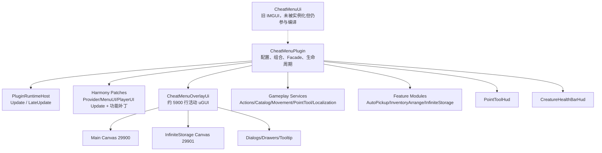
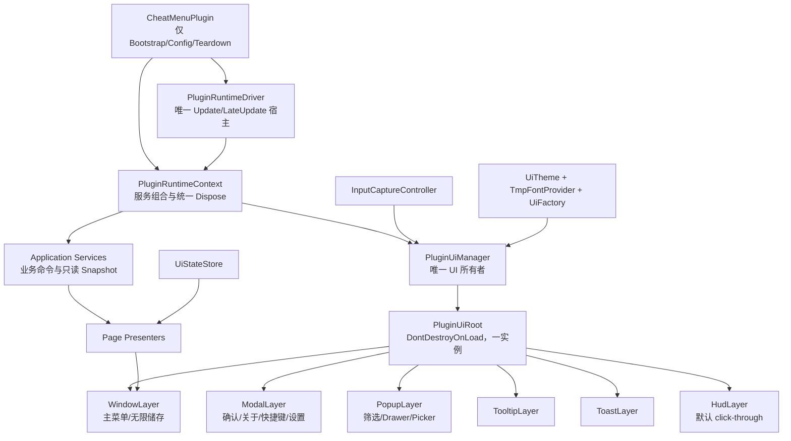

# Unturned 单人作弊菜单：全量 uGUI 统一架构优化落地文档

> 文档状态：待实施基线（Documentation Only）  
> 审计日期：2026-08-27  
> 审计对象：当前工作树，包括尚未提交的新功能与测试  
> 目标运行时：Windows x64、Unity 2022.3.62f3、Unity Mono、BepInEx 5.4.23.5、`netstandard2.1`  
> 核心约束：插件自有 UI 只允许使用 Unity uGUI；最终代码、项目引用、测试、脚本和文档中不得保留废弃 UI、失效分支或旧路径残留。

## 1. 结论与架构决策

当前插件的**活动菜单**已经是动态 uGUI：`CheatMenuPlugin` 只实例化
`CheatMenuOverlayUi`，主窗口使用 `Canvas + CanvasScaler + GraphicRaycaster`，并以
`sortingOrder = 29900` 运行在 Unturned 原生鼠标 Canvas（已知为 30000）下方。

但当前仓库还不能称为“全量统一 uGUI”，原因不是活动界面仍在走 IMGUI，而是旧实现和
双重运行路径仍参与编译：

1. `UI/CheatMenuUi.cs` 是约 962 行的完整 IMGUI/GUILayout 菜单，虽然没有活动调用者，
   但仍被通配编译。
2. 项目和引用准备脚本仍包含 `UnityEngine.IMGUIModule.dll`。
3. `CheatMenuOverlayUi.cs` 已增长到约 5,900 行，同时承担窗口、页面、控件工厂、状态、
   输入、弹窗、Tooltip、重建、持久化和业务调度，形成新的单体 UI。
4. 主菜单和无限储存分别创建持久 Canvas，两个入口各自检查/创建 EventSystem。
5. RuntimeHost 与三个游戏 `Update` Harmony Postfix 同时承担更新兜底，生命周期没有唯一
   所有者；插件组件的 `OnDestroy` 甚至明确不清理运行服务。
6. 搜索、分类和部分配置变更仍通过 `ShowTab -> ReplaceContentHost` 销毁并重建整页，
   会破坏输入焦点、IME 组合文本、滚动位置和局部状态。
7. UI 文本仍是 `UnityEngine.UI.Text`，字体解析散落在三个 UI/HUD 类中，地图 Tooltip
   甚至直接回退到内置 Arial；视觉组件和字体生命周期并未真正统一。

因此本方案采用以下最终决策：

- 插件 UI 固定为**程序化 uGUI**，不保留 IMGUI、UI Toolkit、Dear ImGui、WebView 或
  另一套可切换 UI 实现。
- 建立**一个插件运行时宿主、一个插件 UI 根、一个输入状态机、一个主题/字体系统**。
- 主窗口、无限储存、模态层、Popup、Tooltip、Toast 和 HUD 都挂在同一插件根下；只有
  经分析器证明有重建收益的 HUD 才允许使用子 Canvas，不能再创建第二个顶层持久根。
- 把 UI 视图、Presenter、UI 状态和游戏服务拆开；视图不得直接决定作弊业务规则。
- 用目标游戏自带的精确 `Unity.TextMeshPro.dll` 完成 TMP uGUI 文本迁移；切换完成后删除
  `UnityEngine.UI.Text` 字体创建和 Arial 回退路径。
- 旧配置兼容采用“迁移版本 -> 验证迁移 -> 最终清除”的两阶段策略；只有隔离、可达、
  有测试且有删除版本的迁移器可以暂时存在，最终验收版本不得再绑定旧键。
- 本文档取代旧方案中“为了回退不删除 Legacy UI 文件”的决定。

## 2. 范围与非范围

### 2.1 本次必须覆盖

- BepInEx 插件入口、运行时宿主、Harmony 生命周期和单人守卫。
- 主菜单七个一级页面：角色、物品、载具、收藏、传送、工具、其他。
- 工具页五个二级页面：准星交互、背包整理、自动拾取、移动、Workshop 翻译。
- 独立无限储存窗口。
- 物品/载具卡片、搜索、分类、筛选、收藏、分页、Hover 详情和缩略图设置。
- 传送地图、传送点、标记选择、颜色选择、删除确认。
- 关于窗口、全局快捷键窗口、所有 Drawer/Picker/Dialog。
- 准星工具 HUD、生物生命条 HUD、状态反馈、Tooltip 和未来 Toast。
- 中英文、键盘/鼠标、原生鼠标、输入捕获、场景切换、分辨率和 UI Scale。
- UI 相关项目引用、准备脚本、Smoke、README、截图和旧设计文档。

### 2.2 明确不做

- 不把 Unturned 自身的 Glazier/native UI 改写成 uGUI。
- 不改变物品给予、载具生成、传送、移动、准星工具、自动拾取、无限储存、背包整理或
  翻译的业务语义。
- 不扩大到多人、BattlEye 绕过或服务端能力。
- 不以视觉重构为理由删除有效配置、收藏、传送点或翻译缓存。
- 不在本轮文档工作中修改生产代码、构建、部署或启动游戏。

### 2.3 Unturned Glazier 边界

官方稳定文档明确说明 IMGUI、uGUI、UIToolkit 是三套不兼容 UI 系统；Unturned 默认
Glazier 后端是 uGUI。插件最终只提供 uGUI 实现，不随 `-Glazier=IMGUI` 或
`-Glazier=UIToolkit` 切换第二套视图。

实施 Phase 0 必须从当前 `SDG.Glazier.Runtime.dll`/`Assembly-CSharp.dll` 确认可用的
后端检测 API。若原生 IMGUI 模式下无法保证插件交互层级，插件应给出一次明确诊断并拒绝
打开模态窗口，不能偷偷回退到 `OnGUI`。默认 Glazier uGUI 是正式验收环境。

## 3. 当前架构基线

### 3.1 已核实运行环境

| 项目 | 当前证据 |
| --- | --- |
| BepInEx | `BepInEx.dll 5.4.23.5`，`BaseUnityPlugin.Awake` |
| Harmony | `0Harmony.dll 2.9.0.0` |
| Unity | 本机 `UnityPlayer.dll` 为 `2022.3.62f3` |
| 运行时 | Windows x64 / Unity Mono |
| TFM | `netstandard2.1` |
| UI 程序集 | `UnityEngine.UI.dll`、`UnityEngine.UIModule.dll`；游戏 Managed 目录存在 `Unity.TextMeshPro.dll` |
| 精确游戏程序集 | 仓库 `lib/Assembly-CSharp.dll` 与本机游戏 SHA-256 相同：`E1146353E5C9BFF901EE94829640D88919C5E89F6A6B90B22C73ABF5C1608F94` |
| 安全边界 | 仅无 BattlEye 的真正单人世界 |

游戏版本号仍应在实施当日从启动日志重新记录；程序集哈希只证明本次静态审计针对当前本机
精确程序集，不证明未来更新仍兼容。

### 3.2 当前模块结构



最新知识图谱在 `src/UnturnedSingleplayerCheatMenu` 范围识别到 122 个 C# 文件、145 个类和
1,123 个方法。`CheatMenuPlugin.cs` 约 1,717 行，`CheatMenuOverlayUi.cs` 约 5,900 行；
`SetLayout`、`CreateObject`、`CreateButton`、`CreateRow`、`CreateLabel` 和
`PersistInterfaceState` 是高扇入热点，说明页面已经共同依赖一组隐式 UI/配置基础设施，
却没有形成显式模块边界。

完整模块账本如下：

| 当前区域 | 代表实现 | 当前职责 | 目标边界 |
| --- | --- | --- | --- |
| 插件入口 | `CheatMenuPlugin` | 元数据、配置、组合、Facade、更新、释放 | 只保留 Bootstrap；其余移入 RuntimeContext/Settings/Commands |
| 运行宿主 | `PluginRuntimeHost` | 独立 Update/LateUpdate | 改为唯一 `PluginRuntimeDriver` |
| 安全与输入 | `SingleplayerGuard`、`GlobalShortcutManager`、`ShortcutInputPolicy` | 单人门禁、快捷键、冲突和捕获 | Application 层服务；UI 只展示/发命令 |
| 游戏动作 | `CheatActions` | 角色、物品、载具、世界操作 | 无 UI 依赖的命令服务 |
| 资产目录 | `AssetCatalog`、`AssetOriginClassifier`、`ItemFilterService` | 物品/载具发现、来源、筛选 | Catalog Domain + 只读 Snapshot |
| 图标管线 | `IconCache`、`VehicleIconRenderer`、`VehicleIconDiskCache` | 原生图标、逐帧载具渲染、磁盘缓存 | Media Service；通过异步结果通知 View |
| 传送 | `TeleportStore`、`TeleportMapService`、`TeleportMapSnapshot` | 点位持久化、地图纹理/坐标 | Teleport Domain；地图 View 只负责显示/交互 |
| 移动 | `MovementCheatService`、`MovementSimulationPatch` | 飞行、穿墙、原生移动模拟 | Movement Feature；UI 通过 Snapshot/Command |
| 准星工具 | `PointToolService`、`PointToolActionGate`、`PointToolInteractionPatch` | Raycast、模式、范围、原生请求 | PointTool Feature；HUD/面板共享同一状态 |
| Workshop 翻译 | Scanner/Service/Client/Cache/Patch 系列 | 扫描、协议、翻译、缓存、原生显示桥 | Localization Feature；网络任务不归 UI 生命周期 |
| 生物生命条 | `CreatureHealthBarService/Settings` | 目标收集、可见性、投影数据 | HUD Feature；Service 与 HudView 分离 |
| 自动拾取 | `AutoPickup/` | 规则、调度、原生拾取、诊断 | 独立 Feature Module；Presenter 只编辑规则 |
| 背包整理 | `InventoryArrange/` | 读取、规划、应用、快捷转移、补丁 | 独立 Feature Module；规划器继续可 Smoke |
| 无限储存 | `InfiniteStorage/` | 持久化、交易、背包/配方桥接 | 独立 Feature Module + 统一 WindowLayer View |
| 持久数据 | `Models/` 及各 Store | 收藏、传送、规则、缓存和快照 | 版本化 Schema；迁移与运行模型分离 |
| Harmony | `Patches/` 及 Feature Patch | 游戏行为桥接和更新兜底 | 只保留必要行为补丁；每个 Patch 有安装/卸载所有者 |
| UI | `UI/` | Shell、页面、HUD、地图、控件和旧 IMGUI | Core/Components/Pages/Dialogs/Hud 明确分层 |
| 测试 | `tests/*Smoke` | 数据、算法、静态源码和部分集成断言 | 继续 Smoke，并补 UI 结构/生命周期/迁移门禁 |
| 构建发布 | `.csproj`、`.slnx`、`scripts/`、README/ACCEPTANCE | 引用、构建、部署和发布边界 | 与单一 uGUI 依赖、递归 Smoke、Plugin-Only 保持一致 |

### 3.3 当前启动与更新链

1. `CheatMenuPlugin.Awake` 同时绑定大量配置、创建服务、创建活动 uGUI、注册快捷键、
   安装 Harmony、创建 RuntimeHost。
2. `PluginRuntimeHost.Update` 调用 `RunUpdateCallback`；三个游戏 `Update` Postfix 也会调用
   同一方法，依靠 frame 去重避免重复执行。
3. `RunUpdateCallback` 在一处泵送图标、翻译、快捷键、背包整理、自动拾取、无限储存、
   移动、准星工具、生命条和 UI Maintain。
4. `PluginRuntimeHost.LateUpdate` 驱动 HUD 晚更新；`RunUpdateCallback` 又保留生命条渲染
   兜底。
5. `CheatMenuPlugin.OnDestroy` 不释放服务，只写日志；主要清理集中在
   `OnApplicationQuit`，且未形成统一的 UI/宿主释放顺序。

这条链路能解释当前为何“能跑”，但也说明运行所有权并不唯一。统一 UI 之前必须先把更新
和销毁变为单一路径，否则拆分视图会放大重复监听、孤儿 GameObject 和场景泄漏风险。

### 3.4 当前 UI 表面清单

| 表面 | 当前入口 | 当前职责 | 迁移目标 |
| --- | --- | --- | --- |
| 主菜单 Shell | `EnsureShell` | Header、七 Tab、ContentHost、Status | `MainMenuWindow` |
| 角色 | `BuildCharacterTab` | 生存、经验、声望、技能 | `CharacterPage` + Presenter |
| 物品 | `BuildItemsTab` | 搜索、数量、筛选、分类、卡片、分页 | `ItemCatalogPage` |
| 载具 | `BuildVehiclesTab` | 搜索、数量、分类、缩略图设置、卡片、分页 | `VehicleCatalogPage` |
| 收藏 | `BuildFavoritesTab` | 物品/载具收藏及各自搜索状态 | `FavoritesPage` |
| 传送 | `BuildTeleportsTab` | 地图、列表、标记、颜色、确认 | `TeleportPage` |
| 工具 | `BuildToolsTab` | 五个二级功能 | `ToolsPage` + 五个 FeaturePanel |
| 其他 | `BuildOtherTab` | 时间、天气、满月、空投、重扫 | `WorldPage` |
| 无限储存 | `EnsureInfiniteStorageShell` | 独立 Canvas、搜索、卡片、取放 | `InfiniteStorageWindow` |
| 全局快捷键 | `ShowShortcutDialog` | 分组、捕获、清除、默认值 | `ShortcutDialog` |
| 关于 | `ShowAboutDialog` | 版本、作者、项目、赞助链接 | `AboutDialog` |
| 筛选/设置 | 多个 `*Root` | ItemFilter、缩略图、颜色、协议 | Modal/Popup 服务托管 |
| Drawer | 多个 `Build*Drawer` | 模式、预设、范围等 | 通用 `PopupMenu<T>` |
| Hover | `OverlayHoverExplanation` | 物品/载具详情 | `TooltipService` |
| 准星 HUD | `PointToolHud` | 目标、模式、移动状态 | `HudLayer/PointToolHudView` |
| 生命条 HUD | `CreatureHealthBarHud` | 僵尸/动物生命条 | `HudLayer/CreatureHealthBarView` |

现有 UI 辅助类型也必须逐个迁移或删除，不能在主类拆分后成为孤儿：

| 当前类型 | 目标归属 |
| --- | --- |
| `CheatMenuStyle` | `Theme/UiTheme` + `UiMetrics` |
| `UiDebouncer` | `Core/UiScheduler`；搜索专用逻辑进入 `SearchController` |
| `OverlaySelectableVisual` | `Components/UiSelectableVisual`，实现统一状态矩阵 |
| `OverlayFocusIndicator` | 合并进统一 Selectable，不再独立散落 |
| `OverlayIconBinder` | `Components/UiImageBinder`，订阅 Icon Service 结果 |
| `PageScrollHandler` | `Components/UiPager/UiScrollNavigation` |
| `TeleportMapSurface` | `Pages/Teleports/TeleportMapView` |
| `TeleportMapMarker` | `Pages/Teleports/TeleportMarkerView` |
| `TeleportMarkerIconFactory` | `Theme/MarkerIconProvider`，由 UiRoot 统一释放资源 |
| `PointToolHud` | `Hud/PointToolHudView` |
| `CreatureHealthBarHud` | `Hud/CreatureHealthBarView` |
| `CheatMenuUi` | 删除，不迁移、不保留开关 |

### 3.5 当前持久化与状态

- BepInEx 配置承担语言、UI Scale、最后页签、快捷键和各功能设置。
- JSON 文件承担收藏、传送点、自动拾取规则、无限储存和翻译缓存。
- `CheatMenuOverlayUi` 自己持有搜索、页码、选中分类、Drawer、输入框、滚动、状态栏、
  Sprite/Texture 和大量 `GameObject` 引用。
- `ShowTab` 每次写入最后页签，然后销毁并重建 ContentHost。
- UI 状态、持久状态和 GameObject 生命周期交织，Presenter 边界尚不存在。

## 4. 问题与优先级

### P0：不解决就不能宣布“全量 uGUI / 无残留”

| 编号 | 问题 | 证据 | 风险 |
| --- | --- | --- | --- |
| P0-01 | 旧 IMGUI 菜单仍编译 | `CheatMenuUi.cs`、GUI/GUILayout 调用 | 形成第二套事实实现，维护和依赖无法收口 |
| P0-02 | IMGUI 程序集仍是必需引用 | `.csproj`、`Prepare-References.ps1` | 构建层仍未统一到 uGUI |
| P0-03 | 更新有 RuntimeHost + 三个 Harmony fallback | `PatchUpdateLoop`、`GameUpdatePostfix` | 重复入口、生命周期和版本脆弱性 |
| P0-04 | 插件销毁不等于运行时销毁 | `OnDestroy` 明确保留服务 | 热重载/异常销毁时泄漏、孤儿 UI 和补丁 |
| P0-05 | 两个顶层持久 Canvas | Overlay 29900、Storage 29901 | 根所有权、输入、EventSystem 和缩放重复 |
| P0-06 | EventSystem 检查/创建重复 | 两个 Ensure 方法各自 `FindObjectOfType` | 场景切换或失活对象下可能重复创建 |
| P0-07 | UI 单体过大 | `CheatMenuOverlayUi` 约 5,900 行 | 任意页面改动影响全局，难以验证删除完整性 |

### P1：功能和交互质量风险

| 编号 | 问题 | 具体表现 | 目标 |
| --- | --- | --- | --- |
| P1-01 | 整页重建 | 搜索 debounce、分类、语言、缩略图更新调用 `ShowTab` | 只刷新结果区或当前绑定 |
| P1-02 | 搜索生命周期不完整 | draft、Enter、blur、IME、焦点和 rebuild 同时耦合 | 统一 `SearchController` 状态机 |
| P1-03 | 字体路径分裂 | 三处创建系统字体，地图 Tooltip 回退 Arial | 单一 TMP FontProvider |
| P1-04 | 输入轮询分散 | Maintain 手动处理 Drawer 外部点击、快捷键捕获、Slider | 事件驱动 + InputCaptureController |
| P1-05 | 视觉原语重复 | Button/Input/Toggle/Slider/Drawer 自行组合 | 组件库和完整状态矩阵 |
| P1-06 | 固定窗口尺寸 | 1120×790 + transform scale | 响应式约束、最小尺寸和屏幕 Clamp |
| P1-07 | 状态反馈只有单状态栏 | 成功/失败/加载来源混杂 | Inline + Status + Toast 分层 |
| P1-08 | View 直接依赖插件大对象 | 构造函数接收 `CheatMenuPlugin`，大量 setter | 小接口、Command 和 Snapshot |

### P2：证据和维护风险

- README 展示截图明确仍是 1.1 版本，不能作为当前 Tools、无限储存、自动拾取和翻译 UI
  的完整视觉基线。
- 旧视觉方案写明“不删除 Legacy UI 文件”，与本次强制收口目标直接冲突。
- 当前解决方案列出 13 个 Smoke，但工作树实际存在 14 个 Smoke 目录；
  `AssemblyMetadataSmoke` 尚未进入 `.slnx`。最终门禁必须递归发现，不能只信解决方案。
- 现有 Smoke 更偏数据、服务和静态源码断言，不能证明 EventSystem、焦点、IME、Canvas
  层级、场景切换或真实点击。
- 当前工作树包含大量用户修改和未跟踪功能；实施必须逐文件小步迁移，禁止 reset、stash、
  清理或宽泛格式化。

## 5. 目标架构

### 5.1 总体结构



### 5.2 运行时所有权

#### `CheatMenuPlugin`

只保留：

- `[BepInPlugin]` / `[BepInProcess]` 元数据；
- 配置入口；
- 创建 `PluginRuntimeContext` 与 `PluginRuntimeDriver`；
- 一次性启动日志；
- 唯一、幂等的 teardown 调用。

不得继续承担页面 setter、每帧 Pump、弹窗控制或大量服务属性暴露。

#### `PluginRuntimeContext`

- 拥有 Gameplay Services、Feature Modules、UI Manager、Harmony owner 和取消令牌。
- `Start()` 与 `Dispose()` 都必须幂等。
- Dispose 顺序固定为：停止输入/异步任务 -> 关闭 UI -> 释放 HUD/资源 -> 取消事件订阅 ->
  恢复移动/鼠标 -> UnpatchSelf -> 销毁 RuntimeDriver。
- 每一项失败单独记录，但不能阻止后续资源释放。

#### `PluginRuntimeDriver`

- 作为唯一 `DontDestroyOnLoad` MonoBehaviour 提供 `Update/LateUpdate`。
- 直接引用普通 C# `PluginRuntimeContext`，不依赖已经销毁的 `BaseUnityPlugin` 对象继续运行。
- 删除 `Provider/MenuUI/PlayerUI.Update` 三重兜底补丁；Harmony 只保留真正需要修改游戏行为的
  小范围补丁。
- 如果实机证明 BepInEx 主组件异常销毁，Driver 负责有序关闭，而不是无限保活未知状态。

### 5.3 UI 根与层级

顶层名称使用插件 GUID，例如：

```text
com.codex.unturned.singleplayer-cheat-menu.UiRoot
└─ Canvas (Screen Space Overlay, sortingOrder 29900)
   ├─ WindowLayer
   │  ├─ MainMenuWindow
   │  └─ InfiniteStorageWindow
   ├─ ModalLayer
   ├─ PopupLayer
   ├─ TooltipLayer
   ├─ ToastLayer
   └─ HudLayer
```

规则：

- 每个进程最多一个插件 UiRoot、一个主 CanvasScaler、一个 GraphicRaycaster。
- 主菜单和无限储存是同一 WindowLayer 下的两个窗口状态，不能再各自创建顶层 Canvas。
- Modal 必须阻断 WindowLayer；Popup 只在需要时拦截局部点击；Tooltip 不拦截 Raycast；
  HUD 默认 `CanvasGroup.blocksRaycasts = false`。
- 层级顺序由固定 sibling/layer 管理，禁止页面自行设置任意 sortingOrder。
- 只有性能分析证明 HUD 更新造成静态窗口重建时，才允许 HudLayer 增加子 Canvas；它仍归
  UiRoot 所有并由统一 Dispose 清理。
- 场景变化只重新绑定游戏对象，不重复创建 UiRoot、Canvas、监听器或快捷键。

### 5.4 EventSystem、鼠标与输入状态机

`EventSystemBroker` 执行以下唯一流程：

1. 优先检查 `EventSystem.current`，再检查活动 EventSystem。
2. 若游戏已有 EventSystem，记录为 borrowed，不修改或销毁其 InputModule。
3. 仅在确认没有 EventSystem 且当前精确运行时使用 Legacy Input 时，创建一个
   `StandaloneInputModule`；只销毁 owned 对象。
4. 场景切换后重新验证 borrowed 引用，禁止在 Update 中全局搜索。

`InputCaptureController` 使用显式状态：

```text
Hidden -> HudOnly -> ModalPluginUi -> NativeUiCoexistence -> Hidden
```

- 主菜单或无限储存打开时才捕获插件 UI 输入。
- 继续使用 Unturned 原生 `PlayerUI.window.showCursor = true`，不模拟 Windows 鼠标。
- 继续保持插件 Canvas 29900、原生鼠标 Canvas 30000。
- 相机阻断只允许使用当前已验证的窄 `PlayerLook.Update` Prefix/Postfix，不跳过原方法，
  保留 FOV、Scope 和相机更新。
- 关闭、异常、场景离开和 Dispose 都必须恢复鼠标、选择对象、相机和移动状态。
- 原生背包、地图、暂停菜单打开时进入 NativeUiCoexistence；不得抢焦点或关闭原生菜单。

### 5.5 UI 状态与数据流

每个页面拆成四层：

```text
Game/Feature Service -> immutable Snapshot -> Presenter -> uGUI View
uGUI Event -> Command -> Service -> Result -> Presenter/Feedback
```

- View 只包含 uGUI 控件和绑定，不直接调用 SDG.Unturned Gameplay API。
- Presenter 不持有 GameObject 之外的业务可变对象；输入草稿、已提交查询、页码、分类、
  选中项和滚动位置进入 `UiStateStore`。
- Gameplay Service 返回结构化结果，不把中文状态字符串作为控制流。
- `UiStateStore` 区分会话态、可持久态和瞬时态；保存配置由统一 Settings Service 执行。
- 页面切换只切换/绑定活动 View；不会重建 Shell，也不会销毁输入框后再恢复文本。

### 5.6 页面和 Presenter 拆分

建议目录：

```text
UI/
├─ Core/
│  ├─ PluginUiManager.cs
│  ├─ PluginUiRoot.cs
│  ├─ UiLayerStack.cs
│  ├─ EventSystemBroker.cs
│  ├─ InputCaptureController.cs
│  ├─ UiStateStore.cs
│  └─ UiScheduler.cs
├─ Theme/
│  ├─ UiTheme.cs
│  ├─ UiMetrics.cs
│  └─ TmpFontProvider.cs
├─ Components/
│  ├─ UiButton.cs / UiToggle.cs / UiInput.cs / UiSlider.cs
│  ├─ UiScrollView.cs / UiCard.cs / UiPager.cs
│  └─ UiModal.cs / UiPopup.cs / UiTooltip.cs / UiToast.cs
├─ Shell/
│  ├─ MainMenuWindow.cs
│  ├─ MainNavigation.cs
│  └─ StatusBar.cs
├─ Pages/
│  ├─ Character/
│  ├─ Items/
│  ├─ Vehicles/
│  ├─ Favorites/
│  ├─ Teleports/
│  ├─ Tools/
│  └─ World/
├─ Windows/InfiniteStorage/
├─ Dialogs/
└─ Hud/
```

不是要求为每个小控件机械拆一个文件，而是要求：一个文件有一个清晰变化原因；页面 View
不承担业务；公共原语只保留一份实现。建议单文件超过 500 行或同时依赖三个以上业务域时
必须在 Review 中说明为什么不能再拆。

### 5.7 统一组件契约

所有交互控件必须实现：Default、Hover、Pressed、Focus-visible、Selected、Disabled、
Loading、Error；需要时再提供 Empty 和 Success。颜色不是唯一状态提示。

| 组件 | 统一约束 |
| --- | --- |
| Button | 36–44 px 有效触达区；Primary/Secondary/Danger/Icon 变体 |
| Toggle | 标签、ON/OFF 文本、Check、焦点指示一致；禁用原因可见 |
| Input | draft 与 committed 值分离；Enter/blur 提交；Escape 取消；支持 IME |
| Slider | 轨道、Grip、数值标签和键盘步进一致；拖动不触发整页重建 |
| ScrollView | `ScrollRect + RectMask2D/Mask`；隐藏控件不进入导航 |
| Card | 物品、载具、收藏、无限储存共用结构和 Hover 详情 |
| Pager | 上一页、页码、下一页和禁用状态一致；切换保持搜索焦点策略 |
| Modal | 单一 ModalStack；打开时保存焦点，关闭时恢复有效焦点 |
| Popup/Drawer | 锚定触发器、屏幕 Clamp、外部点击关闭、Escape 关闭 |
| Tooltip | 延迟显示、不拦截点击、边缘 Clamp、来源销毁即关闭 |
| Toast | 有界队列、可取消、UI 销毁时清空；不能替代字段级错误 |

### 5.8 主题、字体和本地化

- 把 `CheatMenuStyle` 升级为不可变 `UiTheme` + `UiMetrics`，集中颜色、字号、间距、
  圆角、边框、动效和控件高度。
- 延续现有深色控制台方向、蓝色主强调、红色危险、金色收藏、语义化状态色；不引入
  紫色渐变或与游戏无关的装饰。
- 以 1920×1080 为参考分辨率，使用 4/8/12/16/24/32 间距节奏。
- 全量文本迁移到 `TextMeshProUGUI`。`Prepare-References.ps1` 从精确游戏 Managed 目录
  复制 `Unity.TextMeshPro.dll`，项目引用它；不随发布包分发游戏程序集。
- `TmpFontProvider` 先在实机检查 Unturned 已加载 TMP 字体资产及中英文 glyph 覆盖；若
  无合格字体，必须提供许可证清晰的插件字体资源方案。没有验证前不得删除现有字体路径，
  也不得以 Arial 作为中文静默回退。
- 切换完成后，`PointToolHud`、`CreatureHealthBarHud`、地图 Tooltip、菜单和所有弹窗共享
  同一 FontProvider。
- 文案仍经 `PluginLocalization`，但 View 只接收 key/已解析文本；`Workshop` 仅中文显示
  “创意工坊”，英文仍为 `Workshop`。

### 5.9 响应式布局

- `CanvasScaler.ScaleWithScreenSize`，参考 1920×1080；记录并验证 match 参数。
- 主窗口使用最小/首选尺寸和屏幕 Clamp，不再仅靠固定 1120×790 后整体缩放。
- 七个一级页签保持一行；窄宽度时允许水平 ScrollRect，不允许静默隐藏。
- 物品高级筛选的七个选项保持一行并统一缩小；当前已验证基线是 112 px cell、4 px
  间距、32 px 高度、约 812 px 可用宽度。
- 长英文、中文、UI Scale 0.75/1.0/1.5、16:9/16:10/21:9 下不得裁切关闭按钮和主操作。
- 窗口位置/尺寸若持久化，保存归一化值并在分辨率变化后重新 Clamp。

## 6. 全量迁移落地顺序

每个 Phase 都必须在独立、可回滚的小提交中完成；只有对应 Gate 通过才能进入下一阶段。

### Phase 0：冻结基线与建立防回归门禁

实施：

1. 保存当前七页、工具五页、无限储存、全部弹窗/HUD 的真实截图或录像基线。
2. 记录当前 Unturned/BepInEx/Unity 版本、Assembly-CSharp 哈希、Canvas/EventSystem 列表、
   原生鼠标 sortingOrder、打开/关闭输入状态和日志。
3. 为 UI 根唯一性、EventSystem 所有权、输入恢复、搜索提交状态、配置迁移建立测试夹具。
4. 把 `AssemblyMetadataSmoke` 纳入 `.slnx`，或明确删除；禁止“目录存在但解决方案不跑”。
5. 建立零残留脚本，初始应因 IMGUI 文件/引用而失败。

Gate：基线证据可复现；当前失败项有清单；没有把历史截图当作当前版本完整验收。

### Phase 1：删除 IMGUI 和构建路径残留

实施：

1. 删除 `UI/CheatMenuUi.cs`。
2. 从 `.csproj` 删除 `UnityEngine.IMGUIModule` 引用。
3. 从 `Prepare-References.ps1` 删除 IMGUI 模块复制。
4. 删除/改写 README、旧设计文档和测试中关于 Legacy UI 回退的内容。
5. 加入源码门禁：生产源码不得出现 `OnGUI`、`GUILayout`、`GUI.Window`、
   `UnityEngine.IMGUIModule`。

Gate：Release 构建与全部 Smoke 通过；零残留脚本对生产源码、项目、脚本和文档均为零。

### Phase 2：统一 RuntimeHost 与销毁链

实施：

1. 抽出 `PluginRuntimeContext`，把服务和 Harmony 所有权移出 `CheatMenuPlugin`。
2. 让 `PluginRuntimeDriver` 成为唯一 Update/LateUpdate 源。
3. 删除 `GameUpdatePostfix`、`PatchUpdateLoop` 及 Provider/MenuUI/PlayerUI 三条 fallback。
4. 实现幂等 `Start/Dispose`；`OnDestroy`、`OnApplicationQuit` 和异常启动失败都进入同一
   teardown。
5. 验证退出世界只关闭世界相关 UI/状态，真正插件销毁才释放全局资源。

Gate：每帧仅一个 runtime tick；补丁注册一次；销毁后无 RuntimeHost、UiRoot、EventSystem
或 Harmony 残留。

### Phase 3：建立 uGUI Kernel、主题、TMP 与单根

实施：

1. 创建 `PluginUiManager/PluginUiRoot/UiLayerStack/EventSystemBroker`。
2. 把主菜单和无限储存迁入同一 WindowLayer。
3. 建立 Modal/Popup/Tooltip/Toast/Hud 层与统一焦点栈。
4. 迁移 `CheatMenuStyle`、按钮、输入、Toggle、Slider、Scroll、Card、Pager 原语。
5. 完成 TMP 程序集、字体资产、CJK/Latin fallback 和资源销毁验证。

Gate：恰好一个顶层 UiRoot；不新增第二 EventSystem；所有组件状态和中英 glyph 验收通过。

### Phase 4：按垂直切片迁移页面

推荐顺序：

1. Character（低复杂度，验证 Presenter/Command 模式）。
2. World/Other（验证 Slider、Toggle、即时状态刷新）。
3. Items（验证搜索、IME、筛选、卡片、分页）。
4. Vehicles（复用 Catalog 组件并验证异步缩略图）。
5. Favorites（复用 Item/Vehicle 卡片，不能另造搜索生命周期）。
6. Teleports（验证地图、Popup、Modal、颜色和场景绑定）。
7. Tools 五页（逐个迁移，不一次重写）。
8. InfiniteStorage（迁移到统一 WindowLayer）。

每迁移一页：旧 Build 方法、旧字段和旧测试断言必须在同一 Phase 删除；禁止同时保留新旧
两套页面并以开关切换。

Gate：功能对照表逐项不回退；页面切换不重建 Shell；当前页面无双实现。

### Phase 5：统一 Dialog、Popup、Tooltip、Toast 和 HUD

实施：

- 删除各自手工维护的 `*Root`/`Build*Drawer` 样板，改用 ModalStack/PopupService。
- 迁移 About、Shortcut、DeleteConfirm、ItemFilter、VehicleThumbnailSettings、
  TeleportMarker/Color、PointToolMode、InventoryPreset/Scope、WorkshopProtocol、
  AutoPickupPicker。
- `PointToolHud` 与 `CreatureHealthBarHud` 接入统一 HudLayer、字体和 click-through 规则。
- 把底部 Status 留作窗口级反馈；跨页成功/失败进入 Toast；字段错误留在字段旁。

Gate：焦点栈、Escape、外部点击、原生菜单共存、Tooltip 边缘 Clamp 和 HUD Raycast 全通过。

### Phase 6：消除整页重建与每帧 UI 维护

实施：

- 用 `SearchController` 统一物品、载具、收藏物品、收藏载具和无限储存搜索。
- `onValueChanged` 只更新 draft；Enter/blur 提交；IME composing 时不提交；debounce 只刷新
  ResultsViewModel，不销毁 InputField。
- 分类、筛选、收藏和分页只更新相应结果、计数、Pager 与卡片池。
- 用事件/脏标记替代重复 `ShowTab`、Header 每帧刷新和 Drawer 每帧定位。
- 只有时间预览、地图玩家标记、HUD 投影等真正实时值允许受控刷新。

Gate：搜索输入保持焦点和 IME；无 debounce 竞态；切页/搜索无整页重建循环；Profiler
相对 Phase 0 无明显 GC、布局重建或卡顿回退。

### Phase 7：配置、数据和命名残留清理

插件自有旧路径：

- `AutoPickup.ScanRadius`、`AutoPickup.RequestRange` -> `AutoPickup.Range`。
- `InventoryArrange.PreserveHotkeys` -> `FixHotkeyItems`。
- 旧 UI 页面名、旧 Root 名、旧截图版本说明和旧测试路径。

执行两阶段迁移：

1. 迁移版仅在 `Migrations/` 中读取旧键，原子备份并写出当前规范格式；迁移结果有 Smoke。
2. 最终清理版删除迁移器、旧字段、旧 setter、旧文案和旧键绑定；配置文件通过规范化写回
   不再保留孤儿键。只有完成第二步才能关闭本计划。

名称中包含 Legacy 但可能仍是当前游戏契约的项不得按字符串盲删：

- `Assets.legacyOfficialOrigin` 在当前精确程序集仍存在，并可能标识由官方兼容加载器产生的
  资产；当前代码没有调用 `[Obsolete] Assets.load/ConvertLegacyOrigin`。
- 资产 `id` 在官方文档中称 legacy ID，但仍是物品/载具、背包排序和缓存中的有效身份。

这些项必须通过精确程序集和调用路径判定：能改用当前公开 `AssetOrigin`/GUID 合同就删除
反射；确实仍服务于当前已加载资产则隔离在 `UnturnedAssetCompatibilityAdapter`，写明
目标程序集哈希、测试和删除条件。**可达且受测的当前兼容适配不是废弃功能；无调用者、
无测试、无删除条件的适配一律视为残留。**

Gate：零残留检索通过；配置规范化后不再生成旧键；不存在没有调用者的兼容代码。

### Phase 8：文档、部署与实机总验收

实施：

1. 更新 README 中英文、架构说明、配置表、截图和验收文档。
2. 用当前版本重拍七个一级页面、五个工具页、无限储存、关键 Dialog/HUD。
3. Release 构建并递归运行全部 Smoke；不能只运行 `.slnx` 当前列出的项目。
4. 游戏完全退出后备份旧 DLL，只部署插件 DLL；比较源/目标大小、SHA-256 和程序集版本。
5. 无 BattlEye 单人世界启动，核对 BepInEx 日志、UI 根、输入、功能和视觉矩阵。
6. 公共发布资产保持 Plugin-Only；除非另有明确要求，不发布完整 BepInEx 包。

Gate：下节所有 DoD 条目完成；构建、部署和实机证据分别记录，不互相替代。

## 7. 明确删除/保留账本

### 7.1 最终必须删除

| 对象 | 删除原因 |
| --- | --- |
| `UI/CheatMenuUi.cs` | 未调用的完整 IMGUI 实现 |
| `UnityEngine.IMGUIModule` 项目引用 | 全量 uGUI 后无用途 |
| Prepare 脚本中的 IMGUI 复制 | 构建路径残留 |
| `GameUpdatePostfix` 与三个 `PatchUpdateLoop` | 统一 Driver 后为重复更新路径 |
| 第二个顶层 InfiniteStorage Canvas | 统一 WindowLayer 后为重复根 |
| 两处 EventSystem 创建逻辑 | 由 EventSystemBroker 取代 |
| `SetAutoPickupScanRadius/RequestRange` | 旧配置别名 setter |
| 旧 AutoPickup 配置字段/绑定 | 完成两阶段迁移后删除 |
| `PreserveHotkeys` fallback | 完成两阶段迁移后删除 |
| 页面内重复控件工厂和 Drawer 样板 | 统一组件/Popup 服务后删除 |
| 旧版 1.1 截图和错误版本说明 | 与当前产品不一致 |
| “保留 Legacy UI 以便回退”的旧文档决定 | 与本计划冲突 |

### 7.2 必须保留且不得回退

- 单人守卫、无 BattlEye 边界和离开单人世界自动关闭。
- 物品/载具/收藏三类搜索、分类、筛选、分页、数量、收藏和 Hover 详情。
- 七选项筛选一行布局及中文“创意工坊”/英文 `Workshop`。
- 车辆缩略图 authored icon 优先、逐帧渲染、GUID+设置缓存键和失败占位。
- 地图传送完整图片适配、拖动/缩放、玩家标记、标记形状/颜色和安全落点。
- 准星工具全部模式、范围与输入门禁；不能只验证第一个目标类别。
- 原生鼠标显示、打开即能点击、相机停止转动、关闭后输入恢复。
- 自动拾取、无限储存、背包整理、生命条、Workshop 翻译和全局快捷键的新功能。
- 收藏、传送点、规则、储存和翻译缓存的原子持久化/失败恢复语义。

## 8. 零残留门禁

最终版本的静态检查至少覆盖：

```powershell
rg -n "\bOnGUI\b|\bGUILayout\b|\bGUI\.Window\b|UnityEngine\.IMGUIModule" src tests scripts *.md
rg -n "\bCheatMenuUi\b|GameUpdatePostfix|PatchUpdateLoop" src tests scripts docs README.md README.en.md
rg -n "AutoPickup.*(ScanRadius|RequestRange)|SetAutoPickup(ScanRadius|RequestRange)|PreserveHotkeys" src tests docs
rg -n "Legacy UI|旧 UI|旧UI|IMGUI fallback|IMGUI 回退" docs README.md README.en.md
```

期望结果均为零。若必须保留上游名称，必须精确限定到兼容适配目录并由 allowlist 说明，
不能用全局忽略掩盖新增残留。

还要执行结构检查：

- `CheatMenuPlugin` 只创建一个 RuntimeContext/Driver。
- 进程中插件 GUID UiRoot 数量恰好为 1。
- 插件创建的 EventSystem 数量为 0 或 1，且只有 owned 对象会被销毁。
- 每个页面只有一个 View/Presenter 注册。
- 每个 Listener 有唯一注册点和对应释放点。
- 生产源码不存在零调用者的旧 UI 类；反射/兼容适配有明确调用者和测试。

## 9. 验收矩阵

### 9.1 源码与构建

- `git diff --check` 通过，无宽泛格式化和无关文件修改。
- Release 构建 0 error；新增 warning 必须解释并清零。
- 递归发现并串行运行 `tests/**/**.csproj`，当前应发现 14 个；后续数量以动态发现为准。
- 新增 UI Architecture Smoke：无 IMGUI 引用、唯一 UiRoot、组件状态契约、迁移器删除状态。
- 数据/业务 Smoke 全部继续通过，不能用 UI 重构删除断言。

### 9.2 运行时生命周期

- 冷启动、进入单人、退出到主菜单、重新进入、切地图、退出游戏各执行一次。
- 每个阶段只存在一个 RuntimeDriver、一个 UiRoot、一个插件 Canvas 层级。
- 打开/关闭主菜单 50 次、无限储存 20 次，无重复 Listener、孤儿 Root 或异常。
- 异常关闭 Modal、切场景、插件 Dispose 后鼠标/相机/移动恢复。
- 日志中无 UI rebuild loop、MissingReference、字体材质、EventSystem 或重复补丁异常。

### 9.3 输入与焦点

- End 打开/关闭；Close/Escape 使用同一状态转换。
- 打开即显示 Unturned 原生鼠标并可点击，不需要先按 ESC。
- 菜单开启时相机不转，关闭后相机/FOV/Scope/移动恢复。
- 原生背包、地图、暂停菜单与插件窗口按规则共存，不抢焦点。
- 物品、载具、收藏物品、收藏载具、无限储存搜索全部验证：逐字输入、150 ms debounce、
  Enter、blur、Escape、清空、快速切页、快速切 Tab、中文 IME 组合与候选确认。
- Shortcut 捕获时不触发其他全局动作；隐藏/禁用控件不进入导航。

### 9.4 视觉与响应式

| 比例 | 建议分辨率 | UI Scale |
| --- | --- | --- |
| 16:9 | 1280×720、1920×1080、2560×1440 | 0.75 / 1.0 / 1.5 |
| 16:10 | 1920×1200 | 0.75 / 1.0 / 1.5 |
| 21:9 | 2560×1080、3440×1440 | 0.75 / 1.0 / 1.5 |

每个组合至少检查 Header、七 Tab、最密集的 Items/Tools 页面、Modal 和 Status；完整截图
集覆盖中英文、空/加载/错误/禁用/选中/焦点状态。正常文本目标对比度 4.5:1，大文本、
图标、边框和焦点指示目标 3:1；不得仅靠颜色表达危险或选中。

### 9.5 全功能回归

- Character：全部开关、数值、经验、声望、技能。
- Items/Vehicles/Favorites：搜索、筛选、分类、数量、分页、收藏、图标、生成/给予。
- Teleports：地图完整显示、拖动/缩放、点选安全落点、保存/传送/删除、颜色/标记。
- Tools：准星、整理、自动拾取、移动、翻译所有二级页和 Drawer。
- InfiniteStorage：启用、打开、搜索、筛选、存入、取出、取全部、配方桥接。
- HUD：准星工具、生物生命条、移动状态、click-through、隐藏/显示和场景恢复。
- Global Shortcuts：未绑定、捕获、冲突、清除、恢复默认、单人拒绝和状态反馈。

### 9.6 部署证据

- 游戏进程已正常退出。
- `artifacts/UnturnedSingleplayerCheatMenu.dll` 构建成功。
- 递归 Smoke 全绿。
- 备份旧 DLL，目标目录仅一份活动同名 DLL。
- 源/目标 SHA-256、大小、程序集版本相同。
- 启动日志确认插件版本、补丁注册、唯一 UiRoot/Driver/EventSystem 所有权。
- 实机交互与截图完成后，才可称“UI 统一完成”；构建、Hash 或 Canvas 创建日志不能代替。

## 10. Definition of Done

只有同时满足以下条件，本文档才可标记为“完整落地”：

- [ ] 插件生产代码中没有 IMGUI/GUILayout/OnGUI 调用。
- [ ] `CheatMenuUi.cs`、IMGUIModule 引用和准备脚本路径已删除。
- [ ] RuntimeDriver、UiRoot、Canvas 层级和 InputCapture 各只有一个所有者。
- [ ] 主菜单、无限储存、Modal、Popup、Tooltip、Toast、HUD 全部属于统一 UiRoot。
- [ ] 七个一级页面、五个工具页和所有弹窗/HUD 已拆成 View + Presenter/Controller。
- [ ] 所有文本使用统一 TMP FontProvider，中英文 glyph 无回退方块或 Arial 静默降级。
- [ ] 物品/载具/收藏/无限储存搜索不再通过整页 ShowTab 重建。
- [ ] 搜索 Enter/blur/debounce/focus/IME 全生命周期通过实机验收。
- [ ] 所有交互组件具备统一状态、焦点、禁用、错误和可访问性行为。
- [ ] 插件自有旧配置键完成迁移并从最终代码/配置中清除。
- [ ] 零残留静态检索、结构检查、Release 构建和全部递归 Smoke 通过。
- [ ] 分辨率、比例、UI Scale、中英文、原生菜单共存和场景生命周期矩阵通过。
- [ ] DLL 部署 Hash/版本一致，日志无新增异常。
- [ ] 真实单人游戏完成点击、输入、相机、鼠标、功能和视觉验收。
- [ ] README、截图、架构、配置和验收文档与最终实现一致。
- [ ] 对本表逐项反向审查，无“代码已改但旧路径仍在”或“文档声称完成但无实机证据”。

## 11. 实施时的变更纪律

- 每一 Phase 开始前先重读当前 diff，避免覆盖工作树中的用户修改。
- 不 reset、stash、clean、批量重排或顺手重构无关业务。
- 一次只迁移一个垂直切片；新路径通过后，在同一切片删除旧路径。
- 任何超出当前精确程序集的 Unturned/BepInEx/TMP API 都必须重新验证，不能凭记忆编写。
- 任何失败先看真实日志和观察状态，再决定是否修改架构。
- 每轮交付都分别报告：源码证据、构建/Smoke、部署 Hash、游戏启动日志、真实 UI/交互。

---

本文档定义的是最终收口状态，不是允许新旧 UI 长期并存的过渡方案。迁移期间可以用小提交
回滚，但正式完成版本只能保留一套程序化 uGUI 架构和一条可证明的运行时路径。
